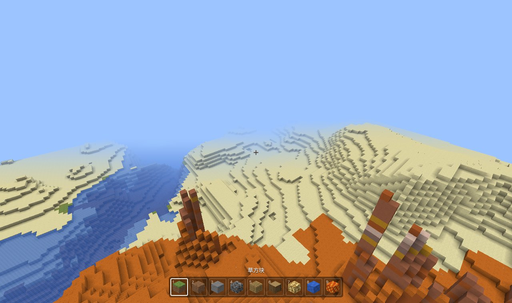

# mc-replica

用 TypeScript + three.js，一个版本一个 demo，逐步复刻 **Minecraft Java 版 1.21.1**。

当前版本：**v4 · 生物群系与地表规则**。能走、能跑、能飞、能挖、能放方块；地形由原版数据包里的密度函数生成，随机数、噪声、密度函数都与原版逐位对齐。v1 起区块按原版的 section + 调色板存储，网格用贪婪合并，方块有了纹理；v2 起移动按原版每秒 20 tick 的公式计算，走、跑、跳、潜行、游泳的速度和高度都与原版一致；v3 起地下的水和岩浆按原版含水层生成，并且会流动；v4 起每个位置按原版的气候参数表选出生物群系，地表按原版 surface_rule 铺草、沙、陶瓦、雪，草、树叶和水按生物群系染色。



| 版本 | 文章 |
| --- | --- |
| v4 | [生物群系与地表规则](docs/articles/v4-生物群系与地表规则.md) |
| v3 | [含水层与流体](docs/articles/v3-含水层与流体.md) |
| v2 | [20 TPS 原版物理与手感](docs/articles/v2-原版物理与手感.md) |
| v1 | [区块存储、贪婪网格与纹理](docs/articles/v1-区块存储与贪婪网格.md) |
| v0 | [功能与实现：噪声层、AABB、方块高亮](docs/articles/v0-功能与实现.md) |

每版的改动见 [CHANGELOG.md](CHANGELOG.md)。

## 运行

```bash
npm install
npm run dev            # 打开终端里给出的地址
npm test               # 对拍测试 + 密度函数 + 原版数据（没放原版数据时自动跳过）+ 游戏逻辑 + 区块存储与网格 + 移动物理 + 流体
npm run build          # 类型检查并打包到 dist/（会包含 datapacks/ 里的数据，只适合自己用）
npm run build:public   # 公开部署用：不打包 datapacks/ 里的原版数据
```

需要 Node 18+。`npm run parity` 会重新生成对拍数据，需要 JDK 17+。`npx tsx tools/bench-v1.ts` 输出 v0 / v1 的内存和网格对比；`npx tsx tools/aquifer-probe.ts` 列出地下湖的坐标（需要原版数据）。

**操作**：WASD 移动 · 空格 跳/上升 · Shift 潜行/下降 · 双击 W 或按住 R 疾跑 · 双击空格或 F 飞行 · 左键挖 · 右键放 · 1–9/滚轮 选方块 · F3 调试信息 · M 噪声图 · G 贪婪网格开关 · K 线框 · Esc 菜单

地址栏参数：`?seed=42&settings=minecraft:overworld&distance=6`（也可以在菜单的“世界设置”里改）。

## 加载原版数据

把你自己 1.21.1 客户端 jar 里的世界生成数据放进 `datapacks/<随便起个名字>/`，两种结构都认：

```text
datapacks/vanilla/worldgen/noise/...                    ← 直接从 jar 的 data/minecraft/ 里拷出来
datapacks/vanilla/data/minecraft/worldgen/noise/...     ← 标准数据包结构
```

要有生物群系颜色和正确的温度，`worldgen/biome/` 也要拷（v4）；没有的话群系都按平原的温度和颜色算，地表规则照常。

没有原版数据时，会用仓库自带的 `demo:overworld_lite`（自己写的简化地形）。详见 [datapacks/README.md](datapacks/README.md)。

## 代码结构

沿用了 [vyse12138/minecraft-threejs](https://github.com/vyse12138/minecraft-threejs) 的组织方式：一个模块一个类，`main.ts` 把它们 new 出来，然后跑动画循环。

```text
src/
  main.ts              入口：new Core / Player / Terrain / Control / UI，animate 循环
  core/                场景、相机、渲染器
  player/              玩家状态和原版物理常数
  control/             键鼠输入、20 TPS 循环、镜头；移动（movement.ts）、碰撞（physics.ts）、选方块（raycast.ts）、挖放
  terrain/
    index.ts           Terrain：区块的加载 / 卸载 / 读写方块，按 section 建网格
    chunk/             区块存储：section + 调色板 + 位压缩（对应原版 PalettedContainer）
    blocks.ts          方块种类、每个面的纹理
    mesh/              贪婪网格（面剔除 + AO + 合并）、纹理数组材质
    textures/          用代码画的方块纹理
    fluid/             流体流动（计划刻）
    highlight/         准星选中方块的线框
    worker/            地形 Worker：密度 → 方块 → 网格；Worker 池
    worldgen/          世界生成引擎：随机数、噪声、密度函数（与原版逐位对齐）
  ui/
    index.ts           菜单、准星、物品栏
    debug/             F3 调试屏、噪声图面板
  utils/
```

每个文件开头都有注释说明它负责什么。整体流程和设计见 [docs/architecture.md](docs/architecture.md)。

## 正确性

- `tools/parity/Parity.java` 用 Java 原生 `long` / `double` / `float` 把随机数、噪声、样条写一遍，TS 测试逐个比较 IEEE 754 原始位，不允许任何误差。
- `LegacyRandomSource` 与 `java.util.Random` 比较 1000 组输出；MD5 以 JDK 为基准。
- 有原版数据时：7 个 noise_settings 全部解析、无警告；仓库手抄的噪声参数与原版逐项相同。
- **还没做**：和游戏本体逐点对数。在游戏里按 F3，用同种子、同坐标对比 `NoiseRouter` 一行即可。

**和原版一致的**：“哪里是石头、哪里是空气”；section 调色板的存储规则；移动物理；含水层和流体流动的规则；生物群系的选择和地表规则。**还不是原版的**：树、花草和矿石、积雪层、原版纹理（草色图是近似的）、光照。这些按下面的路线逐版补上。

## 版本路线

| 版本 | 主题 |
| --- | --- |
| v0 | 随机数、噪声、密度函数 → 原版地形，能走能挖 |
| v1 | 区块 section + 调色板存储、贪婪网格、方块纹理 |
| v2 | 20 TPS 固定步长、原版移动 / 碰撞 / 游泳公式、视角摇晃 |
| v3 | 含水层、流体状态与流动 |
| **v4** | 生物群系、地表规则、生物群系颜色（本版） |
| v5 | 树、矿石等地物 |
| v6 | 光照、昼夜 |
| v7 | 方块状态与 JSON 模型 |
| v8 | 存档：IndexedDB，读取原版 `.mca` |

## 版权说明

- 代码采用 MIT 协议。项目结构参考了 vyse12138/minecraft-threejs（MIT）。
- Minecraft 是 Mojang AB 的商标。本项目与 Mojang、Microsoft 无关。
- 原版的纹理、声音、音乐和数据文件归 Mojang 所有，本仓库不包含它们（方块纹理是 `src/terrain/textures/painters.ts` 用代码画的）；`data/minecraft/` 下只有少量手抄的数值参数。原版数据请从你自己的客户端里取，放进被 git 忽略的 `datapacks/`。公开部署请用 `npm run build:public`。
