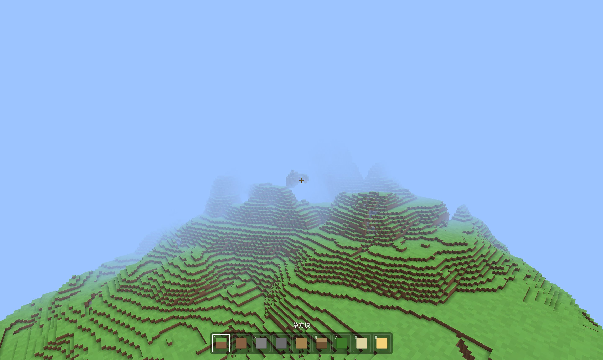
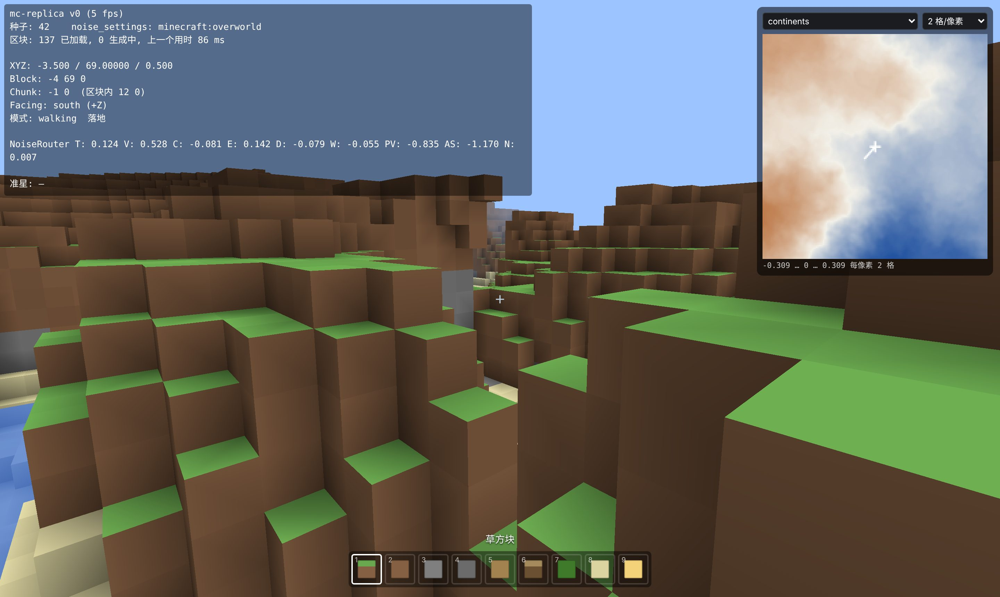
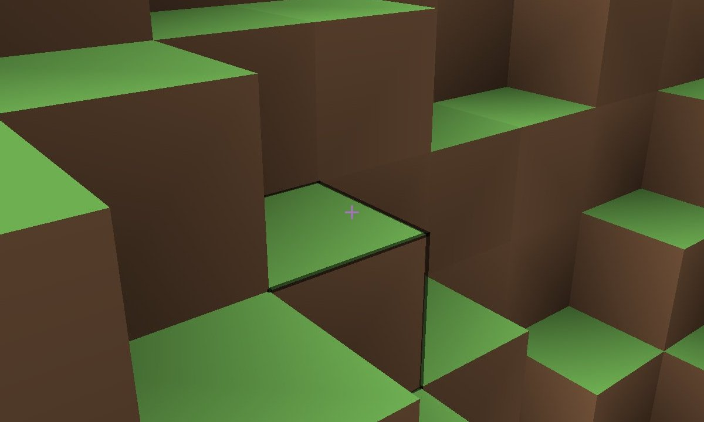

# 用 TypeScript 复刻 Minecraft（v0）：功能与实现

> 系列目标：用 TypeScript + three.js 在浏览器里逐版复刻 Minecraft Java 版 1.21.1，每一版一个能打开的 demo。
> 本篇讲 v0：做了哪些功能、代码怎么组织，以及三个核心部分——**噪声层**、**AABB 碰撞**、**方块高亮**——是怎么实现的。
>
> 代码：mc-replica（tag `v0`） · Demo：（部署后填链接）



## 一、v0 实现了什么

| 模块 | 功能 |
| --- | --- |
| 世界生成 | 原版的随机数（Legacy / Xoroshiro）、噪声（Perlin / Normal / Blended / Simplex）、JSON 密度函数，与原版逐位对齐；能直接读取原版 1.21.1 的 7 个 noise_settings（主世界、下界、末地、放大化等） |
| 区块 | 16×16×384 的区块，按玩家位置加载 / 卸载；多个 Worker 并行生成；只画看得见的面，带环境光遮蔽（AO） |
| 玩家 | 走、疾跑、潜行、跳跃、飞行、游泳；和方块的碰撞（AABB） |
| 交互 | 准星选中方块并画出边框；左键挖、右键放；9 格物品栏 |
| 界面 | 开始菜单（换种子、换 noise_settings、调视距）；F3 调试屏；M 键噪声图面板 |

还**没有**做的：纹理（现在每种方块是一个颜色）、原版的地表规则（草、土、沙的分布现在是我写的近似版）、生物群系、含水层（洞穴里没有水）、树和矿石、光照。

操作：WASD 移动 · 空格 跳 · Shift 潜行 · 双击 W 疾跑 · 双击空格或 F 飞行 · 左键挖 · 右键放 · 1–9 选方块 · F3 调试 · M 噪声图。

## 二、目录结构

代码结构沿用了 [vyse12138/minecraft-threejs](https://github.com/vyse12138/minecraft-threejs)：**一个模块一个类**，`main.ts` 把它们 new 出来，每帧挨个调用 `update()`。

```text
src/
├─ main.ts                入口：创建各模块，跑动画循环
├─ core/                  场景、相机、渲染器
├─ player/                玩家的参数：速度、碰撞箱、重力
├─ control/               玩家控制
│  ├─ index.ts            键鼠输入 → 移动、挖放方块
│  ├─ physics.ts          AABB 碰撞
│  └─ raycast.ts          射线选方块
├─ terrain/               地形
│  ├─ index.ts            Terrain：区块的加载 / 卸载，读写方块
│  ├─ chunk.ts            一个区块的方块数组
│  ├─ blocks.ts           方块种类、颜色、是否实心
│  ├─ mesh/               方块数组 → 三角形网格；材质
│  ├─ highlight/          选中方块的边框
│  ├─ worker/             地形 Worker：在后台生成区块
│  └─ worldgen/           世界生成引擎：随机数、噪声、密度函数
├─ ui/                    界面
│  ├─ index.ts            菜单、准星、物品栏
│  └─ debug/              F3 调试屏、噪声图面板
└─ utils/                 小工具
```

### 每个目录做什么

**`main.ts`**：只做组装。

```ts
const core = new Core()
const player = new Player()
const terrain = new Terrain(core.scene, core.camera)
const control = new Control(core.scene, core.camera, player, terrain)
const ui = new UI(core, terrain, control)

terrain.init(seed, settings)   // 让 Worker 用这个种子初始化

;(function animate() {
  requestAnimationFrame(animate)
  const dt = clock.getDelta()
  control.update(dt)   // 1. 按键 → 速度 → 碰撞 → 新位置；射线选方块
  terrain.update()     // 2. 按玩家位置加载 / 卸载区块
  ui.update()          // 3. 刷新帧率、物品栏、F3、噪声图
  renderer.render(scene, camera)
})()
```

**`core/`**：three.js 的场景、相机、渲染器和雾。不关心游戏逻辑。

**`player/`**：只存数据，不做计算。数值取自原版：

```ts
export const Speed = {
  walking: 4.317, sprinting: 5.612, sneaking: 1.295, flying: 10.92, sprintFlying: 21.78
}
body = { width: 0.6, height: 1.8, eye: 1.62 }   // 碰撞箱和眼高
gravity = 32
jumpHeight = 1.2522                              // 原版能跳上 1.25 格
```

**`control/`**：读键盘鼠标，算速度，调 `physics.ts` 做碰撞，调 `raycast.ts` 找准星对准的方块，然后挖或放。

**`terrain/`**：管理所有区块。

- `chunk.ts`：一个区块存 16×16×384 个方块，每个 1 字节，约 96 KB。下标规则是 `((y - minY) * 16 + z) * 16 + x`，同一层的 256 个方块在内存里连续。
- `index.ts`：每帧检查玩家在哪个区块，视距内缺的区块按“离玩家近的先生成”交给 Worker，视距外的卸载。还提供 `getBlock` / `setBlock`。玩家改过的方块记在 `edits` 里，区块卸载后再加载也不会丢。
- `worker/`：生成区块的活在 Worker 里做，多个 Worker 并行，主线程不会卡。
- `mesh/`：把方块数组变成三角形，只画露在外面的面。
- `worldgen/`：v0 的核心，下一节详细讲。

**`ui/`**：所有 HTML 界面。F3 里有一行和原版格式完全相同的 `NoiseRouter T: … C: … E: …`，用来和游戏里的数值对比。



### 模块之间的关系

```text
UI ──► Control ──► Terrain ──► WorkerPool ──► Worker（worldgen）
          │
          └──► Player
```

依赖是单向的：Terrain 不知道玩家和界面的存在，worldgen 不依赖 three.js 和 DOM（所以 Node 里的测试可以直接用它）。

## 三、噪声层怎么实现

原版 1.18 以后的地形，本质是：**对每个方块坐标 (x, y, z) 算一个密度值，大于 0 是石头，小于等于 0 是空气。** 这个密度由数据包里的 JSON 描述，最底层是噪声，噪声的种子来自世界种子。

整条链从下往上是：

```text
世界种子
  └─ 随机源（Xoroshiro128++）
       └─ ImprovedNoise          单层 Perlin 噪声
            └─ PerlinNoise       多层叠加（八度）
                 └─ NormalNoise  两个 PerlinNoise 相加并归一化
                      └─ 密度函数（JSON 描述的表达式树）
                           └─ NoiseChunk  按区块求值 → 每个方块是石头还是空气
```

对应的代码都在 `terrain/worldgen/` 下。

### 1. 随机源：`random/`

原版有两种随机源，都要和 Java 一模一样，否则同一个种子算出来的世界就不一样。

**LegacyRandomSource** 就是 `java.util.Random`，48 位线性同余。JS 的 number 只能精确表示 53 位整数，乘法会溢出，所以 Java 的 `long` 一律用 `bigint`：

```ts
next(bits: number): number {
  this.seed = (this.seed * 0x5DEECE66Dn + 11n) & ((1n << 48n) - 1n)
  return toInt(this.seed >> BigInt(48 - bits))
}
```

**XoroshiroRandomSource** 是 1.18 以后世界生成用的，128 位状态。64 位的世界种子先“升级”成 128 位：

```ts
const lo = seed ^ 0x6A09E667F3BCC909n
const hi = lo + 0x9E3779B97F4A7C15n
return { lo: mixStafford13(lo), hi: mixStafford13(hi) }
```

**每个噪声的随机源怎么来**：用噪声的名字做 MD5，和世界种子派生的 128 位异或：

```ts
// RandomState 里：random = Xoroshiro(世界种子).forkPositional()
fromHashOf(name: string): RandomSource {
  const s = seedFromHashOf(name)            // MD5("minecraft:continentalness") → 两个 long
  return new XoroshiroRandomSource(s.lo ^ this.seedLo, s.hi ^ this.seedHi)
}
```

这样每个噪声只取决于“世界种子 + 噪声名字”，互不影响。（浏览器的 `crypto.subtle` 不支持 MD5，所以自己写了一个，见 `math/md5.ts`。）

### 2. ImprovedNoise：单层噪声

Ken Perlin 2002 年的改进 Perlin 噪声。构造时用随机源生成三个偏移量，再把 0..255 洗牌成排列表：

```ts
constructor(random: RandomSource) {
  this.xo = random.nextDouble() * 256.0
  this.yo = random.nextDouble() * 256.0
  this.zo = random.nextDouble() * 256.0
  for (let i = 0; i < 256; i++) this.p[i] = i
  for (let i = 0; i < 256; i++) {           // 洗牌，顺序必须和原版一致
    const j = random.nextInt(256 - i)
    ;[this.p[i], this.p[i + j]] = [this.p[i + j], this.p[i]]
  }
}
```

采样时：坐标加上偏移 → 找到所在的整数格子 → 用排列表给格子的 8 个角各分配一个梯度方向 → 每个角算“梯度 · 到这个角的向量” → 用 smoothstep 权重做三线性插值。

```ts
noise(x, y, z) {
  const d = x + this.xo, e = y + this.yo, f = z + this.zo
  const i = floor(d), j = floor(e), k = floor(f)      // 所在格子
  return this.sampleAndLerp(i, j, k, d - i, e - j, f - k)
}
// sampleAndLerp：8 个角各算一次 gradDot，再 lerp3(smoothstep(dx), smoothstep(dy), smoothstep(dz), …)
```

结果在 -1 到 1 之间，是一张连续、平滑、没有明显方向性的“起伏”。

### 3. PerlinNoise：多层叠加

单层噪声太“均匀”。把频率翻倍、振幅减半的若干层叠起来，就有了大起伏上的小细节。`worldgen/noise/continentalness.json` 描述的就是这个：

```json
{ "firstOctave": -9, "amplitudes": [1, 1, 2, 2, 2, 1, 1, 1, 1] }
```

意思是：最低频的一层频率是 2⁻⁹（大约 512 格一个起伏），一共 9 层，每层的权重分别是 1, 1, 2, …。

```ts
getValue(x, y, z) {
  let sum = 0
  let freq = this.lowestFreqInputFactor   // 2^firstOctave
  let amp = this.lowestFreqValueFactor
  for (let i = 0; i < this.noiseLevels.length; i++) {
    const n = this.noiseLevels[i]
    if (n !== null) sum += this.amplitudes[i] * n.noise(wrap(x * freq), wrap(y * freq), wrap(z * freq)) * amp
    freq *= 2   // 每层频率翻倍
    amp /= 2    // 振幅减半
  }
  return sum
}
```

`wrap()` 在坐标很大时把它折回来，防止 double 精度丢失。每一层的随机源用 `fromHashOf("octave_-9")` 这样的名字派生。

### 4. NormalNoise：两个叠加再归一化

原版实际使用的噪声是两个独立的 PerlinNoise 相加。第二个的坐标乘一个“不整齐”的系数，让两层的格点错开；最后乘 `valueFactor`，把输出的标准差拉到约 1/3，使所有噪声的取值都大致落在 [-1, 1]：

```ts
getValue(x, y, z) {
  const k = 1.0181268882175227
  return (this.first.getValue(x, y, z) + this.second.getValue(x * k, y * k, z * k)) * this.valueFactor
}
```

### 5. 密度函数：把 JSON 变成一棵树

噪声只是原料。原版用 JSON 描述“怎么把噪声组合成地形”，例如 `worldgen/density_function/overworld/continents.json`：

```json
{
  "type": "minecraft:flat_cache",
  "argument": {
    "type": "minecraft:shifted_noise",
    "noise": "minecraft:continentalness",
    "xz_scale": 0.25, "y_scale": 0.0,
    "shift_x": "minecraft:shift_x", "shift_y": 0.0, "shift_z": "minecraft:shift_z"
  }
}
```

JSON 值只有三种写法：

| 写法 | 含义 | 例子 |
| --- | --- | --- |
| 数字 | 常数 | `0.25` |
| 字符串 | 引用另一个密度函数 | `"minecraft:shift_x"` |
| 对象 | 某种运算，字段名和原版一致 | `{ "type": "minecraft:add", "argument1": …, "argument2": … }` |

`density/DensityFunctionParser.ts` 是一个大 `switch`，每种 `type` 对应 `density/DensityFunction.ts` 里的一个类，每个类都有 `compute(ctx)`：

```ts
class Ap2 implements DensityFunction {          // add / mul / min / max
  compute(ctx) {
    const a = this.argument1.compute(ctx)
    switch (this.type) {
      case 'add': return a + this.argument2.compute(ctx)
      case 'mul': return a === 0 ? 0 : a * this.argument2.compute(ctx)
      case 'min': return Math.min(a, this.argument2.compute(ctx))
      case 'max': return Math.max(a, this.argument2.compute(ctx))
    }
  }
}
```

解析出来的树里噪声还是空的。拿到种子后，`density/RandomState.ts` 遍历整棵树，把每个噪声节点换成用 `fromHashOf(噪声名)` 构造的真噪声，这棵树就能求值了：

```ts
const wg = new Worldgen(packs)   // 读数据包、解析
wg.setSeed('42')                 // 绑定种子
const f = wg.sampler('router|minecraft:overworld|final_density')
f({ blockX: 0, blockY: 64, blockZ: 0 })   // > 0 石头，≤ 0 空气
```

主世界最终用的是 `noise_settings/overworld.json` 里的 `final_density`，它把大陆性、侵蚀度、山脊、三条地形样条、洞穴等几十个函数组合在一起。

### 6. NoiseChunk：按区块求值

单个点算 `final_density` 要几十微秒，一个区块有 10 万个方块，逐个算太慢。原版的办法是：只在 4×8×4 的格子（cell）的 8 个角上算，格子内部做三线性插值。`density/NoiseChunk.ts` 复现了这个规则，平均每个方块不到 1 微秒。

### 7. 生成一个区块：`terrain/worker/surface.ts`

Worker 收到 `{cx, cz}` 后做三件事：

```text
1. NoiseChunk 算出每个方块的密度：> 0 记为石头，≤ 0 记为空气
2. 临时地表规则：每列最上面的石头换成草 + 3 层土，海边换成沙，
   海平面以下、地表以上的空气换成水，y < 0 换成深板岩，最底下是基岩
3. buildChunkMesh() 生成网格，连同方块数组一起发回主线程
```

第 1 步和原版一致；第 2 步是近似版，原版的地表规则依赖生物群系，后面的版本再做。

为了让区块边缘的面也能正确剔除，Worker 实际算的是 18×18 列（区块四周各多一圈），外面那圈只用来判断“邻居是不是实心”。

### 怎么保证和原版一致

`tools/parity/Parity.java` 用 Java 原生的 `long`、`double`、`float` 把随机数、噪声、样条写了一遍，导出结果；TS 的测试逐个比较 IEEE 754 原始位，不允许任何误差。`LegacyRandomSource` 还和 `java.util.Random` 比较了 1000 组输出。

最终的验证要在游戏里做：用同一个种子、站到同一个坐标，比较 F3 里的 `NoiseRouter` 一行。

## 四、AABB 碰撞怎么实现

代码在 `control/physics.ts` 和 `control/index.ts`。

### 碰撞箱

AABB（Axis-Aligned Bounding Box，轴对齐包围盒）就是一个不会旋转的长方体。玩家的碰撞箱宽 0.6、高 1.8，位置用**脚底中心** `feet` 表示：

```text
          ┌─────┐  ← feet.y + 1.8
          │     │
          │  眼 │  ← feet.y + 1.62（相机位置）
          │     │
          │     │
          └──●──┘  ← feet.y
        feet.x ± 0.3
```

### 判断有没有撞上：`collides()`

把碰撞箱覆盖到的所有方块格子都检查一遍，只要有一个是实心的，就算撞上了：

```ts
export function collides(pos: Vec3, body: Body, solid: SolidFn): boolean {
  const x0 = Math.floor(pos.x - body.half), x1 = Math.floor(pos.x + body.half - EPS)
  const y0 = Math.floor(pos.y),             y1 = Math.floor(pos.y + body.height - EPS)
  const z0 = Math.floor(pos.z - body.half), z1 = Math.floor(pos.z + body.half - EPS)
  for (let x = x0; x <= x1; x++)
    for (let y = y0; y <= y1; y++)
      for (let z = z0; z <= z1; z++)
        if (solid(x, y, z)) return true
  return false
}
```

`EPS` 是一个很小的数（0.0001）：玩家正好贴着方块表面站着时，碰撞箱的边恰好落在格子边界上，不减掉它就会被误判成“已经进入下一格”。

`solid` 由 Terrain 提供。**还没加载的区块当作实心**，防止玩家掉进还没生成的地方：

```ts
isSolidAt(x, y, z) {
  const b = this.getBlock(x, y, z)
  return b === null ? true : isSolid(b)
}
```

### 移动：分轴处理

每一帧先算出速度，再按 **y → x → z** 的顺序一个轴一个轴地移动。每动一个轴就检查一次，撞上了就退回到紧贴方块的位置，并把这个轴的速度清零：

```ts
// y 轴
pos.y += vel.y * h
if (collides(pos, body, solid)) {
  if (vel.y < 0) {
    pos.y = Math.floor(pos.y) + 1          // 落到脚下那个方块的顶面
    onGround = true
  } else {
    pos.y = Math.floor(pos.y + body.height) - body.height - EPS   // 头顶撞到方块
  }
  vel.y = 0
}

// x 轴（z 轴同理）
pos.x += vel.x * h
if (collides(pos, body, solid)) {
  pos.x = vel.x > 0
    ? Math.floor(pos.x + body.half) - body.half - EPS      // 向 +x 撞墙：贴到墙的西侧
    : Math.floor(pos.x - body.half) + 1 + body.half + EPS  // 向 -x 撞墙：贴到墙的东侧
  vel.x = 0
}
```

为什么要分轴：如果三个方向一起移动，撞墙时不知道该退哪个方向。分轴以后，斜着贴墙走时只有撞墙的那个轴被挡住，另一个轴照常移动，人物会自然地沿着墙滑过去。

### 防止穿墙：拆成小步

下落很快或者疾跑飞行时，一帧可能移动好几格，直接跳过去会穿过薄墙。所以把一帧拆成若干小步，每步不超过 0.45 格：

```ts
const maxDelta = Math.max(Math.abs(vel.x), Math.abs(vel.y), Math.abs(vel.z)) * dt
const steps = Math.max(1, Math.ceil(maxDelta / 0.45))
const h = dt / steps
for (let s = 0; s < steps; s++) { /* 上面的 y、x、z 三步 */ }
```

### 速度从哪来：重力和跳跃

`Control.updateVelocity()` 每帧算速度：

```ts
// 水平：相机朝向投影到水平面，按 WASD 组合
v.x = move.x * speed
v.z = move.z * speed

// 竖直
if (flying) {
  v.y = up ? speed * 0.75 : down ? -speed * 0.75 : 0
} else {
  v.y = Math.max(v.y - gravity * dt, -terminalVelocity)    // 重力加速，有最大下落速度
  if (up && onGround) v.y = Math.sqrt(2 * gravity * jumpHeight)  // 起跳速度
}
```

起跳速度由 `v² = 2gh` 算出：想跳 1.2522 格高、重力 32，起跳速度就是 √(2 × 32 × 1.2522) ≈ 8.95 格/秒。

`onGround` 由碰撞结果决定（向下移动时撞到方块），只有站在地上才能起跳。

> 原版的物理是每秒 20 次的固定步长（tick），而且有加速度和摩擦。v0 先用“每帧连续积分”近似，v2 会改成和原版一致。

## 五、方块高亮怎么确定

方块高亮分两步：**找出准星对准的是哪个方块**（`control/raycast.ts`），然后**在那个方块外面画边框**（`terrain/highlight/`）。



### 1. 射线：DDA 算法

从眼睛出发，沿视线方向一格一格往前走，碰到第一个不是空气、也不是水的方块就停。最远走 5 格。

关键是“一格一格”怎么走才不会漏掉。DDA（Amanatides & Woo, 1987）的思路是：射线每前进一段，总会先穿过 x、y、z 三个方向中**某一个方向**的格子边界。每一步只需要比较“沿射线走多远会碰到下一条 x 边界 / y 边界 / z 边界”，哪个最近就往哪个方向走一格。

```text
        │     │     │
   ─────┼─────┼─────┼─────
        │   ╱ │     │
        │ ╱   │     │       tMaxX：走到下一条竖线要多远
   ─────●─────┼─────┼─────  tMaxY：走到下一条横线要多远
      ╱ │     │     │       每次选小的那个，跨过去
```

```ts
let x = Math.floor(ox), y = Math.floor(oy), z = Math.floor(oz)   // 起点所在格子
const stepX = Math.sign(dx)                // 往正方向还是负方向走
const tDeltaX = Math.abs(1 / dx)           // 沿射线走多远会跨过一整格
let tMaxX = (stepX > 0 ? Math.floor(ox) + 1 - ox : ox - Math.floor(ox)) * tDeltaX  // 到第一条边界
// y、z 同理

while (t <= maxDistance) {
  if (hitTest(x, y, z)) return { x, y, z, nx, ny, nz, distance: t }
  if (tMaxX < tMaxY && tMaxX < tMaxZ) {
    x += stepX; t = tMaxX; tMaxX += tDeltaX
    nx = -stepX; ny = nz = 0               // 从 x 方向的面进入这一格
  } else if (tMaxY < tMaxZ) {
    y += stepY; t = tMaxY; tMaxY += tDeltaY
    ny = -stepY; nx = nz = 0
  } else {
    z += stepZ; t = tMaxZ; tMaxZ += tDeltaZ
    nz = -stepZ; nx = ny = 0
  }
}
return null
```

除了命中的方块坐标，还顺带得到了**从哪个面进去的**（法线 `nx, ny, nz`）。比如射线是往下走、从上面进入方块的，法线就是 `(0, 1, 0)`。放方块时就放在这个面的外侧。

和原项目对 three.js 的网格做三角形求交相比，DDA 直接查方块数组，不依赖网格，每一步只是几次加法和比较。

### 2. 每帧更新目标

`Control.updateTarget()` 每帧从相机发一条射线：

```ts
const dir = new THREE.Vector3()
this.camera.getWorldDirection(dir)
const o = this.camera.position
this.target = raycast(o.x, o.y, o.z, dir.x, dir.y, dir.z, this.reach, (x, y, z) => {
  const b = this.terrain.getBlock(x, y, z)
  return b !== null && b !== BlockType.air && b !== BlockType.water   // 空气和水可以穿过
})
if (this.target) this.terrain.highlight.show(this.target.x, this.target.y, this.target.z)
else this.terrain.highlight.hide()
```

### 3. 画边框

最直接的写法是 `LineSegments + EdgesGeometry`，但 WebGL 里线宽永远是 1 像素（`linewidth` 参数在大多数浏览器里无效），在高分屏上几乎看不见。所以这里用 12 根细长的长方体拼出立方体的 12 条棱，粗细可以自己控制：

```ts
const THICKNESS = 0.02   // 棱的粗细
const SIZE = 1.002       // 比方块稍大一点，避免和方块表面重叠闪烁

for (const axis of [0, 1, 2]) {              // x、y、z 三个方向
  const dims = [THICKNESS, THICKNESS, THICKNESS]
  dims[axis] = SIZE + THICKNESS              // 沿这个方向拉长
  const geometry = new THREE.BoxGeometry(...dims)
  for (const a of [-h, h]) for (const b of [-h, h]) {   // 每个方向 4 条
    const pos = [a, b]
    pos.splice(axis, 0, 0)
    const edge = new THREE.Mesh(geometry, material)
    edge.position.set(pos[0], pos[1], pos[2])
    this.mesh.add(edge)
  }
}
```

方块坐标 `(x, y, z)` 是方块的最小角，所以边框的中心要放在 `(x + 0.5, y + 0.5, z + 0.5)`。

### 4. 挖和放

有了目标方块和命中面，挖和放就很简单了：

```ts
breakBlock() {
  const t = this.target
  if (BLOCKS[this.terrain.getBlock(t.x, t.y, t.z)].breakable)   // 基岩挖不动
    this.terrain.setBlock(t.x, t.y, t.z, BlockType.air)
}

placeBlock() {
  const t = this.target
  const x = t.x + t.nx, y = t.y + t.ny, z = t.z + t.nz           // 命中面的外侧
  // 不能放进自己的碰撞箱里——复用 AABB 的 collides()
  if (collides(this.feet, body, (bx, by, bz) => bx === x && by === y && bz === z)) return
  this.terrain.setBlock(x, y, z, HOTBAR[this.slot])
}
```

`Terrain.setBlock()` 改完数组后，在主线程重建这个区块的网格；如果改的是区块边上的方块，相邻区块也一起重建（它们的面要跟着变）。

## 六、下一版

v1 解决“能玩”之后暴露出来的问题：

- 区块改成 16³ 的 section + 调色板存储（现在一个区块 96 KB，大部分是重复的石头和空气）
- 贪婪网格合并，减少三角形数量
- 自己画的纹理图集

---

*Minecraft 是 Mojang AB 的商标，本项目与 Mojang、Microsoft 无关。文中截图使用的原版数据来自本人的客户端，仓库不包含任何原版资源。*
