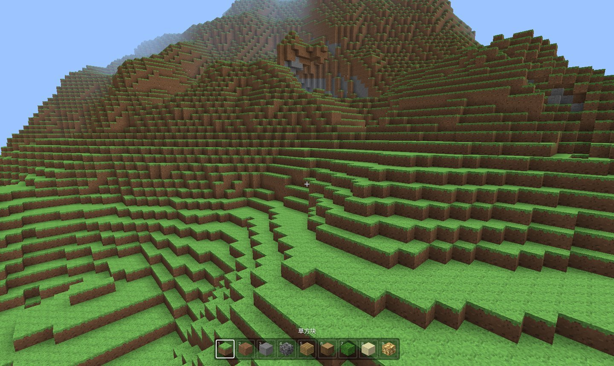
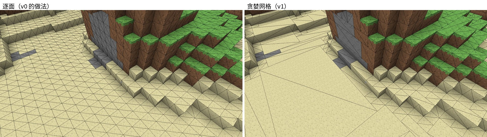
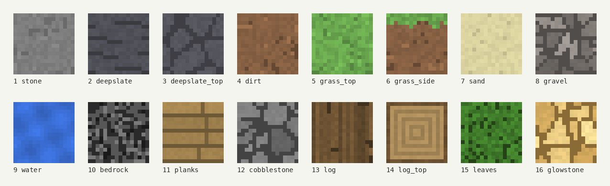
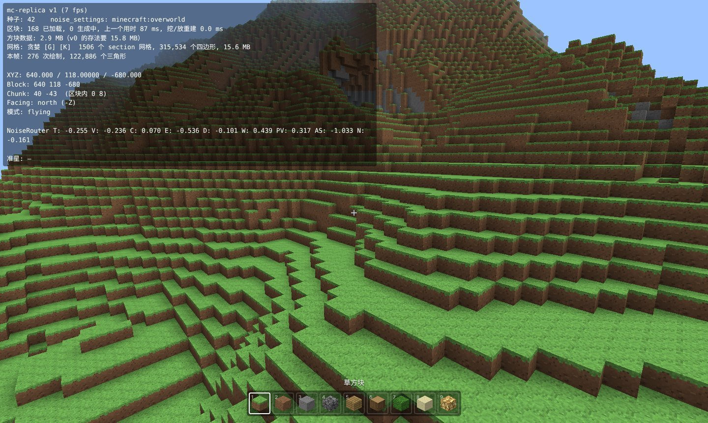

# 用 TypeScript 复刻 Minecraft（v1）：区块存储、贪婪网格与纹理

> 系列目标：用 TypeScript + three.js 在浏览器里逐版复刻 Minecraft Java 版 1.21.1，每一版一个能打开的 demo。
> 本篇讲 v1：把区块从“一个大数组”改成原版的 **section + 调色板**，把网格从“一个面一个四边形”改成**贪婪网格**，并给方块加上**纹理**。
>
> 代码：mc-replica（tag `v1`） · Demo：（部署后填链接） · 上一篇：[v0：功能与实现](v0-功能与实现.md)



## 一、v1 做了什么

| 模块 | v0 | v1 |
| --- | --- | --- |
| 区块存储 | 每个区块一个 `Uint8Array`，16×16×384，每格 1 字节 | 24 个 16³ 的 **section**，每段用**调色板 + 位压缩**存（原版的 `PalettedContainer`） |
| 网格 | 每个露出来的面一个四边形；一个区块一个网格 | **贪婪网格**：相邻的相同面合并成大矩形；**一个 section 一个网格** |
| 顶点格式 | 位置 + 颜色，6 个 float = 24 字节 | 位置 3×Uint16 + 信息 4×Uint8 = **10 字节** |
| 外观 | 每种方块一个颜色 | 16 张 16×16 的纹理（全部用代码画，没有版权问题），放在一个**纹理数组**里 |
| 挖 / 放 | 重建整个区块（16×16×384）的网格 | 只重建受影响的 section（16³） |
| 调试 | F3 | F3 新增内存、四边形、绘制调用统计；**G** 切换贪婪 / 逐面，**K** 显示线框 |

世界生成没有变，地形和 v0 完全相同。

### 效果

用原版 `minecraft:overworld`、种子 42，生成 8×8 = 64 个区块，同样的方块分别用两种方式存储和建网格（`npx tsx tools/bench-v1.ts`）：

| 项目 | v0 的做法 | v1 | v1 / v0 |
| --- | --- | --- | --- |
| 方块数据 | 6.00 MB | 0.70 MB | **11.7%** |
| 平均每个区块 | 96.0 KB | 11.2 KB | |
| 四边形 | 104,416 | 60,763 | **58.2%** |
| 网格显存 | 11.95 MB | 3.01 MB | **25.2%** |
| 挖一个方块要重建的网格 | 整个区块，约 33 ms | 1 个 section，约 1.6 ms | **约 1/20** |

在浏览器里站在同一个位置、看同一个方向（视距 6，137 个区块）：

| | v0 | v1 |
| --- | --- | --- |
| 每帧画的三角形 | 236,008 | 62,800 |
| 绘制调用 | 111 | 195 |
| 帧时间（中位数） | 81.9 ms | 59.8 ms |

帧时间是在没有显卡的测试机上用软件渲染（SwiftShader）测的，绝对值没有参考意义，只看相对变化。三角形少了近 3/4，一部分来自贪婪网格，另一部分来自按 section 做视锥剔除：v0 的区块是一整根 384 格高的柱子，只要有一点在屏幕里，地下的洞穴也要一起画；v1 只画在屏幕里的那几段。代价是绘制调用变多了，这个问题留到后面的版本处理（见第八节）。

## 二、目录变化

```text
src/terrain/
├─ index.ts              Terrain：改为按 section 建网格、挖放时只重建受影响的 section
├─ blocks.ts             方块表：颜色 → 每个面的纹理名
├─ chunk/                【新】区块存储（替换原来的 chunk.ts）
│  ├─ BitStorage.ts      位压缩数组（原版 SimpleBitStorage）
│  ├─ PalettedContainer.ts  调色板容器（原版 PalettedContainer）
│  ├─ Section.ts         16³ 的一段（原版 LevelChunkSection）
│  └─ Chunk.ts           一根区块柱 = 24 个 section（原版 LevelChunk）
├─ mesh/
│  ├─ mesher.ts          【重写】贪婪网格，输入一个 section，输出 10 字节 / 顶点的网格
│  └─ materials.ts       【重写】ShaderMaterial：纹理数组 + 方向亮度 + AO + 雾
├─ textures/             【新】
│  ├─ painters.ts        用代码画 16 张纹理
│  └─ index.ts           纹理数组（DataArrayTexture）
└─ worker/
   └─ surface.ts         生成完方块后切成 section，逐段压缩、建网格
src/ui/icons.ts          【新】物品栏的立体方块图标
tools/bench-v1.ts        【新】上面那张对比表的脚本
tests/chunk.test.ts      【新】位压缩、调色板、贪婪网格、纹理的测试
```

各模块的关系和 v0 一样，变的只是 `terrain/` 内部。Worker 交给主线程的数据从“一个大数组 + 一个网格”变成“24 段压缩数据 + 24 个小网格”：

```ts
// terrain/worker/protocol.ts
export interface ChunkData {
  cx: number
  cz: number
  sections: PalettedData[]   // 每段：{ bits, palette, data }
  meshes: SectionMeshes[]    // 每段：{ opaque, water }，整段没有面时为 null
  ms: number
}
```

## 三、section 与调色板

### 为什么要改

v0 的区块是 16×16×384 个字节，每个区块 96 KB，视距 8 时大约 200 个区块，就是 19 MB。可是一根区块柱里：

- 上面一大半是空气（主世界 y = 64 以上几乎都是空的）；
- 地下大段是石头和深板岩，一个 16³ 的范围里往往只有 2~3 种方块。

只有 2 种方块的地方，每格存 1 个字节（256 种可能）太浪费了。原版的做法是：

1. 把区块柱切成 16³ 的 **section**（主世界 384 / 16 = 24 段）；
2. 每段单独列一张**调色板**：这段里出现过哪些方块；
3. 每格只存“它是调色板里的第几个”，用尽量少的位数。

```text
一个 section 里出现了：空气、石头、泥土、草方块
调色板：  0 → 空气   1 → 石头   2 → 泥土   3 → 草方块
每格只要存 0..3，2 位就够；原版规定间接模式至少 4 位，所以实际用 4 位
4096 格 × 4 位 = 2 KB（原来 4 KB）

整段都是空气：调色板只有 [空气] 一项，什么数组都不用存
```

### 三种模式

原版的 `PalettedContainer` 根据调色板大小自动在三种模式之间切换，v1 用的是同一套规则：

| 每格位数 | 模式 | 存什么 |
| --- | --- | --- |
| 0 | 单值 | 只有调色板（1 项），整段都是这一种方块 |
| 4 ~ 8 | 间接 | 调色板 + 位压缩数组，数组里存调色板下标。不到 4 位也按 4 位算，减少扩容次数 |
| > 8 | 直接 | 不要调色板了，数组里直接存全局方块 ID，位数 = ceil(log2(全局方块状态数)) |

原版有约 2.6 万个方块状态，直接模式是 15 位。v1 只有 14 种方块，调色板最多 14 项，永远用不到直接模式。代码先写好了，v7 加方块状态后就会用上。

实测 64 个区块共 1536 个 section：**1178 个是单值**（整段空气、石头、深板岩或水），剩下 358 个都是 4 位。所以平均每个区块只有 11 KB。

### 位压缩数组：BitStorage

“每格 4 位”要把多个值塞进一个整数里。原版从 1.16 开始的规则是：**一个值不会跨两个整数存放**，塞不下的位空着。

```text
bits = 4：一个 32 位整数放 8 个值        [7][6][5][4][3][2][1][0]
bits = 5：一个 32 位整数放 6 个值，空 2 位 [--][5][4][3][2][1][0]
```

```ts
// terrain/chunk/BitStorage.ts
get(i: number): number {
  const word = (i / this.valuesPerWord) | 0                     // 在第几个整数里
  const shift = (i - word * this.valuesPerWord) * this.bits      // 在整数里的第几位
  return (this.data[word] >>> shift) & this.mask
}

set(i: number, value: number): void {
  const word = (i / this.valuesPerWord) | 0
  const shift = (i - word * this.valuesPerWord) * this.bits
  this.data[word] = (this.data[word] & ~(this.mask << shift)) | ((value & this.mask) << shift)
}
```

原版用 `long[]`（64 位），这里用 `Uint32Array`（32 位）。JS 的位运算只支持 32 位，64 位要用 `bigint`，慢几十倍。规则相同，只是“一个整数”变小了。v8 读原版存档时，把每个 long 按同样规则拆开就行。

### 调色板容器：PalettedContainer

读一格：

```ts
get(i: number): number {
  if (this.bits === 0) return this.palette[0]          // 单值
  const v = this.storage!.get(i)
  return this.bits > MAX_INDIRECT_BITS ? v : this.palette[v]   // 直接 / 间接
}
```

写一格时，如果是新方块，就加进调色板。调色板放不下了（比如 4 位最多 16 项，现在要放第 17 项），就**扩容**：换一个更宽的数组，把 4096 个值逐个搬过去。

```ts
private idFor(value: number): number {
  if (this.bits > MAX_INDIRECT_BITS) return value       // 直接模式：存的就是方块 ID
  const found = this.lookup.get(value)
  if (found !== undefined && this.bits > 0) return found

  const size = this.palette.length + (found === undefined ? 1 : 0)
  const capacity = this.bits === 0 ? 1 : 1 << this.bits
  if (size > capacity) this.resize(size)                // 放不下：0 → 4 → 5 → … → 直接
  ...
  this.palette.push(value)
  return this.palette.length - 1
}
```

挖方块会让调色板变大，但方块挖空了调色板**不会变小**，原版也是这样。原版在存盘时会重新整理一遍调色板（`PalettedContainer.pack`），对应这里的 `fromValues()`：先统计出现了哪些方块，直接选出最小的位数。Worker 生成区块时用的就是它，不经过一次次扩容。

### Section 和 Chunk

```ts
// terrain/chunk/Section.ts
export default class Section {
  nonAir = 0     // 非空气方块数（原版的 nonEmptyBlockCount），为 0 时整段可以跳过
  constructor(public blocks = new PalettedContainer(BLOCK_BITS, BlockType.air)) { ... }
  static index(lx, ly, lz) { return (ly * 16 + lz) * 16 + lx }   // 和原版相同的段内顺序
}

// terrain/chunk/Chunk.ts
get(lx: number, y: number, lz: number): BlockType {
  if (y < this.minY || y >= this.minY + this.height) return BlockType.air
  const ry = y - this.minY
  return this.sections[ry >> 4].get(lx, ry & 15, lz)     // 高 4 位选 section，低 4 位是段内 y
}
```

`nonAir` 有不少用处，比如出生时要找某一列最高的实心方块，空气 section 一次就能跳过 16 格：

```ts
for (let sy = c.sections.length - 1; sy >= 0; sy--) {
  if (c.sections[sy].isEmpty) continue
  for (let ly = 15; ly >= 0; ly--) if (isSolid(c.sections[sy].get(lx, ly, lz))) return c.minY + sy * 16 + ly
}
```

压缩不是没有代价：每次读方块多了一次除法、一次移位和一次查表。碰撞检测、射线检测每帧只读几十个方块，感觉不到。网格生成要读大量方块，所以先把 section 和一圈邻居展开成一个普通的 18³ 数组再处理（下一节）。

## 四、贪婪网格

### 思路

v0 每个露出来的面画一个四边形，一片 16×16 的平地就是 256 个四边形。可是这 256 个面纹理一样、亮度一样，完全可以画成**一个** 16×16 的大四边形，纹理让 GPU 重复铺 16×16 次。



贪婪网格（Greedy Meshing）就是做这种合并。以“朝上的面”为例：

```text
1. 一层一层往上扫。对每一层，填一张 16×16 的 mask：
   这个位置有朝上的面 → 记下它的“样子”（纹理 + 四个角的 AO）
   没有 → 记 0

   mask（数字代表样子，. 代表没有面）：
   1 1 1 2 2 .
   1 1 1 2 2 .
   1 1 . . 3 3

2. 从左上角找第一个非 0 的格子，先向右延伸（样子相同就继续），
   再整行整行地向下延伸，得到一个尽量大的矩形：

   [1 1 1] 2 2 .        ← 第一个矩形：3 宽 × 2 高
   [1 1 1] 2 2 .
    1 1 .  . 3 3

3. 输出这个矩形，把 mask 里对应的格子清零，继续找下一个。
```

6 个方向各做一遍。“贪婪”是指每次都先往右延伸到底、再往下延伸到底，不保证矩形最少，但很快，效果也足够好。

### 代码

先把 section 本身和四周一圈邻居展开成一个 18³ 的数组。邻居用来判断面会不会被挡住，以及计算 AO：

```ts
// terrain/mesh/mesher.ts
export const N = 18
export const nIndex = (x: number, y: number, z: number) => ((y + 1) * N + (z + 1)) * N + (x + 1)
```

6 个方向用同一段代码处理。`axis` 是法线所在的轴，`u`、`v` 是面内的两个轴，取 `u = (axis+1)%3`、`v = (axis+2)%3`，保证 `u × v` 正好是法线的正方向，后面判断三角形朝向时要用：

```ts
for (let face = 0; face < 6; face++) {          // -x, +x, -y, +y, -z, +z
  const n = FACE_DIRS[face]
  const axis = face >> 1
  const u = (axis + 1) % 3
  const v = (axis + 2) % 3
  for (let k = 0; k < 16; k++) {                // 沿法线方向一层一层扫
    // ---- 1. 填 mask
    for (let j = 0; j < 16; j++) for (let i = 0; i < 16; i++) {
      p[axis] = k; p[u] = i; p[v] = j
      const b = blocks[nIndex(p[0], p[1], p[2])]
      const nb = blocks[nIndex(p[0] + n[0], p[1] + n[1], p[2] + n[2])]
      if (SOLID[b] && !SOLID[nb]) {
        const packed = 四个角的 AO，每个 2 位
        maskO[j * 16 + i] = 纹理层号 | (packed << 8) | 能往哪个方向合并
      }
    }
    // ---- 2. 在 mask 里找矩形（见下）
  }
}
```

找矩形：

```ts
for (let j = 0; j < 16; j++) {
  for (let i = 0; i < 16; ) {
    const key = mask[j * 16 + i]
    if (key === 0) { i++; continue }
    let w = 1, h = 1
    if (mergeU) while (i + w < 16 && mask[j * 16 + i + w] === key) w++        // 向右
    if (mergeV) grow: while (j + h < 16) {                                     // 向下，整行都相同才行
      for (let t = 0; t < w; t++) if (mask[(j + h) * 16 + i + t] !== key) break grow
      h++
    }
    emit(..., i, j, w, h)
    for (let y = 0; y < h; y++) for (let x = 0; x < w; x++) mask[(j + y) * 16 + i + x] = 0
    i += w
  }
}
```

### 关键问题：AO 不能随便合并

v0 的方块有顶点 AO：墙角、缝隙处的顶点更暗。每个四边形的 4 个角各有一个 AO 值，GPU 在四边形内部做插值。

如果把 AO 不同的面合并，比如“左边暗、右边亮”的面连续 5 个合成一个，插值就会变成从最左边暗到最右边亮的一整条渐变，和原来“每格各自左暗右亮”完全不同。所以 mask 里的“样子”必须包含 4 个角的 AO，样子完全相同才能合并。

但只要求样子相同还不够。“左暗右亮”的面横向合并后，合并后的大矩形也只有左右两条边、4 个角，左边暗、右边亮，中间的格子就不对了。所以要看 AO 沿哪个方向变化：

| 4 个角的 AO | 例子 | 能怎么合并 |
| --- | --- | --- |
| 全部相同 | 空旷的地面（最常见） | 两个方向都行 |
| 只沿 v 方向变化：`ao0 = ao1` 且 `ao2 = ao3` | 墙根下的一排地面，靠墙一侧暗 | 只能沿 u 方向（顺着墙）拉长 |
| 只沿 u 方向变化：`ao0 = ao2` 且 `ao1 = ao3` | 同上，墙在另一个方向 | 只能沿 v 方向拉长 |
| 其他 | 墙角，只有一个角暗 | 不合并，保持 1×1 |

```ts
const flags = (a0 === a1 && a2 === a3 ? MERGE_U : 0) | (a0 === a2 && a1 === a3 ? MERGE_V : 0)
maskO[m] = FACE_TEXTURES[b * 6 + face] | (packed << 8) | flags
```

这样合并后每个位置的明暗和不合并时完全一样。一开始我只允许“4 个角全相同”的面合并，四边形只减少到 66.6%；加上单方向合并后降到 58.2%。

原版主世界起伏多，有 AO 的面很多，所以只减少了 4 成。平原、海底这种平坦的地方效果最明显（上面那张线框图）。

### 输出矩形

矩形的 4 个角按 `(u-,v-) (u+,v-) (u-,v+) (u+,v+)` 的顺序排：

```ts
for (let c = 0; c < 4; c++) {
  const pt = [0, 0, 0]
  pt[axis] = (k + (positive ? 1 : 0)) * S        // 朝正方向的面在方块的另一侧
  pt[u] = (i + (c & 1 ? w : 0)) * S
  pt[v] = (j + (c & 2 ? h : 0)) * S
  corners.push(pt[0], pt[1], pt[2])
}
```

两个三角形用 `[0,1,2]` 和 `[2,1,3]`。因为 `u × v` 指向法线正方向，三角形 `(0,1,2)` 从正方向看是逆时针，所以朝负方向的面（-x、-y、-z）要把每个三角形的后两个顶点对调。three.js 默认只画逆时针的一面，顺序反了面就不见了。测试里专门检查了每个三角形的法线方向。

AO 不均匀的面还要选对角线：沿“两端更亮”的那条对角线切开。这样只有一个暗角时，阴影只留在角落的那个三角形里，不会沿对角线拉成一条斜线。

### 水

水单独一个网格（半透明、最后画），也用同样的方法合并。水面比方块矮 2/16，所以“上面不是水”的水块会把顶面和侧面的上边压低。这个信息也放进 mask 的样子里，压低的和不压低的不会合并到一起。

## 五、纹理

### 用代码画纹理

原版的纹理归 Mojang 所有，不能放进公开仓库。v1 的 16 张纹理全部用代码画：每张纹理一个函数，用固定种子的随机数加一点规则。



几个例子：

```ts
// 石头：灰色底，每个像素随机亮一点暗一点，再撒几块深色斑点
function stone(c: Canvas, r: () => number) {
  speckle(c, hex(0x7d7d7d), 0.06, r)
  blotches(c, () => shade(hex(0x7d7d7d), 0.82 + r() * 0.06), 10, 4, r)
}

// 草方块侧面：先画泥土，上面每一列往下涂 2~5 格绿色，下边缘参差不齐
function grassSide(c: Canvas, r: () => number) {
  dirt(c, r)
  for (let x = 0; x < 16; x++) {
    const depth = 2 + Math.floor(r() * 3) + (r() < 0.2 ? 1 : 0)
    for (let y = 0; y < depth; y++) c.set(x, y, shade(GRASS, 0.88 + r() * 0.24))
  }
}

// 圆石：Voronoi 分块，每块石头一个亮度，块与块之间的缝涂暗
```

贪婪网格会把一张纹理平铺很多次，所以纹理必须能无缝拼接。逐像素的随机天然满足；Voronoi 计算距离时按 16 取模，左右、上下也能接上。

每张纹理的种子由它的名字算出来。以后加新纹理，旧纹理的样子不会变。

### 纹理数组，而不是图集

常见做法是把所有小纹理拼成一张大图（**纹理图集**），每个面用纹理坐标取其中一小块。但贪婪网格合并出一个 5×3 的矩形，就需要把那一小块**重复铺** 5×3 次。GPU 的重复平铺（`RepeatWrapping`）只能对整张图做，图集里的一小块没法单独重复。要么在着色器里自己取小数部分（`fract`），要么接受 mipmap 时和隔壁小图串色的问题。

WebGL2 有**纹理数组**（`sampler2DArray`）：一叠同样大小的图，用层号区分，每一层都可以独立地重复平铺。three.js 从 r163 起只支持 WebGL2，所以没有兼容性损失。

```ts
// terrain/textures/index.ts
const tex = new THREE.DataArrayTexture(paintAll(), 16, 16, TEXTURE_COUNT)
tex.wrapS = tex.wrapT = THREE.RepeatWrapping
tex.magFilter = THREE.NearestFilter              // 放大取最近像素：像素风的关键
tex.minFilter = THREE.NearestMipmapLinearFilter  // 缩小用 mipmap：远处不闪烁
tex.generateMipmaps = true
```

### 10 字节的顶点

纹理坐标、明暗都能从“位置 + 面的方向”算出来，所以顶点里不存它们：

```text
positions  Uint16 × 3   section 内的坐标 × 16（水面在 14/16 高度，所以要放大成整数）
info       Uint8  × 4   [面的方向 0..5, 纹理层号, AO 等级 0..3, 未用]
```

v0 一个顶点 24 字节（位置 3 个 float + 颜色 3 个 float），v1 只要 10 字节。索引也从 Uint32 换成 Uint16，一个 section 的顶点数不会超过 65536。网格显存因此降到原来的 1/4。

坐标放大存储有一个副作用：three.js 自己算出来的包围球会大 16 倍，视锥剔除就不准了。好在 section 的大小是固定的，包围球直接写死：

```ts
g.boundingSphere = new THREE.Sphere(new THREE.Vector3(8, 8, 8), 8 * Math.sqrt(3))
```

### 着色器

three 自带的材质不支持纹理数组，所以写了一个很短的 `ShaderMaterial`。顶点着色器：

```glsl
attribute vec4 info; // [面的方向, 纹理层, AO 等级, 未用]

const float FACE_SHADE[6] = float[6](0.6, 0.6, 0.5, 1.0, 0.8, 0.8);
const float AO_LEVEL[4] = float[4](0.5, 0.68, 0.84, 1.0);

void main() {
  vec3 p = position / 16.0;
  int face = int(info.x + 0.5);

  // 纹理坐标直接取位置：5×3 的矩形，纹理坐标就是 0..5 × 0..3，自动重复 5×3 次
  if (face == 0)      vUv = vec2( p.z, -p.y); // -x 面
  else if (face == 1) vUv = vec2(-p.z, -p.y); // +x 面
  else if (face == 4) vUv = vec2(-p.x, -p.y); // -z 面
  else if (face == 5) vUv = vec2( p.x, -p.y); // +z 面
  else                vUv = vec2( p.x,  p.z); // 顶面、底面

  vLayer = info.y;
  vLight = FACE_SHADE[face] * AO_LEVEL[int(info.z + 0.5)];
  ...
}
```

侧面的 `u` 方向按“站在面前看，右手边”取，草方块侧面的绿边才不会左右颠倒；`v` 取 `-y`，因为纹理数据的第一行是图片的最上面。

片元着色器只有两行：

```glsl
vec4 c = texture(map, vec3(vUv, floor(vLayer + 0.5)));
gl_FragColor = vec4(c.rgb * vLight, opacity);
```

加上 three 的 `fog_*` 片段，雾就和 v0 一样了（材质设 `fog: true`，three 每帧自动填雾的参数）。

所有方块共用这一个材质，一个 section 不管有几种方块都只要一次绘制调用。

### 物品栏图标

物品栏也换成了立体的小方块：把顶面、侧面纹理画到 canvas 上，用 `setTransform` 斜切贴到立方体的三个可见面，左右两面调暗（`ui/icons.ts`）。

## 六、挖 / 放：只重建受影响的 section

改一个方块，影响的不只是它所在的 section：

- 它旁边方块的面可能要显示或隐藏（如果它在 section 的边上，旁边的方块就在相邻 section 里）；
- 斜对角方块的 AO 也会变。

所以把这个方块周围 3×3×3 的 27 个位置所属的 section 都找出来，去重后逐个重建：

```ts
// terrain/index.ts → setBlock()
const done = new Set<string>()
for (let dx = -1; dx <= 1; dx++)
  for (let dy = -1; dy <= 1; dy++)
    for (let dz = -1; dz <= 1; dz++) {
      const nc = this.getChunk(x + dx, z + dz)
      const sy = nc.sectionIndex(y + dy)
      const k = `${nc.cx},${nc.cz},${sy}`
      if (!done.has(k)) { done.add(k); this.remeshSection(nc, sy) }
    }
```

方块在 section 内部时只有 1 个；在 section 的角上时最多 8 个。重建一个 section（包括展开邻域）约 1.6 ms，v0 重建一个区块要 33 ms，挖方块时偶尔会卡一下，现在感觉不到了。

展开邻域时，先把周围 3×3 个区块从 Map 里取出来，再逐格读，不必每个方块都查一次 Map：

```ts
private fillNeighborhood(c: Chunk, sy: number, out: Uint8Array): void {
  const around = []   // 周围 3×3 个区块
  for (let dz = -1; dz <= 1; dz++) for (let dx = -1; dx <= 1; dx++) around.push(this.chunks.get(`${c.cx + dx},${c.cz + dz}`))
  for (ly = -1..16) for (lz = -1..16) for (lx = -1..16) {
    const n = around[(dz + 1) * 3 + (dx + 1)]     // dx/dz 由 lx/lz 是否越界决定
    out[nIndex(lx, ly, lz)] = n ? n.get(lx - dx * 16, y0 + ly, lz - dz * 16) : BlockType.air
  }
}
```

## 七、怎么验证

**单元测试**（`tests/chunk.test.ts`，`npm test` 一起跑）：

- `BitStorage`：1、2、4~8、13、15 位各写 4096 个随机值再读回来；
- 调色板：从单值开始不断写入新方块，检查 0 → 4 → 5 → 直接模式的切换，每一步数据都正确；`toData` / `fromData` 往返不变；
- 贪婪网格：一层平地只有 1 个顶面四边形（逐面 256 个）；不同纹理不合并；
- **合并前后覆盖面积相同**：随机方块，分别用贪婪和逐面建网格，按“方向 + 纹理”统计面积，两边必须完全相等。这条保证合并不会漏面、不会多面；
- 每个三角形的法线朝外；水面压低到 14/16；
- 每个方块的每个面都指向一张存在的纹理，纹理每次生成都一样。

**对比数据**：`npx tsx tools/bench-v1.ts [半径] [种子]` 输出第一节的表格。

**游戏里**：F3 显示方块数据的内存（以及 v0 的存法需要多少）、四边形数、网格显存、每帧的绘制调用和三角形数。按 **G** 在贪婪和逐面之间切换（会重新生成所有区块），按 **K** 显示线框，可以直接看到合并的效果。



## 八、还没解决的问题和下一版

- **绘制调用变多了**：一个 section 一个网格，视距 6 时有 800 多个网格对象，不过视锥剔除后每帧只画 200 个左右。原版也是按 section 画的，但它会把多个 section 的数据放进同一个大缓冲区一起画。等视距调大、调用数成为瓶颈时再做。
- **区块加载后，邻居区块边上的面不会更新**：比如在区块 A 的边上挖了一个洞，A 卸载后再加载，B 那一侧的面是按生成时的数据算的。v0 就有这个问题，v8 做存档时一起处理。
- **纹理是自己画的**：v7 做方块模型时，会支持读取你自己客户端里的资源包，本地就能换成原版贴图。
- **草的颜色是写死的**：原版的草和树叶是灰色纹理，按生物群系染色。v4 做生物群系时改。

下一版 v2 做**物理与手感**：20 TPS 固定步长（和原版一样每秒 20 次物理更新，渲染时插值），原版的加速度和摩擦，能走上台阶，潜行不会掉下方块边缘。
