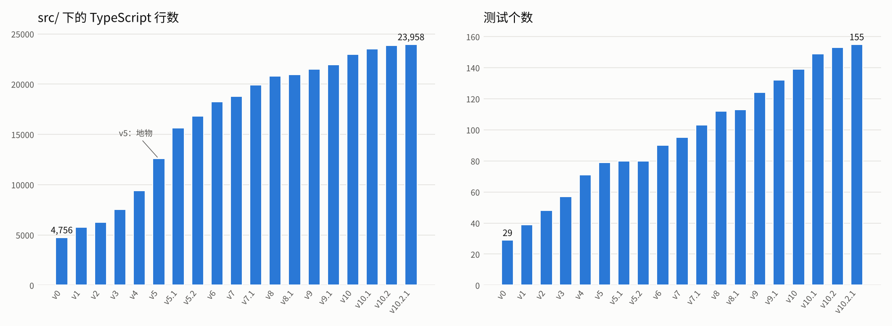

# 用 TypeScript 复刻 Minecraft：v0–v10 回顾

> mc-replica 从 v0 到 v10.2.1 一共 19 个版本。这篇不讲新东西，把前面的版本串起来看：
> 现在做到了什么、整体结构是什么样、“和原版一致”是怎么验证的、性能怎么变过来的，以及技术上有哪些做法值得复用。
> 每一节都链到对应版本的文章，细节在那里。



*每个版本 `src/` 下的 TypeScript 行数和测试个数（按 git tag 统计）。v5 的地物是一次最大的跳跃：36 种树、16 种矿石和它们的放置规则。*

## 一、现在是什么样

目标版本是 Java 版 1.21.4。打开 demo，看到的世界是这样来的：

| 层 | 做到了什么 | 版本 |
| --- | --- | --- |
| 随机数、噪声 | Legacy / Xoroshiro 随机源、ImprovedNoise / PerlinNoise / NormalNoise，和 Java 逐位一致 | [v0](v0-功能与实现.md) |
| 地形 | 原版数据包里的 JSON 密度函数，NoiseRouter、样条、插值 | [v0](v0-功能与实现.md) |
| 区块 | 16³ section + 调色板 + 位压缩，贪婪网格，纹理数组 | [v1](v1-区块存储与贪婪网格.md) |
| 物理 | 20 TPS 固定步长，走跑跳潜行游泳飞行的公式照原版 | [v2](v2-原版物理与手感.md) |
| 水和岩浆 | 含水层、流体流动 | [v3](v3-含水层与流体.md) |
| 生物群系 | 7593 项气候参数表、BiomeManager 抖动、surface_rule、按群系染色 | [v4](v4-生物群系与地表规则.md) |
| 地物 | 矿石、36 种树、花草、晶洞、滴水石、幽匿、珊瑚、地牢、化石……；洞穴和峡谷雕刻器；下界和末地 | [v5](v5-地物：矿石与树.md) · [v5.1](v5.1-其余地物与洞穴.md) · [v5.2](v5.2-下界、末地与收尾.md) |
| 光照 | 天空光、方块光，平滑光照、光照贴图，昼夜 | [v6](v6-光照与昼夜.md) |
| 方块 | 原版全部 1095 种方块、27816 个状态；读原版 JSON 模型和纹理 | [v7](v7-方块状态.md) · [v7.1](v7.1-方块模型.md) · [v8.1](v8.1-原版全部方块.md) |
| 存档 | IndexedDB 自动保存；导入原版存档（NBT、.mca） | [v8](v8-存档.md) |
| 交互 | 放方块按原版规则定状态（楼梯拐角、栅栏连接、门）；红石 | [v9](v9-放方块.md) · [v9.1](v9.1-红石.md) |
| 生存 | 挖掘时间、战利品表、掉落物、背包；合成、工具 | [v10](v10-生存模式.md) · [v10.1](v10.1-合成和工具.md) |
| 性能 | 区块生成的三段任务调度；含水层、查群系的提速 | [v10.2](v10.2-整理与区块生成调度.md) · [v10.2.1](v10.2.1-生成提速.md) |

规模：`src/` 下 109 个 TypeScript 文件、约 2.4 万行；155 个测试；`tools/` 下 29 个脚本（对拍、测速、从原版 jar 导出数据）。

## 二、整体结构

v0 一开始照着初版 demo 的结构重写：`main.ts` 里 new 出 Core / Player / Terrain / Control / UI，跑一个 animate 循环。
后面每一版只在对应的目录里加东西，没有推倒重来过：

```text
src/
├─ main.ts            animate 循环：固定 20 TPS 的 tick + 每帧插值渲染（v2）
├─ core/              场景、相机、渲染器
├─ player/ control/   玩家参数；输入、移动、碰撞、选方块、挖放
├─ terrain/
│  ├─ index.ts        Terrain：区块的加载卸载、读写方块
│  ├─ generator.ts    区块生成的调度（主线程，v10.2）
│  ├─ chunk/          section + 调色板
│  ├─ mesh/ models/   贪婪网格；原版方块模型
│  ├─ light/          光照引擎
│  ├─ placement.ts    放方块、方块更新（v9）
│  ├─ redstone.ts     红石（v9.1）
│  ├─ worker/         Worker：原型 / 装饰 / 组装、光照 + 网格
│  └─ worldgen/       世界生成：随机数、噪声、密度函数、含水层、群系、地表、雕刻器、地物
├─ items/             物品、背包、战利品表、合成、工具（v10）
├─ save/              存档（v8）
├─ sky/               昼夜（v6）
└─ ui/                菜单、物品栏、F3
```

一个区块从无到有（v10.2 以后）：

```text
Terrain.update()  玩家附近缺哪个区块
  → ChunkGenerator  拆成三种任务，依赖好了才排队，近的先算
      原型   密度函数 → 方块、含水层 → 水和岩浆、地表规则、雕刻器        （Worker）
      装饰   在周围 3×3 个原型上放地物                                  （Worker）
      组装   原型 + 周围 3×3 的装饰 → 最终区块、群系颜色                 （Worker）
  → 周围 8 个区块都到了 → 光照 + 网格                                    （Worker）
  → 主线程放进场景
```

`worldgen/` 是整个项目的核心，约 1.1 万行，接近一半的代码，而且**完全不依赖 three.js**：测试和对照工具都在 Node 里直接跑它。

## 三、“和原版一致”是怎么验证的

这个系列最硬的卖点是“和原版对得上”。随着版本推进，验证方式换了四种，一种比一种直接：

| 方式 | 比的是什么 | 从哪一版开始 | 例子 |
| --- | --- | --- | --- |
| Java 参照实现对拍 | 同一个算法用 Java 原生的 long / double / float 写一遍，逐位比较 | v0 | 随机数、噪声、样条；后来加了种子哈希、BiomeManager、HashSet 遍历顺序 |
| 原版数据报告 | 用原版服务端 `--reports` 导出的表逐项比较 | v4 | 主世界 7593 项、下界 5 项群系参数全部一致 |
| 原版存档逐格对照 | 用原版服务端以同一种子生成存档，和我们生成的区块逐格比 | v5 | 地形 + 地表 99.996%～100%；完整地物 99.67% |
| 实测数值 | 测试里跑出来的数和原版 / Wiki 的值比 | v2 | 连续疾跑跳 7.127 格/秒；木镐挖石头 1.15 秒 |

v5 之前只能证明“TS 和我写的 Java 一致”，两份都是按我对原版的理解写的，所以第一篇文章就说明了这个局限。
v5 开始直接跑原版服务端生成标准答案（`tools/vanilla/`），这之后每一版的“一致率”才真正有分量：

| 内容 | 和原版存档的一致率 | 版本 |
| --- | --- | --- |
| 地形 + 地表（关掉地物、雕刻器） | 99.996%～100% | v5 |
| 雕刻器（只开雕刻器） | 99.996%～100% | v5.1 |
| 主世界完整地物 | 99.44% → 99.67% | v5 → v5.1 |
| 下界、末地地形（关掉地物） | 100%（之前约 60%） | v5.2 |
| 光照（没有地物的存档） | 100% | v6 |
| 连方块属性一起比 | 99.50% → 99.66% | v7 |
| 导入原版存档 vs 按种子生成 | 99.92% | v8 |

剩下的不一致大部分有明确的原因，写在各版的文章里，最主要的一条是**生成顺序**：
跨区块的大地物（树、滴水石簇、幽匿）在原版里取决于哪个区块先生成，而原版是多线程生成的，自己换个顺序结果也会变。
我们按 4×4 的“装饰区域”固定顺序，结果和加载顺序无关，代价是区域边界上和原版有出入（v5）。

## 四、性能是怎么变过来的

| 版本 | 改了什么 | 数字 |
| --- | --- | --- |
| v1 | InstancedMesh → section + 调色板 + 贪婪网格 | 方块数据 6.00 → 0.70 MB；四边形 104,416 → 60,763；挖一个方块重建 33 → 1.6 ms |
| v3～v5.1 | 加含水层、群系、地物、雕刻器 | 一个区块 83 → 102 → 121 → 约 500 ms（功能变多，变慢是预期的） |
| v7.1 | 原版模型（树叶不再互相遮挡、草的覆盖层） | 四边形 47.8 万 → 89.5 万，网格显存 28.7 → 82.4 MB |
| v10.2 | 生成拆成三段任务，主线程调度，每样只算一次 | 81 个区块、3 个 Worker：79.6 → 45.4 秒 |
| v10.2.1 | 含水层格子跨区块共享，查群系先看近的 | 45.4 → 35.3 秒 |

v5～v10.1 一直在加功能，生成速度没有专门管，到 v10 时一个区块要半秒以上。v10.2 先测量再动手，发现最大的浪费不在任何一个函数里，
而在结构上：几个 Worker 各算各的，同一个邻居区块的原型被算了好几遍（81 个区块算了 601 次原型）。

## 五、技术上值得复用的做法

**先有数据结构，再谈功能。** 初版 demo 只有“每列一个地表方块”，洞穴、水、光照都没法做。v0 定下“区块 + 体素数组 + Worker 生成”，
v1 换成原版的 section + 调色板，之后十几个版本都没再动过存储层。

**数据从原版导出，不手抄。** 早期的噪声参数是凭记忆手抄的，接上原版数据包以后就查出一处参数顺序和原版不一样（v0）。
后来所有能导出的都导出：方块状态（数据报告）、光照属性和碰撞箱（v8.1 用反射调原版服务端的代码）、配方和工具规则（v10.1）、
群系参数表（用 `--reports` 核对）。手写的只剩原版写在 Java 代码里、又没法导出的规则。

**原版的怪癖要照抄。** 有几处原版的行为看起来像 bug，但不照抄就对不上：

- 发光地衣的“往外找”每次都检查起点旁边同一格，从来不往外走。照抄以后一致率从 55% 到 97%（v5.1）。
- 含水层的 erosion 在区块范围里按 quart 取值，范围外按精确位置取值（v3），v10.2.1 做缓存时也必须带上这一位。
- 树的装饰器（藤蔓、蜂巢、可可果……）遍历原木和树叶的顺序来自 Java HashSet 的桶顺序，换个顺序随机数就对不上；对拍工具里专门加了这一项（v5）。
- 原版的“半连接”：活塞上面那格有信号也会动（v9.1）。

**测试要能失败。** v10.2、v10.2.1 的几个“结果不变”测试，都故意把代码改坏一次，确认测试真会报错。这样还查出了一个局限：
含水层缓存键里少一位，在测试的 9 个区块上并不会出错，测试证明不了这一位是必要的，日志里如实记下了。

**先测量再优化。** v10.2 之前我猜慢在含水层和查群系，采样也确实这么说；但真正的大头是重复计算，单看函数的耗时排行看不出来，
是数“81 个区块算了多少次原型”才发现的。

**版权边界从第一天就划清。** 原版的纹理、音效、数据文件都不进仓库：数据包和资源包从你自己的客户端 jar 里取，放进被 git 忽略的目录；
程序画了一套纹理，公开 demo 用简化的 demo 地形（v1 起）。代价是在线 demo 看不到原版的样子，首页和菜单里都写明了这一点（v10.2）。

## 六、现在和原版的差距

- **没有实体**：没有生物，没有玩家生命值、饥饿、摔落伤害。地上的物品是唯一的实体，而且不存档。
- **方块实体**：箱子、熔炉、告示牌、床、旗帜还是普通方块的样子，箱子不能打开。
- **红石**：没有比较器、侦测器、压力板；活塞没有动画。
- **渲染**：动画纹理不动，没有阴影、云、天气、粒子、音效。
- **生成**：结构（村庄、要塞、神殿……）完全没做；大地物在装饰区域边界上和原版有出入。
- **验证**：生成速度、内存在 2 核机器上测的，没在你的机器上测过；含水层只抽查过几处。

## 七、接下来

| 版本 | 内容 |
| --- | --- |
| v10.3 | 熔炉和箱子：烧炼配方、燃料、方块实体（物品存档） |
| 之后 | 实体框架和生物（移动、AI、寻路）；生命值、饥饿、伤害；结构生成；多人联机 |

实体会同时动到物理（v2）、渲染、存档（v8）三块，是下一阶段工作量最大的部分。
