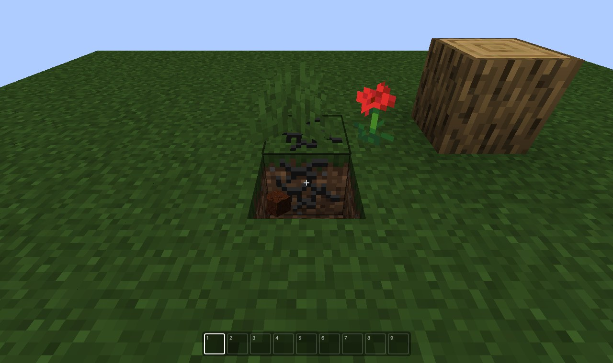
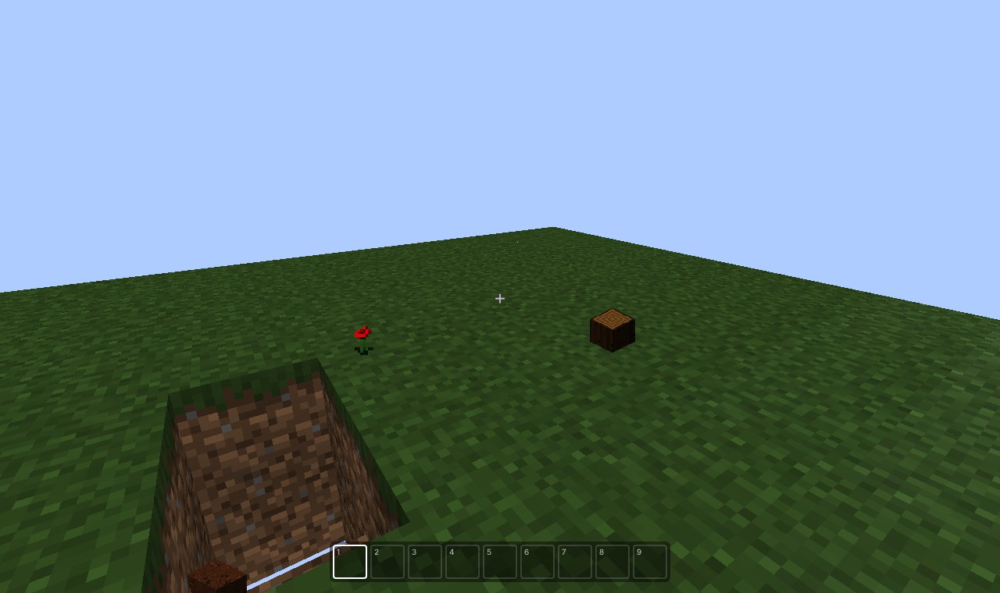
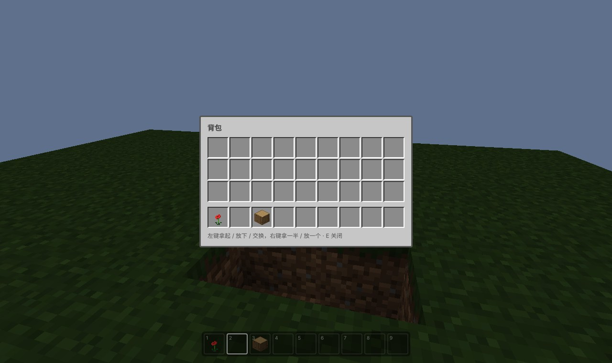

# 用 TypeScript 复刻 Minecraft（v10）：生存模式 —— 挖掘、掉落、背包

> 本文是 mc-replica 系列的第 v10 篇。到 v9.1 为止都是“创造模式”：点一下方块就没了，物品栏里的方块用不完。
> v10 加上生存模式最基础的一圈：挖要时间，挖掉会掉东西，东西掉在地上，走过去捡起来，进背包，放方块要用背包里的。
> 开发日志见 [../notes/v10-notes.md](../notes/v10-notes.md)。



*正在挖的泥土上有原版的裂纹；坑里是刚才挖掉的草方块掉的泥土。*

## 一、物品不是方块

原版里方块和物品是两套注册表：方块在世界里，有状态、碰撞箱、模型；物品在背包里，有名字、能叠多少个、图标。
大部分方块有一个同名的物品，但也有例外：

| 物品 | 放下去是 |
| --- | --- |
| 红石粉 | 红石线 |
| 小麦种子 | 小麦（作物） |
| 胡萝卜、马铃薯 | 胡萝卜、马铃薯（作物） |
| 火把 | 火把，或者贴墙的火把（v9 按点的面决定） |

反过来，对着贴墙的火把按中键，拿到的是“火把”这个物品。木棍、钻石、生肉这些物品放不下去。

物品的名字和最大堆叠数来自数据报告（`items.json`，1385 种）：大部分 64，告示牌、雪球 16，工具、床 1。

## 二、挖要多久

原版的公式（`BlockBehaviour.getDestroyProgress`）：

```text
每 tick 的进度 = 挖掘速度 / 硬度 / (能掉东西 ? 30 : 100)
```

- **硬度**：v8.1 从原版导出的破坏时间。泥土 0.5、原木 2、石头 1.5、黑曜石 50，花草 0，基岩 -1（挖不动）
- **挖掘速度**：空手是 1。脚不在地上 ÷5，眼睛在水下 ÷5（所以在水里、在空中挖得很慢）
- **能不能掉东西**：有的方块要用对的工具挖才掉东西（`requiresCorrectToolForDrops`）—— 石头、矿石要镐。空手挖它们时，除数从 30 变成 100

算下来：泥土 15 tick（0.75 秒），原木 60 tick（3 秒），石头空手 150 tick（7.5 秒），而且什么都不掉。挖掉一块以后等 5 tick 才开始挖下一块。

“要不要对的工具”又是一个原版代码里的属性。v8.1 起我们用“按行为认方法”的办法从混淆的 jar 里导出数据：
这次找的是“没有参数、返回 boolean，石头、黑曜石、铁矿、深板岩是，泥土、原木、沙子、玻璃、草方块不是”的那个方法。

裂纹是资源包里的 `destroy_stage_0..9`，按进度贴在方块外面一点点的一个盒子上。

## 三、掉什么：战利品表

挖掉的方块掉什么，原版写在数据包里，每种方块一个 JSON（`loot_table/blocks/`）。比如矮草：

```text
alternatives（取第一个满足条件的）：
  用剪刀挖 → 矮草
  1/8 的概率 → 小麦种子（时运会加成）
```

一张表有几个“池”，每个池抽若干次，每次在满足条件的条目里按权重抽一个，再用“函数”改数量。用到的东西不多：

- **条件**：概率（`random_chance`）、按附魔等级的概率（`table_bonus`，我们没有附魔，取 0 级）、方块状态（`block_state_property`：门只有下半掉门，雪层按层数掉雪球）、
  用什么工具（`match_tool`：剪刀、精准采集…… 我们还没有工具，一律不满足）
- **函数**：设数量（`set_count`，可以是区间、二项分布）、限制数量、时运加成（0 级时大多不变，只有作物种子的 `binomial_with_bonus_count` 还会多掉）

所以生存模式空手挖，掉的就是原版空手挖的结果：草方块掉泥土，树叶 5% 掉树苗、2% 掉木棍、橡树 0.5% 掉苹果，成熟的小麦掉小麦和 1~4 颗种子。
测试里每种抽 4 万次，比例和表里写的一致。

## 四、掉在地上

掉出来的东西是一个 0.25 × 0.25 的小实体（原版 `ItemEntity`）：

- 出生在方块中心附近 ±0.25 的位置，带一个往上 0.2、水平 ±0.1 的初速度，所以会“蹦”出来
- 每 tick 重力 0.04；在水里改成慢慢往上浮
- 空中摩擦 0.98，落在地上 0.6 × 0.98（方块的滑度），很快停住
- 10 tick 内捡不起来（玩家按 Q 扔出去的是 40 tick，免得刚扔就捡回来）；5 分钟后消失

玩家的碰撞箱四周放大 1 格、上下放大 0.5 格，碰到物品就捡起来。背包放不下的部分留在地上。



地上的物品现在画成一个始终朝着镜头的图标；原版是会转的小方块和有厚度的薄片，留到以后。

## 五、背包和图标

背包 36 格，前 9 格是屏幕下面的物品栏。捡东西的顺序照原版：先往已经有同种物品、还没满的格子里塞，再放第一个空格。
按 E 打开背包界面，左键拿起一整组 / 放下 / 交换，右键拿一半 / 放一个 —— 和原版的点击规则一样。



图标：1.21.4 新加了 `assets/minecraft/items/*.json`，写着每个物品用哪个模型。模型是方块模型的（石头、原木）画成斜 45° 的小立方体；
是物品模型的（虞美人、木棍）画成平面，有的还要染色（草的图标是草色）。没有资源包时，能放下去的物品用 v1 的程序纹理图标。

## 六、还没做的

- 合成、工具（v10.1）：现在生存模式只能空手，挖不出石头
- 生命值、饥饿、摔落伤害
- 地上的物品合成一堆、存档
