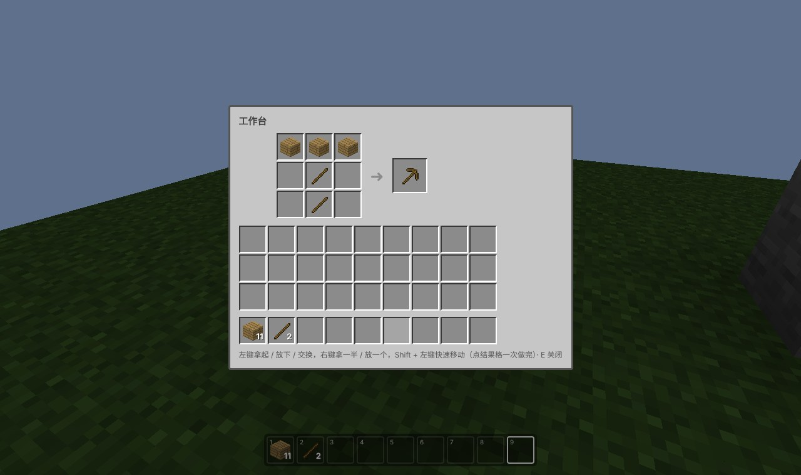
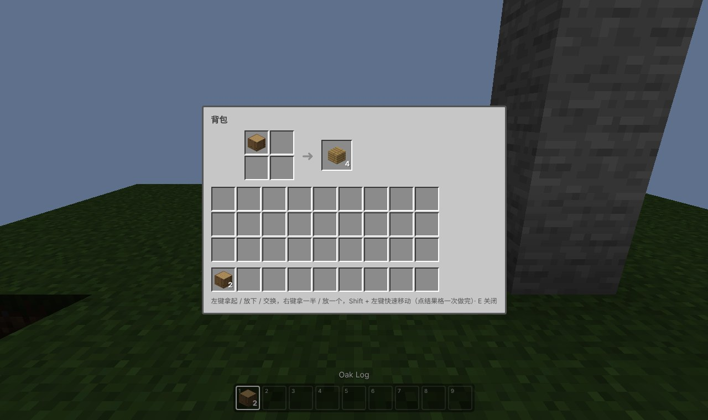
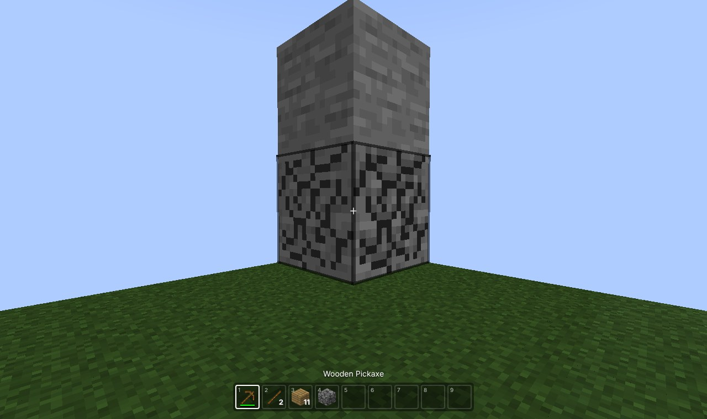

# 用 TypeScript 复刻 Minecraft（v10.1）：合成和工具

> 本文是 mc-replica 系列的第 v10.1 篇。v10 有了生存模式，但只能空手：石头、矿石挖半天什么都不掉。
> v10.1 补上生存模式的第一步：原木 → 木板 → 工作台 → 木镐 → 圆石。合成用原版的 964 个工作台配方，
> 工具的速度、“对不对”、耐久都照原版 1.21.4 的 `minecraft:tool` 组件。
> 开发日志见 [../notes/v10.1-notes.md](../notes/v10.1-notes.md)。



*工作台的 3×3 格子里摆好木镐的图案，结果格就出现木镐。*

## 一、数据从哪来

两样都不用手抄：

- **配方**：jar 里的 `data/minecraft/recipe/` 有 1370 个 JSON。工作台用的是其中三种：
  有序（`crafting_shaped`，655 个）、无序（`crafting_shapeless`，277 个）、换色（`crafting_transmute`，32 个，染潜影盒和收纳袋）。
  其余是熔炉、高炉、烟熏炉、营火、切石机、锻造台的配方，以及 13 个写死在代码里的特殊配方（烟花、地图复制、修理……），这一版不做。
- **工具**：1.21.4 起，工具能挖什么不再写在 `PickaxeItem` 这样的类里，而是物品的一个数据组件。数据报告 `items.json` 里能直接看到：

```json
"minecraft:iron_pickaxe": { "components": {
  "minecraft:max_damage": 250,
  "minecraft:tool": { "rules": [
    { "blocks": "#minecraft:incorrect_for_iron_tool", "correct_for_drops": false },
    { "blocks": "#minecraft:mineable/pickaxe", "correct_for_drops": true, "speed": 6.0 }
  ]}
}}
```

`tools/vanilla/gen-items.py` 把这些读出来，配方里的物品标签（`#minecraft:planks`）和工具规则里的方块标签（`#minecraft:mineable/pickaxe`）
都展开成具体的名字，写成 `src/items/recipes.json`（195 KB）和 `tools.json`（40 KB）。

## 二、配方怎么对

### 有序配方

木镐的配方：

```json
{ "pattern": ["XXX", " # ", " # "],
  "key": { "#": "minecraft:stick", "X": "#minecraft:wooden_tool_materials" } }
```

原版（`ShapedRecipePattern`）的比法：

1. 配方的图案先去掉四周的空行空列（木棍是 `"#" / "#"`，1×2）。
2. 格子里摆的东西也裁掉四周的空行空列（`CraftingInput.ofPositioned`）。所以木棍的两块木板放在 3×3 的哪一列都行。
3. 两边宽高一样、格子数一样，再逐格比：配方是空的那格必须是空的，否则物品要在原料的集合里。
4. 不对称的图案再比一次左右镜像。斧头、弓都能两个方向摆。

两块木板竖着是木棍，横着是木质压力板——测试里一开始写成“横着做不出东西”，结果配方表比我记得清楚。

### 无序配方

原木 → 木板只要一个原料，放哪都行。多原料的无序配方（染料混色、书……）要“每个原料配一个不同的格子”：
原料是集合，一个物品可能同时满足几个原料，不能贪心地见一个配一个。原版用 `StackedContents` 做这件事，这里写成最普通的增广路二分图匹配，最多 9 个点。

### 换色配方

正好两样东西：一个“输入”（任意颜色的潜影盒）加一个“材料”（红色染料）→ 红色潜影盒。

### 每个配方都能做出来吗

测试里把 964 个配方一个个按自己的摆法放进 3×3（每格放原料集合里的第一种物品），查 `find` 的结果：964 个全都做出了自己的结果，
没有被别的配方抢先对上。

## 三、合成格子



*背包里的 2×2：放一个原木，结果格是 4 个木板。*

照原版 `ResultSlot` 的规则：

- 点结果格：手上空，或者手上是同一种东西而且叠得下，就拿起一份；否则什么都不做。
- 拿走以后每格少一个。牛奶桶、蜂蜜瓶这类有“剩余物”的，格子里留下空桶、玻璃瓶（做蛋糕后三个空桶留在原位）。
- Shift + 点结果格：一直做，直到材料用完、结果变了，或者背包放不下。一组 64 个原木 Shift 一下就是 256 个木板。
- 关掉界面，格子里剩下的东西回到背包，放不下的扔出去。

背包里的格子也有了 Shift + 点：物品栏的挪到背包三排，背包里的挪到物品栏。

右键工作台打开 3×3（按着 Shift 右键还是放方块，和开门一样）。

## 四、工具

### 速度和“对不对”

原版 `Tool` 的两个问题都是“从前往后找第一条包含这个方块、并且写了这一项的规则”：

| | 速度 | 对不对 |
| --- | --- | --- |
| 铁镐挖石头 | 第 2 条：6 | 第 2 条：对 |
| 铁镐挖钻石矿 | 第 1 条没写速度 → 第 2 条：6 | 第 1 条 `incorrect_for_iron_tool` 不含钻石矿 → 第 2 条：对 |
| 木镐挖铁矿 | 2 | 第 1 条 `incorrect_for_wooden_tool` 含铁矿：不对 |
| 金镐挖铁矿 | 12 | 金镐用的是 `incorrect_for_gold_tool`，和木头一个级别：不对 |

“对不对”决定两件事：要用工具的方块（石头、矿石……）掉不掉东西，以及挖掘公式除以 30 还是 100：

    每 tick 进度 = 速度 / 硬度 / (能掉东西 ? 30 : 100)

| 挖石头（硬度 1.5） | tick | 秒 |
| --- | --- | --- |
| 空手 | 150 | 7.5 |
| 木镐 | 23 | 1.15 |
| 石镐 | 12 | 0.6 |
| 铁镐 | 8 | 0.4 |
| 钻石镐 | 6 | 0.3 |
| 下界合金镐 | 5 | 0.25 |
| 金镐 | 4 | 0.2 |

和 Minecraft Wiki 的破坏时间表一样。浏览器里用木镐挖石头量出来 1.14 秒（墙上的时间，含测试脚本的延迟）。



*用刚做的木镐挖第二块石头；物品栏第一格下面的绿条是耐久，第四格是第一块石头掉的圆石。*

剑对蜘蛛网是 15、对 `sword_efficient`（竹子、南瓜、藤蔓……）是 1.5；剪刀对树叶、蜘蛛网 15，羊毛 5。

### 耐久

挖掉一块硬度不为 0 的方块，工具掉 `damage_per_block` 点耐久（剑是 2，其他是 1），用完就从背包里消失。
木镐 59、石 131、铁 250、钻石 1561、下界合金 2031、金 32。格子下面的耐久条按原版 `getBarWidth`（13 像素宽）和 `getBarColor`（绿 → 红）画。

用过的工具和新的不能叠在一起，背包的“是不是同一种”现在要比耐久（`sameItem`）。

### 战利品表里的工具

v10 时战利品表的 `match_tool` 一律不满足。现在它会看手上拿的是什么：

- 剪刀剪树叶掉树叶，剪草掉草（原版 43 个表用 `{"items": "minecraft:shears"}`）
- 紫水晶簇用镐（`#minecraft:cluster_max_harvestables`）掉 4 个碎片，空手 2 个

还没有附魔，所以 153 个“精准采集”的条件仍然不满足。

### 创造模式拿剑挖不动

原版 `SwordItem.canAttackBlock` 在创造模式返回 false，三叉戟、重锤、调试棒也一样。这里照做。

## 五、还没做的

- 熔炉、切石机、锻造台；特殊配方（烟花、地图、旗帜、修理……）
- 配方书、合成格子里按住拖动分配（原版的 QUICK_CRAFT 拖动）
- 附魔（效率、精准采集、时运、耐久）
- 打怪物、工具的攻击伤害
