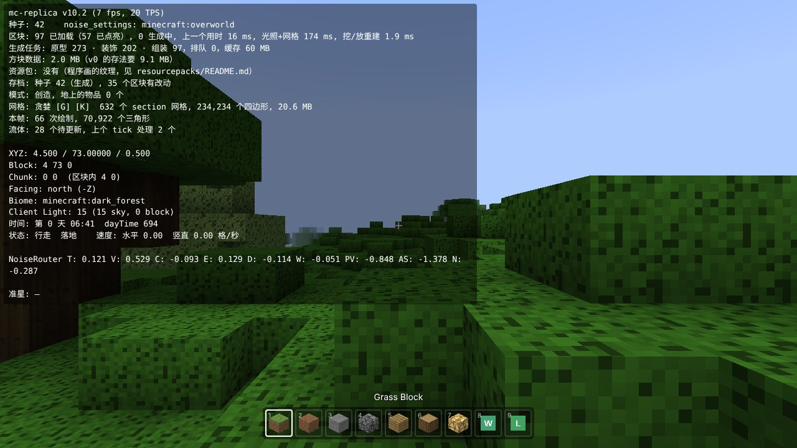

# 用 TypeScript 复刻 Minecraft（v10.2）：整理与区块生成调度

> 本文是 mc-replica 系列的第 v10.2 篇。这一版不加玩法，做两件事：整理仓库和发布流程；解决区块生成慢的问题。
> 区块生成拆成“原型 / 装饰 / 组装”三种任务，由主线程统一调度，每样只算一次。
> 生成结果和 v10.1 逐格相同，同样的区块 CPU 时间少了约 43%。
> 开发日志见 [../notes/v10.2-notes.md](../notes/v10.2-notes.md)。



*F3 新加的一行：一共算了多少个原型、装饰、组装，排队的任务数，中间结果占的内存。*

## 一、这一版做了什么

| 方面 | 内容 |
| --- | --- |
| 性能 | 区块生成拆成三种 Worker 任务，主线程保存中间结果、按依赖调度，每个原型和装饰只算一次 |
| 测试 | `tests/generator.test.ts`：三段任务和 v10.1 的结果逐格相同，调度器发的依赖是全的 |
| 工具 | `tools/bench-gen.ts`：区块生成各阶段的耗时，可以按 v10.1 或 v10.2 的方式算 |
| 调试 | F3 显示原型 / 装饰 / 组装的个数、排队数、中间结果的内存 |
| 仓库 | `main` 快进到最新；Pages 首页列出所有版本；公开版 demo 的菜单说明它和原版的区别 |

## 二、先量：慢在哪

`tools/bench-gen.ts` 从中心往外生成半径 4 的 81 个区块，和游戏里加载的顺序一样，分别计时：

```
生成（generateChunk）  平均 608.1 ms/区块
  原型（地形+地表+雕刻器）83.8 ms × 398 个
  装饰（地物）          70.5 ms × 216 个
  其余（拼邻居、颜色、压缩）8.0 ms/区块
光照 + 网格（meshChunk） 平均 45.2 ms/区块
```

一个原型 84 ms、一个装饰 70 ms，每个区块理论上只要 160 ms 左右，实际平均却要 600 ms，因为 **81 个区块算了 398 次原型**。

### 为什么会重复

v5 定下的生成流程是这样的（详见 v5 的文章）：

- **原型**：一个区块的地形、含水层、地表、雕刻器。
- **装饰**：在周围 3×3 个原型的副本上，放这个区块的地物（树会伸到邻居里），记下改了哪些格子。
  同一个 4×4“装饰区域”里，排在前面、2 个区块以内的装饰要先做完，后面的在它们的结果上接着放。
- **最终区块**：自己的原型，再叠上周围 3×3 个区块的装饰。

所以生成一个区块，要用到周围 3×3 的装饰，而这些装饰又要用到各自周围 3×3 的原型，加上前序装饰。v10.1 里这一切都在 `ChunkSource` 里，带一个 LRU 缓存。
问题有两层：

1. **缓存会被挤掉**：每个 `ChunkSource` 最多存 160 个原型，一圈一圈往外生成时，早算的原型被挤掉，后面又要用就重算。
2. **Worker 之间不共享**：游戏里有 3 个 Worker，每个有自己的 `ChunkSource`。区块按装饰区域固定分给某个 Worker，
   但区域边上的区块要用邻居区域的原型和装饰，那是另一个 Worker 已经算过的，这边看不到，只能再算一遍。

用 `--workers=3` 模拟游戏里的 3 个 Worker，81 个区块一共算了 **601 个原型、370 个装饰**。

### CPU 采样

顺便用 `node --cpu-prof` 看了单个原型、装饰内部的热点：

| 自身耗时 | 函数 | 说明 |
| --- | --- | --- |
| 12.8% | `Aquifer.computeSubstance` | 含水层：每个空着的格子都要问一次 |
| 8.1% | `Climate.find` | 在 7593 项参数表里找最近的群系 |
| 8.0% | `DensityFunction.compute` | 密度函数树 |
| 6.9% | `NoiseChunk.compute` | 插值、缓存 |
| 5.3% | `ImprovedNoise.sampleAndLerp` | 噪声 |

这些是单个任务本身的成本，原版也要算。重复计算是结构问题，收益最大，先解决它。

## 三、设计：三段任务 + 主线程调度

原版的做法是**区块状态**（`ChunkStatus`）：一个区块从 `noise` → `surface` → `carvers` → `features` → `full` 一步步推进，
每一步的结果存在区块上；某一步要用邻居，就要求邻居先到上一步。每样东西只算一次。

v10.2 照这个思路，把生成拆成三种任务：

```text
                  依赖                                       Worker 任务
原型 proto(x,z)    无                                         protoTask    地形 + 含水层 + 地表 + 雕刻器
装饰 deco(x,z)     周围 3×3 的原型 + decorationDeps 的装饰     decorateTask 放这个区块的地物
组装 chunk(x,z)    周围 3×3 的原型 + 周围 3×3 的装饰           assembleTask 叠装饰、算颜色、压缩成 section
```

主线程的 `ChunkGenerator` 负责：

- **保存**算好的原型和装饰，谁要用就发给哪个 Worker；
- **依赖都好了才排队**，所以队列里的任务拿到就能算；
- **按离玩家的距离**把任务发给空闲的 Worker，近的先算；
- **丢掉**离玩家太远（视距 + 5 圈以外）的中间结果。

```text
Terrain.update()  ──预约──▶  ChunkGenerator.chunk(x, z, 距离²)
                                │  要周围 3×3 的原型和装饰：缓存里有就用，没有就创建（递归）
                                │  依赖好了 → 进队列
                                ▼
                         pump()：Worker 有空就按距离发任务
                                ▼
         Worker：proto / decorate / assemble  ──结果──▶  存进 ChunkGenerator
```

## 四、实现

### 1. 依赖关系抽成函数

装饰的前序依赖原来写在 `ChunkSource.decoration()` 的循环里。调度器也要知道它，所以抽出来（`worker/pipeline.ts`）：

```ts
export function decorationDeps(cx: number, cz: number): [number, number][] {
  const out: [number, number][] = []
  const rx = Math.floor(cx / REGION)
  const rz = Math.floor(cz / REGION)
  for (let ez = Math.max(rz * REGION, cz - 2); ez <= cz; ez++)
    for (let ex = Math.max(rx * REGION, cx - 2); ex <= Math.min(rx * REGION + REGION - 1, cx + 2); ex++) {
      if (ez === cz && ex >= cx) break
      out.push([ex, ez])
    }
  return out
}
```

区域里的第一个区块没有依赖；`(1, 0)` 依赖 `(0, 0)`；`(0, 1)` 依赖上一行 x = 0..2 的三个。

### 2. Worker 的任务：不改计算代码

最省事、也最不容易出错的办法，是**不碰原来的计算**：给 `ChunkSource` 加两个方法，把别处算好的结果直接放进缓存。

```ts
putProto(cx: number, cz: number, p: Proto): void {
  this.protos.set(`${cx},${cz}`, p)
}
putDecoration(cx: number, cz: number, d: Decoration): void {
  this.decorations.set(`${cx},${cz}`, d)
}
```

Worker 收到“装饰”任务时，先把 9 个原型和前序装饰放进去，再调用原来的 `decoration()`。它在缓存里找到要用的东西，就不会再算（`worker/tasks.ts`）：

```ts
export function decorateTask(wg, settingsId, s, cx, cz, protos: Proto[], priors: [number, number, Decoration][]): Decoration {
  const src = chunkSource(wg, settingsId, s)
  src.clear()
  AROUND.forEach(([dx, dz], i) => src.putProto(cx + dx, cz + dz, protos[i]))
  for (const [ex, ez, d] of priors) src.putDecoration(ex, ez, d)
  const d = src.decoration(cx, cz)
  src.clear() // 不在 Worker 里攒内存
  return d
}
```

组装任务同理：放进 3×3 的原型和装饰，调用原来的 `generateChunk()`。

数据怎么传：Worker 把结果交回主线程时，数组的内存直接“转移”（transfer），不复制；主线程把原型发给 Worker 时要复制，因为自己还要留着。
一个原型 196 KB，一次装饰任务要发 9 个，约 1.8 MB，复制只要一两毫秒，和 70 ms 的计算比可以忽略。

### 3. 主线程的调度器

`terrain/generator.ts` 的核心是一个“有就用、没有就创建”的缓存，值是 Promise。正在算的也算“有”，所以同一个原型同时被好几个区块要，也只算一次：

```ts
private decoration(cx: number, cz: number, priority: number): Promise<Decoration> {
  return this.get(this.decorations, cx, cz, priority, (epoch, self) => {
    const deps = decorationDeps(cx, cz)
    const protos = AROUND.map(([dx, dz]) => this.proto(cx + dx, cz + dz, priority))
    const priors = deps.map(([ex, ez]) => this.decoration(ex, ez, priority))
    // 依赖都好了才进队列
    return Promise.all([Promise.all(protos), Promise.all(priors)]).then(([p, d]) =>
      this.run(epoch, self, () => this.pool.call('decorate', { cx, cz, protos: p, priors: /* … */ })))
  })
}
```

队列每帧由 `pump()` 清一次：按优先级排序，Worker 里同时最多 `Worker 数 × 2` 个任务（光照任务先发，因为算完就能显示）：

```ts
pump(limit: number): void {
  this.queue.sort((a, b) => a.owner.priority - b.owner.priority)
  while (this.queue.length && this.pool.busy < limit) this.queue.shift()!.start()
}
```

**优先级要能提前**：一个原型可能先被远处的区块要、后被近处的区块要。排序时读的是缓存项当前的优先级（`owner.priority`），
后来的请求更急时直接把它改小，排着的任务就被提前了；装饰还会把它的依赖一起提前。

**换种子时作废**：每次 `reset()` 让 `epoch` 加一，旧的任务进队列前发现 epoch 不对就放弃。

### 4. 测试：怎么证明结果没变

`tests/generator.test.ts` 同步地模拟调度器：要什么先递归算什么，每样只算一次。然后和另一个 Worldgen 直接 `generateChunk` 的结果比较方块、流体更新、颜色。
6 个区块覆盖了装饰区域的边界、区域中间和负坐标，主世界、下界、demo 地形各一组，全部逐格相同。

还有一个容易漏的问题：**如果调度器少发了一个依赖，Worker 会自己悄悄补算**，结果照样对，测试却发现不了，性能又回到老样子。
所以测试里把“缓存里没有还去算原型”改成直接报错：

```ts
src.proto = (cx, cz) => {
  if (!allow && !src.protos.has(`${cx},${cz}`)) throw new Error(`任务缺少原型 ${cx},${cz}`)
  return orig(cx, cz)
}
```

为了确认这个检查真的有用，我故意把 `decorationDeps` 改成返回空数组，测试立刻报“任务缺少原型 -4,-4”。

## 五、结果

Node，种子 42，原版主世界，半径 4 共 81 个区块，单线程依次算（总时间就是总 CPU 时间）：

| | 原型 | 装饰 | 总时间 |
| --- | --- | --- | --- |
| v10.1，1 个 Worker | 398 | 216 | 54.1 秒 |
| v10.1，3 个 Worker（游戏里的情况） | 601 | 370 | 79.6 秒 |
| **v10.2** | **286** | **216** | **45.4 秒** |

自己跑：`npx tsx tools/bench-gen.ts 4 42 minecraft:overworld --workers=3`，以及加 `--tasks`。

浏览器里，3 个 Worker、视距 6，加载 177 个区块：

| | v10.1 | v10.2 |
| --- | --- | --- |
| 出生点可以开始玩 | 36 秒 | 23 秒 |
| 全部加载完 | 约 160 秒 | 约 90 秒 |

这是在一台只有 2 个核的机器上测的，3 个 Worker 抢 2 个核，所以总 CPU 时间决定了速度。核更多的电脑上，绝对时间会短得多，但省下的比例差不多。

v10.2 的 286 个原型里，有一部分是“视野外一圈”的：最外圈区块的装饰要用到再往外的原型。视距越大，这部分占比越小，每个区块越接近只算 1 个原型、1 个装饰。

## 六、代价和还没做的

- **内存**：中间结果存在主线程，视距 6 时约 80 MB（F3 能看到）。以前是每个 Worker 各存最多 160 个原型，3 个 Worker 加起来差不多。原型还可以压缩，留到以后。
- **单个任务的速度没变**：原型约 85 ms，装饰约 75 ms。采样里查生物群系约占 18%、含水层约占 16%，是下一步可以优化的地方。
- 原版存档的解码（`vanillaChunk`）还是按区域固定分配 Worker，没有改。

下一版是 v10.3「熔炉和箱子」。
