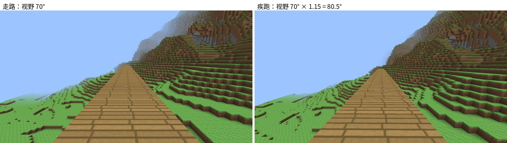
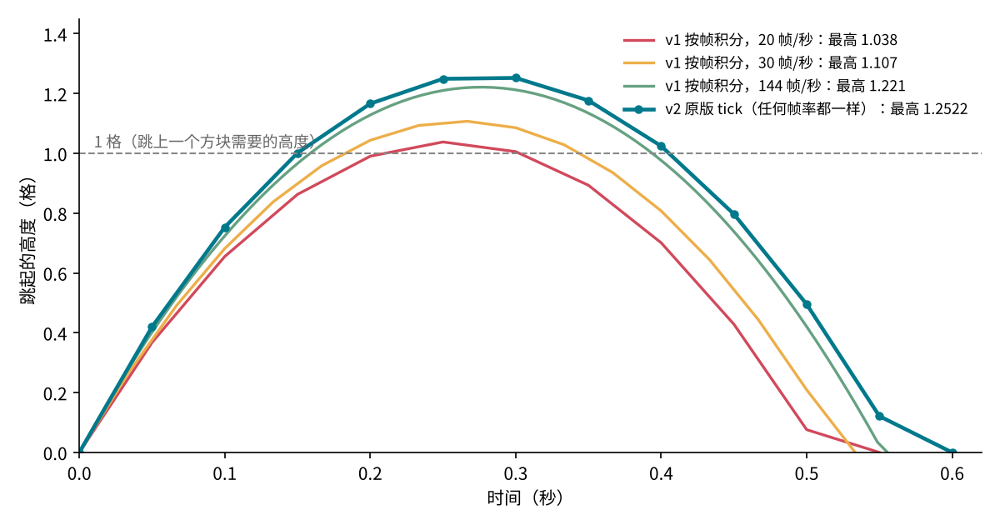
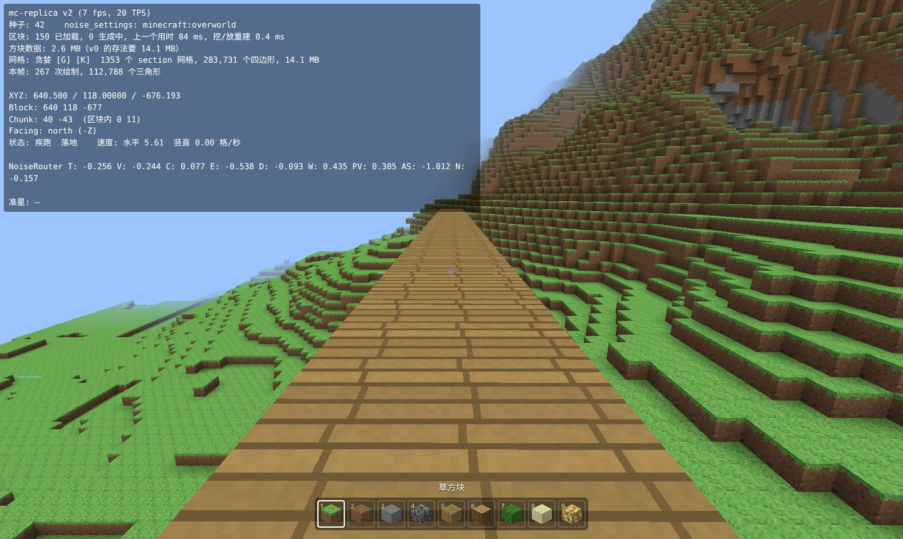

# 用 TypeScript 复刻 Minecraft（v2）：20 TPS 原版物理与手感

> 系列目标：用 TypeScript + three.js 在浏览器里逐版复刻 Minecraft Java 版 1.21.1，每一版一个能打开的 demo。
> 本篇讲 v2：把玩家移动从“每帧按秒积分”改成原版的**每秒 20 个 tick**，照搬原版的加速度、摩擦、跳跃、碰撞、游泳公式，再补上插值、视角摇晃、疾跑视野这些“手感”。
>
> 代码：mc-replica（tag `v2`） · Demo：（部署后填链接） · 上一篇：[v1：区块存储、贪婪网格与纹理](v1-区块存储与贪婪网格.md)



## 一、v2 做了什么

| | v0 / v1 | v2 |
| --- | --- | --- |
| 物理步长 | 每帧一次，按经过的秒数积分 | 固定每秒 20 tick，和帧率无关；画面在两个 tick 之间插值 |
| 水平移动 | 按键 = 直接设成目标速度 | 原版的**加速度 + 摩擦**：起步、停下都有惯性；空中几乎不能变向 |
| 跳跃 | 按 v² = 2gh 算初速度 | 原版：初速度 0.42 格/tick，每 tick 减 0.08 再乘 0.98；疾跑跳往前额外推 0.2 |
| 碰撞 | 先移动，撞了再退回来 | 原版：先按轴裁剪位移再移动；轴顺序、抬步都和原版一致 |
| 潜行 | 只是走得慢 | 碰撞箱变成 1.5 格高（能钻 1.5 格的缝，头顶有东西站不起来）；**不会走下方块边缘** |
| 水 | 自己写的近似公式 | 原版：水的阻力、浮力、在水面上下浮动、游上一格高的岸 |
| 镜头 | 直接放在眼睛位置 | 插值；蹲下时眼高平滑过渡；**视角摇晃**；疾跑 / 飞行时视野变宽，水下变窄 |

用下面这些原版的“公认数值”来检验（`tests/movement.test.ts`，全部是模拟 tick 后得出的结果，不是写死的）：

| 项目 | 原版 | v2 模拟 |
| --- | --- | --- |
| 走路 | 4.317 格/秒 | 4.317 |
| 疾跑 | 5.612 格/秒 | 5.612 |
| 潜行 | 1.295 格/秒 | 1.295 |
| **连续疾跑跳** | **7.127 格/秒** | **7.127** |
| 跳跃高度 | 1.2522 格 | 1.2522 |
| 跳跃时长 | 12 tick | 12 tick |
| 最大下落速度 | 78.4 格/秒 | 78.4 |
| 创造飞行 / 疾跑飞行 | 10.92 / 21.78 格/秒 | 10.89 / 21.78 |
| 水底行走 | 1.96 格/秒 | 1.96 |

最有说服力的是**连续疾跑跳 7.127**：代码里没有任何地方写这个数。它是加速度、摩擦、空气阻力、起跳推力这几条规则在 12 tick 一个循环里叠出来的结果，只要任何一条和原版不一样，这个数就对不上。

## 二、为什么要按 tick 算

v1 的写法是每一帧：

```ts
v.y -= gravity * dt     // dt = 这一帧经过的秒数
pos.y += v.y * dt
```

看起来和帧率无关，其实不是。这是对抛物线的离散近似，误差和 dt 成正比。按 v1 的参数算一下跳跃高度：



| 帧率 | v1 最高跳多高 |
| --- | --- |
| 20 | 1.038 格 |
| 30 | 1.107 格 |
| 60 | 1.178 格 |
| 144 | 1.221 格 |

电脑卡的时候，玩家跳得矮了，差一点就跳不上一格高的方块。而原版本来就不是连续的物理，它就是每秒算 20 次、每次用固定的公式。所以最简单也最准确的做法是：**照原版的方式算**。

## 三、固定步长 + 插值

```ts
// control/index.ts
update = (dt: number) => {
  // 卡顿太久（切到别的标签页再回来）就不补了，最多补 5 个 tick
  this.acc = Math.min(this.acc + dt, PHYSICS.TICK * 5)
  while (this.acc >= PHYSICS.TICK) {    // TICK = 0.05 秒
    this.acc -= PHYSICS.TICK
    this.tick()                          // 跑一遍原版的移动逻辑
  }
  this.render(this.acc / PHYSICS.TICK)  // 0..1：现在处在两个 tick 之间的什么位置
}
```

只按 tick 更新位置的话，60 帧的屏幕上，人物每 3 帧才动一下，看起来一顿一顿的。所以每个 tick 开始时记下 `prevPos`，画面上的位置取两者之间的插值：

```ts
private render(t: number) {
  const lerp = (a: number, b: number) => a + (b - a) * t
  this.camera.position.set(lerp(p.prevPos.x, p.pos.x), lerp(p.prevPos.y, p.pos.y) + eye, lerp(p.prevPos.z, p.pos.z))
  ...
}
```

代价是画面比物理晚最多 1 个 tick（50 ms），原版也是这样。鼠标转视角不经过 tick，每帧直接生效，所以不会觉得“粘”。

## 四、原版的移动公式

v2 的移动逻辑都在 `control/movement.ts` 的 `tickPlayer()` 里，按原版的调用顺序写：

```text
tickPlayer
  1. 更新水的状态         Entity.updateInWaterStateAndDoFluidPushing
  2. 姿势（站 / 蹲）      Player.updatePlayerPose
  3. 疾跑开始 / 结束      LocalPlayer.aiStep
  4. 输入：潜行 ×0.3      LocalPlayer.aiStep
  5. 飞行的上升 / 下降    LocalPlayer.aiStep
  6. 速度太小归零、跳跃   LivingEntity.aiStep
  7. 输入 ×0.98，travel   LivingEntity.travel：水里 / 地上 / 空中 / 飞行
  8. 视角摇晃的幅度       Player.aiStep
```

速度的单位从“格/秒”改成了原版的“格/tick”，常数都是原版源码里的原始值（`player/index.ts` 的 `PHYSICS`）。

### 加速度和摩擦

原版不是“按下 W 速度就是 4.317”。每个 tick：

```text
1. 速度 += 加速度（方向是按键方向）            moveRelative
2. 按速度移动，碰撞裁剪                         move
3. 水平速度 ×= 摩擦系数；竖直速度 = (vy - 0.08) × 0.98
```

```ts
// 地上：加速度 = 移动速度属性（走 0.1，疾跑 0.13）× 0.216 / 滑度³
//       普通方块滑度 0.6，0.6³ = 0.216，正好 1 倍；冰的滑度 0.98，加速度只有 0.23 倍
// 空中：加速度 0.02（疾跑 0.026）
const speed = p.onGround
  ? p.speedAttribute * (0.21600002 / (friction * friction * friction))
  : p.flying ? 0.05 * (p.sprinting ? 2 : 1) : p.sprinting ? 0.026 : 0.02
// 摩擦：地上 = 滑度 × 0.91 = 0.546；空中 = 0.91
const drag = p.onGround ? friction * 0.91 : 0.91
```

走路速度是怎么来的：输入 1 先乘 0.98，加速度 a = 0.1 × 0.98 = 0.098。设稳定后每 tick 走 d 格，那么摩擦后剩下的速度是 d × 0.546，下一 tick 再加上 a 又等于 d：

```text
d = d × 0.546 + 0.098   →   d = 0.098 / (1 - 0.546) = 0.21585 格/tick = 4.317 格/秒
```

疾跑：a = 0.13 × 0.98，d = 0.2806 格/tick = 5.612 格/秒。潜行：输入先 ×0.3，d = 1.295 格/秒。三个数都对上了。

这套规则带来几个 v1 没有的手感：

- **起步和停下有惯性**：松开 W 后速度每 tick ×0.546，大约滑 0.26 格才停。
- **空中几乎不能变向**：空中加速度只有 0.02，地上是 0.1，所以起跳后转身没什么用。
- **疾跑跳更快**：起跳的那一 tick 往面向的方向额外推 0.2，空中摩擦又小（0.91），速度能保持住。连续疾跑跳平均 7.127 格/秒，比疾跑快 27%。这就是原版玩家赶路时一直跳的原因。

### 斜着走

```ts
function moveRelative(p: Player, speed: number, left: number, forward: number, yaw: number): void {
  const len2 = left * left + forward * forward
  if (len2 < 1e-7) return
  const k = (len2 > 1 ? 1 / Math.sqrt(len2) : 1) * speed     // 长度超过 1 才归一化
  ...
}
```

只有长度**超过 1** 才归一化。单独按 W 时输入是 0.98（不归一化）；同时按 W 和 A 时长度是 0.98 × √2 > 1，归一化成 1。所以斜着走比直着走快 2%（1/0.98），这是原版就有的特性，测试里也检查了。

### 跳跃

```ts
function jumpFromGround(p: Player, yaw: number): void {
  p.velocity.y = 0.42
  if (p.sprinting) {           // 疾跑跳：朝面向的方向推 0.2
    p.velocity.x += -Math.sin(yaw) * 0.2
    p.velocity.z += -Math.cos(yaw) * 0.2
  }
}
```

之后每 tick：vy = (vy - 0.08) × 0.98。初速度 0.42，6 tick 后到最高点 1.2522 格，第 12 tick 落地。按住空格时两次起跳至少隔 10 tick（`noJumpDelay`），正好比一次跳跃短，所以按住空格会一落地就起跳。

### 飞行

创造模式飞行用的是“空中”那套，只是加速度换成 0.05（疾跑 ×2），没有重力，竖直速度每 tick ×0.6。按住空格每 tick 竖直速度 +0.15，稳定后每 tick 上升 0.375 格 = 7.5 格/秒。

### 疾跑什么时候停

- 松开前进；
- 蹲下；
- 浮在水面上；
- 撞墙。贴着墙斜着跑、方向只偏了不到 8° 时不算（原版的 `minorHorizontalCollision`），所以沿着墙边跑不会一直被打断。

## 五、碰撞：先裁剪，再移动

v1 的做法是“移动 → 撞了 → 退回到贴着方块的位置”。原版反过来：**先算出最多能走多远，再移动**。

```text
1. 收集这一 tick 可能碰到的所有方块碰撞箱（身体碰撞箱沿位移方向扩大一圈）
2. 沿 y 轴：身体想走 dy，逐个检查挡在路上的盒子，dy 缩到最先碰到的那个
3. 再沿 x、z 轴各做一次（位移小的那个轴先走）
4. 按裁剪后的位移移动；被裁剪的轴，速度清零
```

```ts
// control/physics.ts
export function clipAxis(axis: 0 | 1 | 2, bb: AABB, boxes: readonly AABB[], d: number): number {
  const a1 = ((axis + 1) % 3) as 0 | 1 | 2
  const a2 = ((axis + 2) % 3) as 0 | 1 | 2
  for (const b of boxes) {
    // 只看另外两个轴上和身体重叠的盒子。刚好贴着边的不算重叠，所以贴墙能滑动
    if (b.max(a1) - EPS <= bb.min(a1) || b.min(a1) + EPS >= bb.max(a1)) continue
    if (b.max(a2) - EPS <= bb.min(a2) || b.min(a2) + EPS >= bb.max(a2)) continue
    if (d > 0 && b.min(axis) >= bb.max(axis) - EPS) d = Math.min(d, b.min(axis) - bb.max(axis))
    else if (d < 0 && b.max(axis) <= bb.min(axis) + EPS) d = Math.max(d, b.max(axis) - bb.min(axis))
  }
  return Math.abs(d) < EPS ? 0 : d
}
```

为什么 x、z 的顺序要讲究：斜着撞到一个方块的角时，先走哪个轴决定了是“滑过去”还是“卡住”。原版是位移小的轴先走，这里照搬，贴墙走的手感才一样。

另一个变化是方块的碰撞形状。v1 只问“这一格是不是实心”，v2 问“这一格的碰撞箱是哪些盒子”：

```ts
export type ShapeFn = (x: number, y: number, z: number) => readonly AABB[]
export const FULL_CUBE = [new AABB(0, 0, 0, 1, 1, 1)]
```

现在所有方块都是完整立方体。v7 加台阶、半砖、栅栏时，只要返回不同的盒子，碰撞代码不用改。

### 抬步

原版玩家能直接走上 0.6 格以内的高度（台阶、半砖）：

```text
如果（站在地上，或者这一步刚落地）并且水平方向被挡住了：
  候选高度 = 挡路的盒子的顶面高度（不超过 0.6），从低到高
  逐个试：“先抬高 h，再水平走”，能走得更远就采用
```

完整方块高 1 格，超过 0.6，所以现在不会触发。测试里用一个 0.5 格高的“半砖”验证了能走上去，用完整方块验证了走不上去。

### 潜行不会掉下去

原版的 `maybeBackOffFromEdge`：按着 Shift 在地上走时，先检查“走完这一步，脚下 0.6 格以内还有没有东西”。没有的话，就把这一步每次缩短 0.05，直到不会掉下去：

```ts
const canFall = (dx: number, dz: number) =>
  noCollision(new AABB(bb.minX + dx, bb.minY - 0.6, bb.minZ + dz, bb.maxX + dx, bb.minY, bb.maxZ + dz), shape)
while (x !== 0 && canFall(x, 0)) {
  if (Math.abs(x) <= 0.05) { x = 0; break }
  x -= Math.sign(x) * 0.05
}
// z 同理，最后再 x、z 一起检查
```

检查的是整个碰撞箱下面有没有东西，所以人最多能探出去半个身子（0.3 格）。原版搭桥就靠这个。

### 蹲下的碰撞箱

蹲下时碰撞箱从 1.8 格变成 1.5 格，眼高从 1.62 变成 1.27，所以能钻进 1.5 格高的缝。在缝里松开 Shift 时，先检查站起来会不会撞到头，会就继续蹲着：

```ts
const wantCrouch = input.sneak && !p.flying
if (wantCrouch) p.pose = 'crouching'
else if (p.pose === 'crouching' && !collides(p.pos, 0.6, 1.8, world.shape)) p.pose = 'standing'
```

## 六、水

v1.1 修水面抖动时用的是连续形式的近似，v2 换成原版每 tick 的公式：

```ts
// 1. 水深：碰撞箱碰到的水方块里，水面（上面还是水 → 1，否则 8/9）比脚底高多少
// 2. 按住跳：在水里 → 竖直速度 +0.04；水深 ≤ 0.4 且站在地上 → 正常起跳
// 3. travel 的水分支：
moveRelative(p, 0.02, left, forward, yaw)   // 水里的加速度
move(p, input, world)
v.x *= 0.8; v.y *= 0.8; v.z *= 0.8          // 水的阻力
v.y -= 0.08 / 16                             // 水里的重力只有 1/16
if (p.horizontalCollision && 抬高 0.6 格后前面是空的) v.y = 0.3   // 游上一格高的岸
```

稳定后，按住跳每 tick 上浮 0.135 格，松开每 tick 下沉 0.025 格；水底行走 0.098 格/tick = 1.96 格/秒。水面附近每 tick 在“水里”和“空中”两套公式之间切换，就形成了原版那种冲出水面、再落回去的浮动。

## 七、镜头

### 眼高平滑

蹲下时眼高不是瞬间从 1.62 变到 1.27，而是每 tick 走剩下距离的一半（原版 `Camera.tick`），大约 3 tick 完成：

```ts
this.prevEye = this.eye
this.eye += (p.body.eye - this.eye) * 0.5
```

### 视角摇晃

原版默认开着“视角摇晃”：走路时镜头随步伐左右晃、上下颠。公式来自 `GameRenderer.bobView`：

```ts
const h = -(p.walkDist + g * t) * Math.PI      // walkDist：累计走过的距离 × 0.6
const i = lerp(p.prevBob, p.bob)               // 幅度：在地上走得越快越大，最多 0.1
this.camera.rotateX(-Math.abs(Math.cos(h - 0.2) * i) * 5 * deg)
this.camera.rotateZ(-Math.sin(h) * i * 3 * deg)
this.camera.translateX(-Math.sin(h) * i * 0.5)
this.camera.translateY(Math.abs(Math.cos(h) * i))
```

这里有个坑：鼠标控制器（`PointerLockControls`）每次转视角时，会读出相机当前的朝向再加上鼠标的位移。如果相机上叠加了摇晃造成的倾斜，就会被当成玩家自己转的，越积越歪。解决办法是让鼠标控制一个单独的“头”（`head`），相机每帧从头复制朝向，再叠加摇晃。射线选方块也用头的朝向，所以准星选中的方块不会跟着晃。

菜单的“世界设置”里可以关掉视角摇晃。

### 视野

疾跑时视野变宽（原版 `getFieldOfViewModifier`）：

```text
倍数 = (移动速度属性 / 0.1 + 1) / 2        疾跑：(1.3 + 1) / 2 = 1.15  →  70° × 1.15 = 80.5°
飞行再 ×1.1
眼睛在水下 ×6/7
```

倍数每 tick 走一半，所以是平滑变化的，就是本文开头那张图。

## 八、怎么验证

**单元测试**（`tests/movement.test.ts`）：第一节那张表里的数，都是在一个假世界里跑几百个 tick 测出来的。还测了：潜行走到柱子边上不掉、蹲着钻进 1.5 格的缝且站不起来、走上 0.5 格的半砖、贴墙滑动、水面浮动和上岸。

**浏览器里**：在天上铺一条跑道实测（软件渲染，只有 5~7 帧/秒，正好检验和帧率无关）：

| | 原版 | 实测 |
| --- | --- | --- |
| 走 | 4.317 | 4.30 |
| 疾跑 | 5.612 | 5.60 |
| 潜行 | 1.295 | 1.29 |
| 连续疾跑跳 | 7.127 | 7.03 |
| 跳跃高度 | 1.2522 | 1.2522 |
| 疾跑视野 | 80.5° | 80.5° |

速度是用两次截取之间的真实时间算的，有一点计时误差。跳跃高度和视野是精确值。

F3 里新加了一行状态和速度，可以自己对比：



## 九、还没做的和下一版

- 原版的疾跑在水下会变成“游泳”姿势（碰撞箱 0.6 格高），还没做。
- 摔落伤害、饥饿值和生命值属于生存模式，后面再说。
- 水流的推力：现在的水都是静止的水源，v3 做流体时补上。

下一版 v3 做**含水层与流体**：原版洞穴里的水和岩浆是按含水层（Aquifer）规则生成的，位置要和原版一致；水会流动，流动的水会推着人走。
