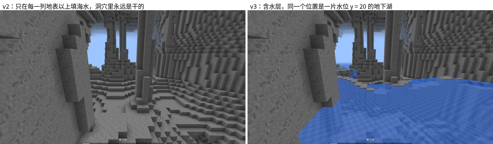
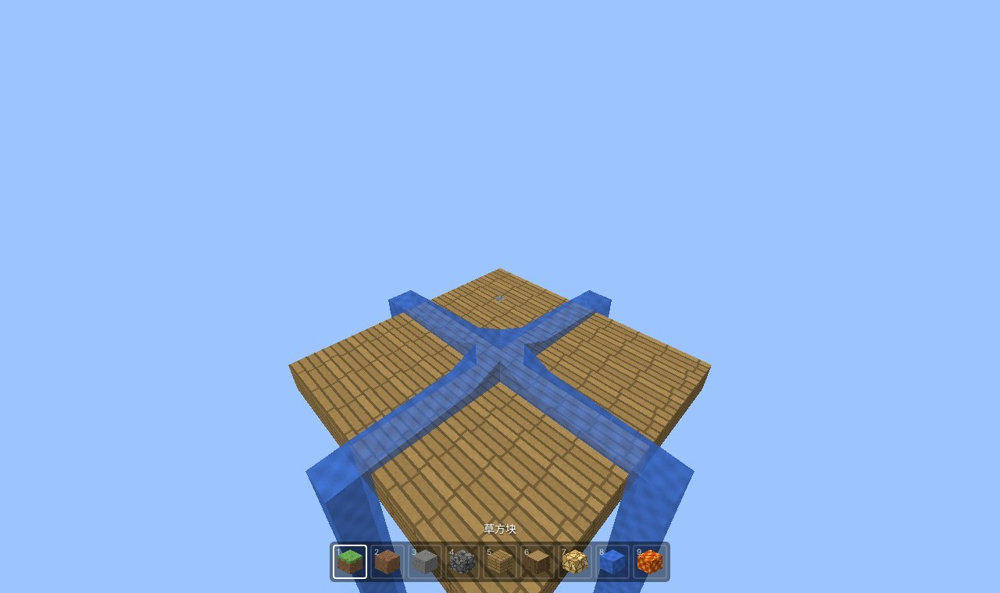
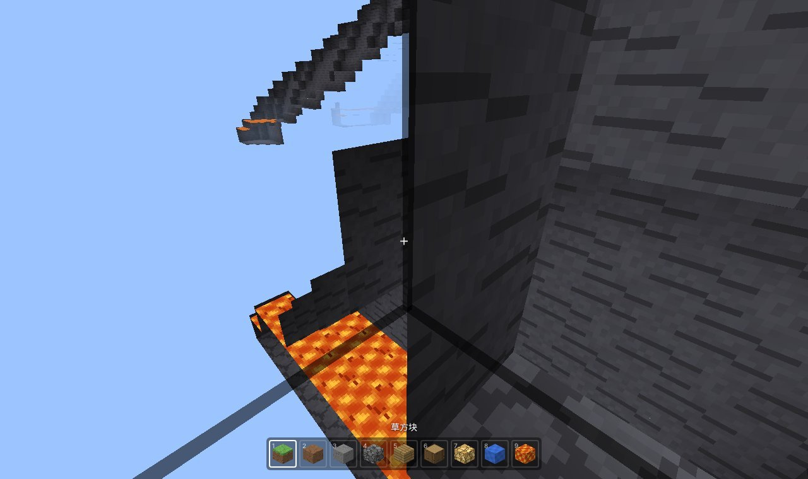

# 用 TypeScript 复刻 Minecraft（v3）：含水层与流体

> 系列目标：用 TypeScript + three.js 在浏览器里逐版复刻 Minecraft Java 版 1.21.1，每一版一个能打开的 demo。
> 本篇讲 v3：地下的水和岩浆按原版的**含水层**（Aquifer）规则生成；水和岩浆会按原版的规则**流动**；流动的水会推着人走。
>
> 代码：mc-replica（tag `v3`） · Demo：（部署后填链接） · 上一篇：[v2：20 TPS 原版物理与手感](v2-原版物理与手感.md)



## 一、v3 做了什么

| | v0 ~ v2 | v3 |
| --- | --- | --- |
| 地下的水 | 只在每一列地表以上、海平面以下填水，洞穴永远是干的 | 原版含水层：地下湖、地下河，每片水有自己的水位；含水层之间有石头隔开 |
| 岩浆 | 没有 | y < -54 的空处是岩浆（原版的深层岩浆湖）；水位很低的含水层有一部分是岩浆 |
| 流体状态 | 只有“水” | 原版的源 / 流动（量 1~7）/ 下落，水和岩浆各 9 种状态 |
| 流动 | 不会动 | 原版的计划刻：水 5 tick 流一格，最远 7 格；岩浆 30 tick，最远 3 格；往最近的坑流；无限水；岩浆遇水变黑曜石 / 圆石 / 石头 |
| 水面 | 平的，统一压低 2/16 | 原版的角高度：每个角由周围四格加权平均，流动的水是斜的 |
| 玩家 | 只有水 | 水流推人；岩浆里的移动（阻力更大）；水下 / 岩浆里的雾 |
| 物品栏 | — | 第 8、9 格是水和岩浆，放下去就是源 |

## 二、含水层

### 为什么需要

密度函数只告诉我们“哪里是石头，哪里是空的”，空的地方放什么，原版交给含水层决定。v0 ~ v2 的临时做法是：每一列找到最高的石头，它上面到海平面之间填水。海和湖是对的，但洞穴全在“最高的石头”下面，所以永远是干的。

原版的做法是把地下切成很多块“含水层”，每块有自己的水位。代码在 `terrain/worldgen/aquifer/Aquifer.ts`，逐行移植自原版的 `Aquifer.NoiseBasedAquifer`。

### 1. 格子和中心点

世界被切成 16×12×16 的格子。每个格子里用位置随机数放一个“中心点”：

```ts
// 原版：aquiferRandom = random.fromHashOf("minecraft:aquifer").forkPositional()
const r = this.random.at(gx, gy, gz)
this.locX[i] = gx * 16 + r.nextInt(10)
this.locY[i] = gy * 12 + r.nextInt(9)
this.locZ[i] = gz * 16 + r.nextInt(10)
```

这里用到的位置随机数（`PositionalRandomFactory.at`）在 v0 已经和 Java 逐位对拍过，所以中心点的位置和原版完全一样。

### 2. 每个中心点的水位

每个中心点有一个 `FluidStatus`：水位 + 流体种类。y 低于水位就是流体，否则是空气。水位这样算（原版 `computeFluid`）：

```text
1. 看自己和周围 12 个区块的“预估地表高度”
   - 中心点比自己这一列的地表还高 → 就是地面上，用全局的（海平面以下是水）
   - 附近有一列地表在水下（海、河），并且中心点离那里不远 → 和那片水连通，水位 = 海平面
2. 否则看 floodedness 噪声：
   - 很大 → 淹没，水位 = 海平面
   - 中等 → 随机水位：每 16×40×16 一个，在格子中间 ±10 格（3 的倍数）
   - 很小 → 干的，水位在世界最底下
3. 水位 ≤ -10 时，再看 lava 噪声：|值| > 0.3 就是岩浆
4. 深暗之域所在的区域（erosion < -0.225 且 depth > 0.9）一律是干的
```

“预估地表高度”是原版 1.21.1 的 `NoiseChunk.preliminarySurfaceLevel`：从世界顶部往下，每 8 格查一次 `initial_density_without_jaggedness`，第一个大于 0.390625 的高度就是。它要查很多次，所以按 4×4 的列缓存。

还有一个全局规则：y < -54 的空处一律是岩浆。原版深层洞穴底部那一片片岩浆湖就是这么来的。

### 3. 一个方块是什么

对每个密度 ≤ 0（本来是空的）的方块：

```text
1. 在周围 2×3×2 个格子里，找离它最近的 4 个中心点
2. 最近的比第二近的近得多（距离平方差 ≥ 25）→ 完全听最近的：y < 水位就是流体
3. 否则它夹在两个含水层之间：算“压力”
```

压力是为了解决一个问题：两个相邻的含水层水位不同，交界处如果什么都没有，高处的水就会悬在空中。原版的办法是在交界处“长”出一道石头墙：

```ts
// 两边水位差越大、这个方块离两个水位的中间越近，压力越大
const mid = 0.5 * (a.fluidLevel + b.fluidLevel)
const e = y + 0.5 - mid
const o = Math.abs(a.fluidLevel - b.fluidLevel) / 2 - Math.abs(e)
let q = e > 0 ? (o > 0 ? o / 1.5 : o / 2.5) : (3 + o > 0 ? (3 + o) / 3 : (3 + o) / 10)
// q 在 ±2 以内时，再加上 barrier 噪声，让墙的形状不规则
return 2.0 * (barrier + q)
```

压力乘上“夹在中间的程度”（相似度）后加到密度上，结果大于 0 的地方就从空气变成石头。一边是水一边是岩浆时，压力固定为 2，一定隔开。

### 4. 和区块生成串起来

```ts
// terrain/worker/surface.ts
noise.forEach((x, y, z, density) => {
  const f = aquifer.computeSubstance(x, y, z, density)   // null = 石头
  padded[...] = f === null ? BlockType.stone : FLUID_BLOCK[f]
  // 含水层边上的流体，原版会在区块加载后马上更新一次，让水流进旁边的洞里
  if (f !== null && f !== Fluid.air && aquifer.shouldScheduleFluidUpdate) fluidUpdates.push(...)
})
```

`shouldScheduleFluidUpdate` 也是原版的：含水层边缘的水，生成后会立刻流一下，所以原版的洞里常常有一道从岩壁里流出来的“瀑布”。主线程收到区块后，把这些位置交给流体系统更新一次。

有一处细节容易漏：判断深暗之域用的 erosion 和 depth，在原版是通过 NoiseChunk 求值的，里面的 `flat_cache` 会把坐标对齐到 4 格（只在这个区块的范围内）。所以单独写了一个 `chunkLocal()`，按“这个区块的 NoiseChunk”的规则求值，不能直接用单点求值。

### 性能

含水层要对每个空的方块找 12 个中心点，第一版用 `Map` 缓存格子，每个区块的生成时间翻了一倍。把格子缓存从 `Map` 换成按格子坐标排好的定长数组（和原版的 `aquiferLocationCache` 一样）后，原版主世界每个区块从约 83 ms 变成约 102 ms，多 20% 左右，结果完全不变。

### 怎么和原版对比

含水层依赖完整的地形管线，没法像 v0 那样单独写 Java 对拍。所以我写了一个探测脚本，列出某个范围内的地下湖：

```bash
npx tsx tools/aquifer-probe.ts 42 0 0 4    # 种子 42，以 (0, 0) 为中心 8×8 个区块
```

```text
| 流体 | 液面 y | 水面面积（格） | 坐标（/tp x y z） |
| 水   | 20     | 437           | 11 20 14         |
| 水   | 20     | 336           | -32 20 40        |
| 水   | 48     | 28            | 32 48 40         |
| 岩浆 | -54    | 7             | -32 -54 -48      |
```

在游戏里用同一个种子创建世界，`/tp` 到这些坐标，看那里是不是同样高度的地下湖，就能逐个核对。

## 三、流体的状态

原版的水和岩浆不是只有一种方块，而是有一个 level 属性：

| 状态 | 量 | 说明 |
| --- | --- | --- |
| 源 | 8 | 放下去的、生成出来的 |
| 流动 | 1 ~ 7 | 离源越远越少；水每流一格少 1，岩浆少 2 |
| 下落 | 8 | 从上面流下来的，竖直的一整柱 |

v7 之前我们还没有“方块状态”，所以每种状态占一个方块 ID：

```ts
// terrain/blocks.ts
water = 7, lava = 15           // 源
16..22 流动的水（量 1..7），23 下落的水
24..30 流动的岩浆，            31 下落的岩浆
```

调色板根本不在乎 ID 有多少：一个 section 里只出现几种，照样是 4 位。

## 四、流动

### 计划刻

原版的流体不是每帧都动，而是由“计划刻”（scheduled tick）驱动：

```text
某个位置的方块变了
  → 它自己和周围 6 格里的流体，都安排在若干 tick 后更新一次（水 5 tick，岩浆 30 tick）
到时间了
  → 这格流体重新算一遍自己应该是什么状态（getNewLiquid）
  → 状态变了就写回去，并且再安排一次更新
  → 往下流、往四周流（spread）。流出去的新流体又会安排自己的更新……
```

一层层扩散，直到稳定。代码在 `terrain/fluid/FluidTicker.ts`，挂在 v2 的 20 TPS 循环上：Control 每个 tick 先算玩家，再调 `terrain.tick()`。

### 一格流体应该是什么（getNewLiquid）

```ts
// 四周同种流体里最大的量
for (const [dx, , dz] of HORIZONTAL) { ...; maxAmount = Math.max(maxAmount, f.amount) }
// 无限水：两个以上的水源相邻，下面是实心方块或水源 → 自己也变成水源
if (p.convertToSource && sources >= 2 && (下面实心 || 下面是水源)) return 水源
// 上面有同种流体 → 下落的流体
if (上面是同种流体) return 下落
// 否则：最大的量减掉每格的损耗（水 1，岩浆 2），减到 0 就消失
return maxAmount - dropOff <= 0 ? 空 : 流动(maxAmount - dropOff)
```

拿走水源后，流动的水会消失，靠的就是这个：旁边没有源了，量一圈圈减下去，最后变成 0。

### 往哪流（spread）

```text
1. 能往下流就往下流
2. 下面流不了（是实心方块）→ 往四周流，但只往“最近的坑”的方向流：
   对每个方向，往前找几格（水 4 格，岩浆 2 格），看最近的“下面是空的”位置有多远，
   只保留最近的那几个方向。附近没有坑时四个方向都流
```

第 2 条就是为什么原版的水会“找路”：在一个 9×9 的平台中间放一格水，它不会铺满整个平台，而是沿着四个方向直奔最近的边缘，形成一个十字，再从边上落下去：



### 岩浆和水

原版 `LiquidBlock.shouldSpreadLiquid` 和 `LavaFluid.spreadTo`：

| 情况 | 结果 |
| --- | --- |
| 岩浆源的上面或四周有水 | 岩浆源 → 黑曜石 |
| 流动的岩浆的上面或四周有水 | → 圆石 |
| 岩浆从上面流进水里 | 那格水 → 石头 |

岩浆在主世界不会形成无限源，也就是 `convertToSource` 为 false。

## 五、画流体

### 水面的角高度

v2 的水面是平的，统一压低 2/16。原版的规则（`LiquidBlockRenderer`）是：

```text
一格的液面高度：上面也是同种流体 → 1；否则 = 量 / 9（源 8/9）
一个角的高度 = 这一格、两个相邻格、对角格的加权平均：
  高度 ≥ 0.8 的格子权重是 10，其他权重 1，空格算 0，实心方块不参与
  相邻格上面有流体时，这个角直接是 1
```

所以挨着源的角几乎和源一样高，往外越来越低，流动的水是一个斜坡。代码是 `mesh/mesher.ts` 的 `fluidHeights()`，邻居都在 v1 的 18³ 邻域里，不需要额外的数据。

### 和贪婪网格配合

流体面的“样子”里带上角高度。只有**完全水平**的面才合并：顶面要 4 个角一样高，侧面要上边两个角一样高。湖面、海面是平的，照样合并成大矩形；斜的流动水保持一格一个面。

角高度不是整数格，原来的顶点坐标是“格 × 16”存成 Uint16，精度只有 1/16 格。改成“格 × 256”：一个 section 最大 16 × 256 = 4096，还在 Uint16 的范围里，精度 1/256 格，看不出差别。

### 岩浆不透明

水画在半透明的 water 网格里（最后画、不写深度）。岩浆在原版是不透明的，所以直接放进 opaque 网格，和方块一起画，不用额外的绘制调用。

## 六、玩家和流体

v2 的移动代码里，“在不在水里”只看方块是不是水。v3 换成原版的 `updateFluidHeightAndDoFluidPushing`，水和岩浆各算一遍：

```ts
for (每个和身体碰撞箱相交的流体方块) {
  const top = y + 液面高度        // 流动的水比源矮
  depth = Math.max(depth, top - 脚底)
  flow += 水流方向 × (depth < 0.4 ? depth : 1)
}
velocity += 平均水流方向 × 0.014     // 岩浆 0.0023
```

水流方向（原版 `getFlow`）看四周的液面比自己高还是低，从高往低；瀑布贴着墙时再加一个很大的向下分量。所以站在流动的水里会被慢慢冲走，在瀑布里会被往下压。

岩浆里的移动是另一套（原版 `travel` 的岩浆分支）：水平和竖直速度每 tick ×0.5，重力是 1/4。

眼睛在水下时雾变成深蓝色、能看几十格；在岩浆里是橙红色，几乎什么都看不见（`Core.setMedium`）。

## 七、一个坑：区块边界上多出来的面

截图时发现地下湖的湖面上有一道竖着的水墙：

```text
原因：
  1. 区块 A 加载后，含水层边上的水开始流动，A 的 section 在主线程上重建
  2. 重建时旁边的区块 B 还没加载，B 那一侧的邻居被当成空气
  3. 于是 A 在边界上画了一层水的侧面
  4. B 加载后，A 的这个 section 没有重建，那层面就一直留着
```

v1 的挖 / 放方块也有同样的问题，只是很少碰到。现在流体一加载就更新，几乎每个区块都会触发。解决办法：重建时如果有邻居区块没加载，就把这个 section 记进 `staleSections`；邻居加载后，把这些 section 再重建一次。

## 八、怎么验证

**流体**（`tests/fluid.test.ts`，在一个用 Map 存方块的小世界里跑计划刻）：

- 水源在平地上流 7 格，量依次减 1；拿走水源后流动的水全部消失
- 水从柱顶流下来，旁边是一整柱“下落的水”，落地后量从 7 重新开始减
- 只往最近的坑流
- 两个水源中间的空格变成水源；岩浆不会
- 岩浆只流 3 格（量 6、4、2）
- 岩浆源遇水变黑曜石，流动的岩浆遇水变圆石
- 流体表面的角高度：往远离源的方向越来越低；上面有水时 4 个角都是 1

**含水层**（有原版数据时）：生成几个区块，洞穴里有水，但大部分是空气；y < -54 的空处一定是岩浆。

**游戏里**：F3 多了一行“流体：N 个待更新”。物品栏第 8、9 格是水和岩浆，可以自己放着玩。



## 九、还没做的和下一版

- 原版的洞穴是黑的，这里还看得见。要等 v6 做光照。岩浆也还不会发光。
- 水的纹理没有按流动方向转，原版流动的水有单独的纹理和方向。
- 含水层还没有和游戏本体逐个核对。上面的探测脚本给出了坐标，欢迎拿原版对一下。
- 矿脉（ore vein，router 里的 vein_toggle / vein_ridged / vein_gap）和含水层是同一套机制里的另一半，留到 v5 和其他矿石一起做。

下一版 v4 做**生物群系与地表规则**：用原版的多噪声参数查出每个位置的生物群系，按原版的 surface_rule 决定草、沙、雪、红沙……替换掉 v0 以来一直用的临时地表规则。
