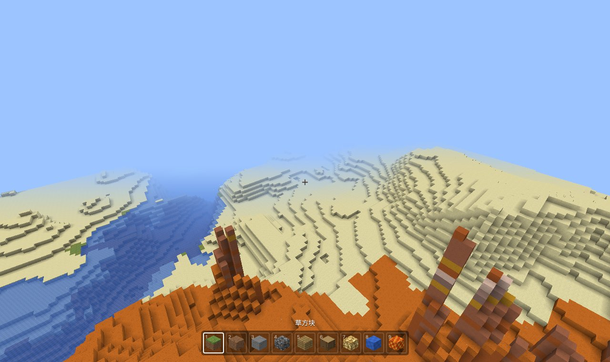
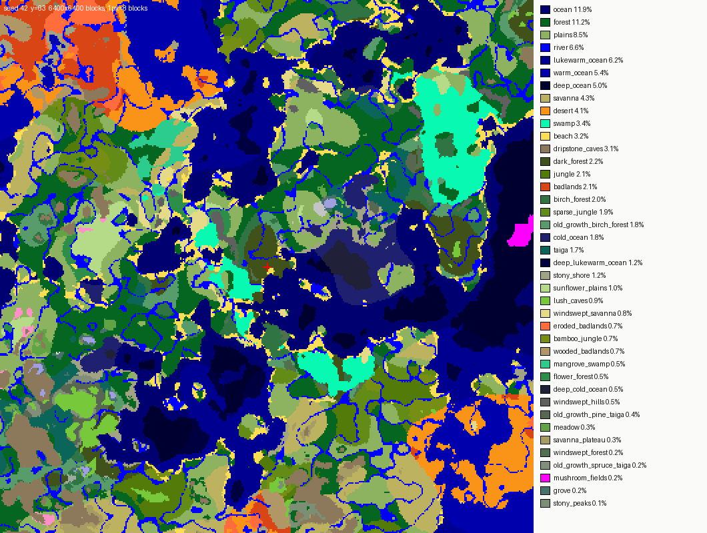
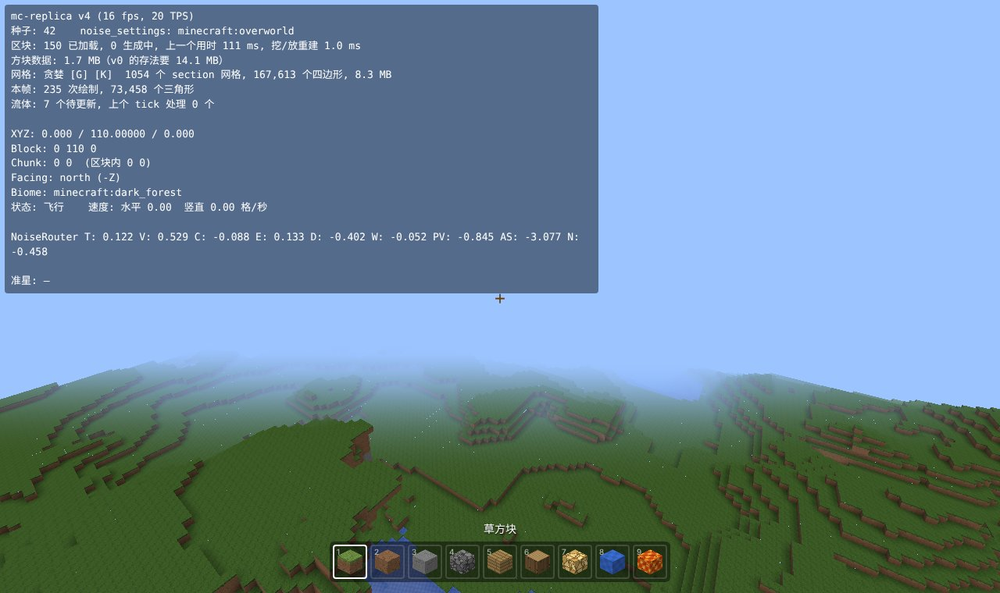
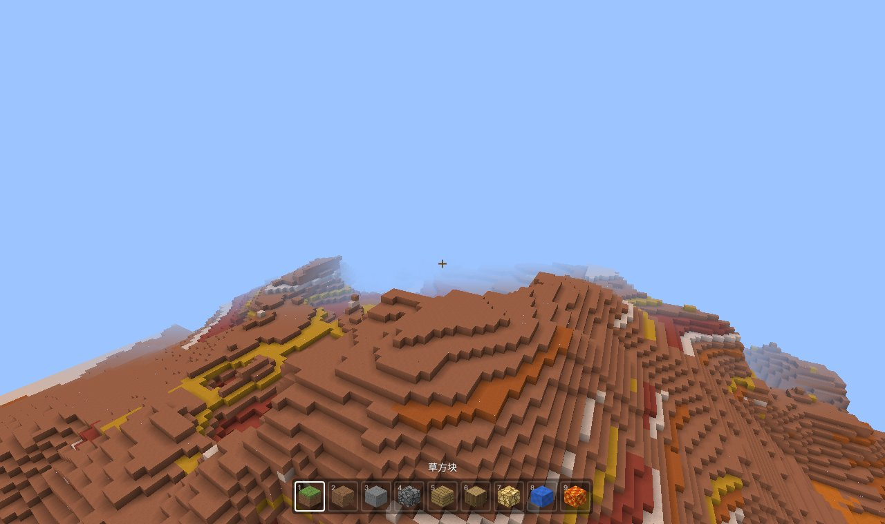
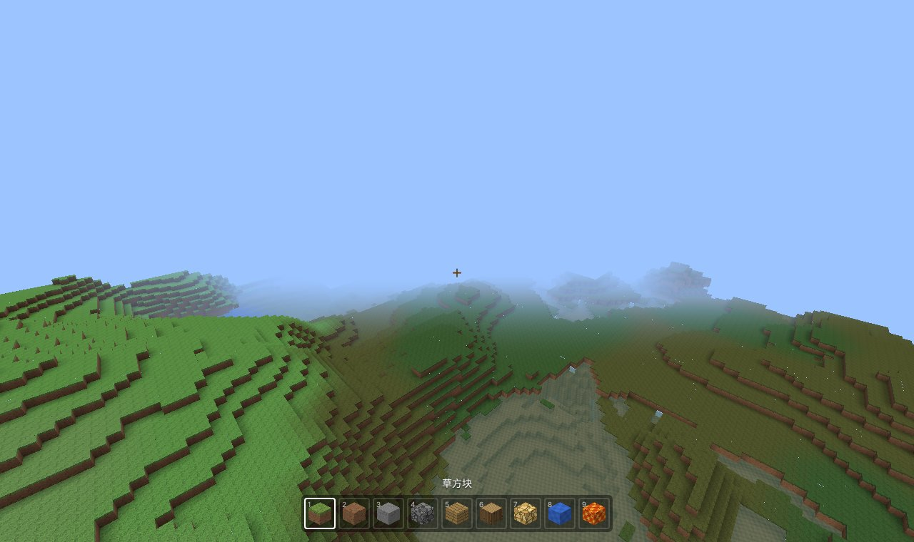
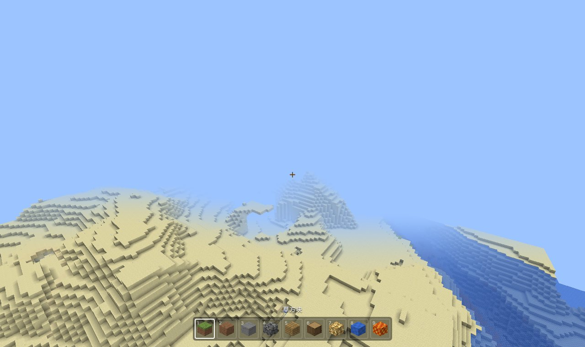

# 用 TypeScript 复刻 Minecraft（v4）：生物群系与地表规则

> 系列目标：用 TypeScript + three.js 在浏览器里逐版复刻 Minecraft Java 版 1.21.1，每一版一个能打开的 demo。
> 本篇讲 v4：每个位置按原版的规则选出**生物群系**；地表按原版的 **surface_rule** 铺草、沙、陶瓦、雪；草、树叶和水按生物群系**染色**。
>
> 代码：mc-replica（tag `v4`） · Demo：（部署后填链接） · 上一篇：[v3：含水层与流体](v3-含水层与流体.md)



## 一、v4 做了什么

| | v0 ~ v3 | v4 |
| --- | --- | --- |
| 生物群系 | 没有 | 原版的气候参数表（主世界 7593 项）+ BiomeManager 的抖动缩放，F3 显示 `Biome:` |
| 地表 | 临时规则：水下沙 / 沙砾，海边沙滩，其他草 + 3 层土 | 原版 noise_settings 里的 `surface_rule`：草、土、沙、砂岩、红沙、陶瓦条纹、雪、冰、灰化土、菌丝、泥巴…… |
| 硬编码的地形 | 没有 | 侵蚀恶地的石柱、冰冻海洋的冰山、恶地的陶瓦条纹 |
| 颜色 | 草、树叶、水都是一个固定颜色 | 按生物群系染色，每列取周围 5×5 列的平均，边界平滑过渡 |
| 新方块 | — | 19 种（砂岩、红沙、雪块、冰、陶瓦 7 色……），纹理仍是代码画的 |

用到的原版数据：`worldgen/noise_settings`（里面有 surface_rule）、`worldgen/biome`（温度、湿度、颜色）。没有 `biome/` 时群系照样能查出来，地表规则也照常，只是所有群系都按平原的温度和颜色算。



## 二、生物群系是怎么选出来的

### 1. 六个气候值

v0 做好的 noise router 里有 15 个字段，其中 6 个就是给生物群系用的：

| router 字段 | 气候参数 | 意思 |
| --- | --- | --- |
| `temperature` | 温度 | 冷 → 热 |
| `vegetation` | 湿度 | 干 → 湿 |
| `continents` | 大陆性 | 深海 → 海 → 海岸 → 内陆 |
| `erosion` | 侵蚀 | 高山 → 平地 |
| `depth` | 深度 | 地表 0，往下变大（这就是洞穴群系能出现在地下的原因） |
| `ridges` | 怪异度 | 决定“峰”和“谷”，也用来挑变种群系 |

生物群系每 4×4×4 格（一个 quart）算一次，在 quart 的角上求这 6 个值，转成 float 后乘 10000 取整（原版 `Climate.quantizeCoord`），得到 6 个整数：

```ts
export function quantize(f: number): number {
  return Math.trunc(Math.fround(Math.fround(f) * 10000))
}
```

### 2. 一张 7593 行的表

每个生物群系占表里的若干行，每行是 6 个区间 + 一个偏移量：

```text
温度 [-1.0, -0.45]  湿度 [-1.0, -0.35]  大陆性 [-0.11, 0.03]  侵蚀 [-0.375, 0.05]  深度 0  怪异度 [-1.0, -0.93]  → snowy_plains
```

查表就是找“最近的一行”：每一维算点到区间的距离（在区间里是 0），平方加起来，再加上偏移量的平方（原版 `fitness`）。距离最小的那行就是这个位置的群系。

这张表不在数据包里，是原版 `OverworldBiomeBuilder` 用代码拼出来的：5 张 5×5 的小表（行是温度、列是湿度）+ 按“大陆性 / 侵蚀 / 怪异度”切成很多片，每一片决定用哪张小表。我照着原版逐个函数抄了一遍（`biome/OverworldBiomeBuilder.ts`），**顺序也要和原版一样**：两行距离完全相同时取靠前的那行，顺序不对，结果就不对。

```ts
const MIDDLE_BIOMES = grid([
  ['snowy_plains', 'snowy_plains', 'snowy_plains', 'snowy_taiga', 'taiga'],
  ['plains', 'plains', 'forest', 'taiga', 'old_growth_spruce_taiga'],
  ['flower_forest', 'plains', 'forest', 'birch_forest', 'dark_forest'],
  ['savanna', 'savanna', 'forest', 'jungle', 'jungle'],
  ['desert', 'desert', 'desert', 'desert', 'desert']
])
```

原版查表用 R 树，还会从上一次的结果开始找。我按原版的另一个实现 `findValueBruteForce` 线性找，先用温度、湿度两维算一个下界，已经比当前最好的大就跳过。一次没有缓存的查找（6 个 router 字段 + 查表）大约 140 µs，查过的 quart 会缓存。

### 3. BiomeManager：让边界不是 4 格的锯齿

如果每个方块直接取所在 quart 的群系，群系边界会是整整齐齐的 4 格台阶。原版的 `BiomeManager.getBiome` 给每个 quart 角点一个随机“抖动”，然后找离方块最近的角点：

```ts
getBiome(x, y, z) {
  // 方块坐标往回挪 2 格，找到周围 8 个 quart 角点
  const l = (x - 2) >> 2, m = (y - 2) >> 2, n = (z - 2) >> 2
  // 每个角点：按种子和角点坐标算 LCG，抖动 ±0.45 格以内，求到方块的距离
  // 取距离最小的角点的群系
}
```

抖动用的种子不是世界种子本身，而是世界种子的 SHA-256 的前 8 个字节（`obfuscateSeed`），所以要写一个 SHA-256。种子 42 算出来是 `-4111196313959201555`，和 Java 一致。

每个方块要查 8 个角点，每个角点要做 3 次 64 位的 LCG 乘法。第一版用 bigint 写，profile 里占了 15%。改成两个 32 位数模拟 64 位乘法（16 位一段拆开算），和 bigint 版本对拍 2 万组随机数全部一致，每个区块的生成时间从 147 ms 降到 121 ms。



## 三、地表规则

### 1. 它在做什么

密度函数只决定“哪里是石头”。v0 ~ v3 的地表是一段手写的临时代码；原版把这件事写成数据：noise_settings 里的 `surface_rule`，一棵由 4 种规则和 11 种条件组成的树。主世界的这棵树有 2000 多行 JSON，大意是：

```text
sequence:
  ├ 最底下 5 格：越往下越可能是基岩（vertical_gradient）
  ├ 如果是地表（above_preliminary_surface）:
  │   ├ 恶地：高处陶瓦条纹，低处红沙，水边红砂岩……
  │   ├ 地面第一格（stone_depth floor, offset 0）:
  │   │   ├ 冰冻山峰：浮冰 / 冰 / 雪块
  │   │   ├ 沙漠、海滩：沙（下面是砂岩）
  │   │   ├ 水下：沙砾 / 沙 / 泥巴（红树林沼泽）
  │   │   └ 其他：草方块
  │   └ 往下几格（add_surface_depth）：土
  └ y < 8 时越往下越可能是深板岩
```

`SurfaceRules.ts` 把 JSON 解析成一个函数 `(ctx) => 方块名 | null`：

```ts
case 'minecraft:condition': {
  const cond = parseCondition(o.if_true, deps)
  const then = parseRule(o.then_run, deps)
  return (ctx) => (cond(ctx) ? then(ctx) : null)
}
case 'minecraft:sequence':   // 依次试，第一个不是 null 的就是结果
```

### 2. ctx 里有什么：从上往下走一列

条件要看的东西都在 ctx 里，由 `SurfaceSystem.buildSurface` 逐列从上往下走时填好（原版同名方法）：

```text
for y 从这一列最高的方块往下:
  空气 → stoneDepthAbove = 0，水面清空            （洞穴的地面会重新从 1 数起）
  流体 → 记下 waterHeight = 第一格水的 y + 1
  石头 → stoneDepthAbove++
         stoneDepthBelow = 这段石头还有多厚         （洞顶用）
         如果是默认方块（石头），问规则换成什么
```

所以规则可以写出“地面第一格是草、往下 3 格是土”（`stone_depth`）、“水面以下 6 格以内是沙”（`water`）、“洞顶一格是砂岩”（`stone_depth ceiling`）这样的逻辑。

几个值是按需算的：

| 值 | 怎么算 |
| --- | --- |
| `surfaceDepth` | `surface` 噪声 × 2.75 + 3 + 位置随机 × 0.25，取整，约 2~6 格 |
| `minSurfaceLevel` | v3 写好的“预估地表高度”，在 16×16 格子的四个角取值、双线性插值，再 + surfaceDepth − 8 |
| `steep` | 这一列和南北 / 东西邻居的高度差 ≥ 4（山的北坡、东坡是石头的原因） |
| `biome` | 当前方块的群系（上一节的 getBiome） |
| `coldEnoughToSnow` | 当前位置温度 < 0.15 |

### 3. 原版硬编码的三件事

有三样东西不在 JSON 里，写死在 `SurfaceSystem` 里：

- **陶瓦条纹**（`generateBands`）：用种子生成一个 192 格长的颜色序列，`bandlands` 规则按 y 取色，再用 `clay_bands_offset` 噪声上下错开一点。和 Java 对拍过，序列逐格一致。
- **侵蚀恶地的石柱**：两个噪声决定柱子高度，在地表规则之前把空气填成石头，然后石柱和地面一起被刷上陶瓦条纹。
- **冰冻海洋的冰山**：类似，在海面上下堆浮冰和雪块。

石柱这里踩了一个坑：第一次截图，柱子是光秃秃的石头。原因是地表规则从“这一列最高的方块”开始往下走，最高的方块来自高度图。原版的 `ProtoChunk.setBlockState` 放方块时会顺手更新高度图，所以规则从柱顶开始走；我的高度图是提前算好的，石柱放下去以后没更新，规则从原来的地面开始走，整根柱子被跳过。在 `column.set` 里更新高度图后就对了（见开头的图）。



## 四、群系的温度

群系 JSON（`worldgen/biome/plains.json` 等）里有温度和湿度。温度不是一个常数：

```ts
// 原版 Biome.getHeightAdjustedTemperature
if (y > 80) {
  const f = TEMPERATURE_NOISE.getValue(x / 8, z / 8) * 8    // 一点噪声（种子 1234）
  temperature -= ((f + y) - 80) * 0.05 / 40                 // 每高 40 格冷 0.05
}
```

所以高山上会下雪，平原不会（要到 y ≈ 600 才冷到 0.15 以下）。冰冻海洋还有一个 `frozen` 修饰器，用另外两个噪声让温度忽高忽低，海面上的冰是一块一块的。

这里的噪声是 `PerlinSimplexNoise`，种子在原版里写死（1234、3456、2345），和世界种子无关，也和 Java 对拍过。

## 五、生物群系颜色

### 1. 颜色从哪来

草和树叶的颜色由温度 t 和湿度 d 决定。原版查一张 256×256 的颜色图（`colormap/grass.png`），横坐标 1 − t，纵坐标 1 − d·t。群系 JSON 里可以直接指定颜色（恶地、沼泽、樱花林），还有两个修饰器：

- 沼泽：按噪声在两种暗绿色之间交替
- 黑森林：`((颜色 & 0xFEFEFE) + 0x28340A) >> 1`，偏暗

颜色图是 Mojang 的资源，不能放进仓库。第一版我用三角形三个角插值，森林、针叶林的草色差了 14~16 个色阶。后来换成一个二次多项式：

```text
通道 = a0 + a1·t + a2·u + a3·t² + a4·u² + a5·t·u      （u = d·t）
```

用 13 个已知群系颜色（平原、森林、丛林、针叶林、雪原、沙漠、草甸……）最小二乘拟合系数，这 13 个群系草色误差 ≤ 1、树叶 ≤ 2 个色阶。6 个参数拟合 13 个点还能这么准，说明原版的颜色图本来就很接近一个二次曲面。

### 2. 怎么画到屏幕上

最直接的做法是把颜色写进顶点。但这样每个顶点多 3 个字节，而且贪婪网格会把颜色不同的面拆开，合并效果变差。

我的做法：

1. 草、树叶、水的纹理改成灰度，要染色的像素 alpha = 0 作标记（草方块侧面只有上面那条草边要染）。
2. Worker 生成区块时，每一列算一个颜色：周围 5×5 列的群系颜色取平均（原版默认的“生物群系过渡”半径 2），随区块一起传回主线程。
3. 主线程把颜色写进三张 512×512 的颜色图（草、树叶、水），每个像素是一列，按世界坐标取模。
4. 着色器按片元的世界 x, z 取颜色图，乘到灰度纹理上：

```glsl
if (vTint > 0.5 && c.a < 0.999) {
  ivec2 col = ivec2(mod(floor(vColumn), 512.0));
  vec3 tint = texelFetch(grassMap, col, 0).rgb;   // 或 foliageMap / waterMap
  c.rgb = mix(c.rgb, c.rgb * tint, 1.0 - c.a);
}
```

网格不用为颜色重建，贪婪合并也不受影响。



## 六、怎么验证

**和 Java 对拍**（`tools/parity/Parity.java` → `tests/parity.test.ts`，新增 4 组）：

- `obfuscateSeed`：8 个种子的 SHA-256 结果
- `BiomeManager.getBiome`：8 个方块位置（包括 ±3000 万的边界）选中的 quart 坐标
- `PerlinSimplexNoise`：原版写死种子的 3 个噪声
- 量化：14 个浮点数
- 陶瓦条纹：8 个种子的 192 格序列

**单元测试**（`tests/biome.test.ts`）：

- 参数表：主世界 7593 项、下界 5 项
- 查表：最近的一项、偏移量、平局取靠前的
- 温度：高处变冷，平原不会下雪，山峰会
- 草色：5 个已知群系的颜色、黑森林修饰器、直接指定的颜色
- 地表条件：stone_depth（地面 / 洞顶）、water、y_above、vertical_gradient 的每个分支
- 用原版数据生成 4 个区块：有草、土、石头、深板岩、基岩

**最准的核对**：原版服务端能导出参数表（`--reports`，命令见 `datapacks/README.md`）。把它放进 `datapacks/reports/biome_parameters/`，测试会逐项比较。用 1.21.4 的服务端导出后，主世界 7593 项、下界 5 项全部一致；不加苍白之园时正好差 20 项，也就是说 1.21.1 和 1.21.4 的表只差这 20 项。

**游戏里**：同一个种子，F3 的 Biome 一行应该和原版完全一样，群系边界上的格子也一样。



## 七、还没做的和下一版

- 树、花、草丛、积雪层和冰面在原版里是“地物”（feature），不在地表规则里，所以现在的雪原只有雪块，没有那一层薄雪，河面也不结冰。
- 草和树叶的颜色是拟合的，拟合以外的群系可能差几个色阶。
- 版本：苍白之园是 1.21.4 加入的。数据包里有它时按 1.21.4 的表放进参数表，否则按 1.21.1。

下一版 v5 做**地物**：树、花草、矿石、积雪和冰，用原版的 `configured_feature` / `placed_feature`。
