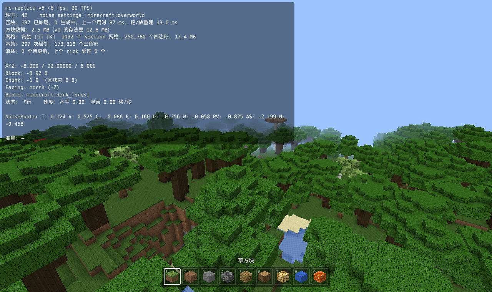
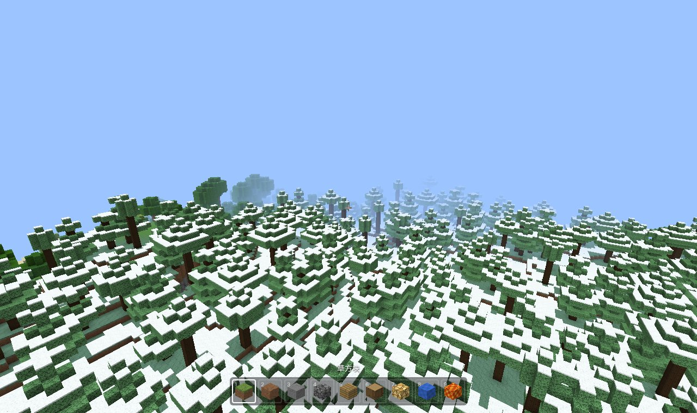
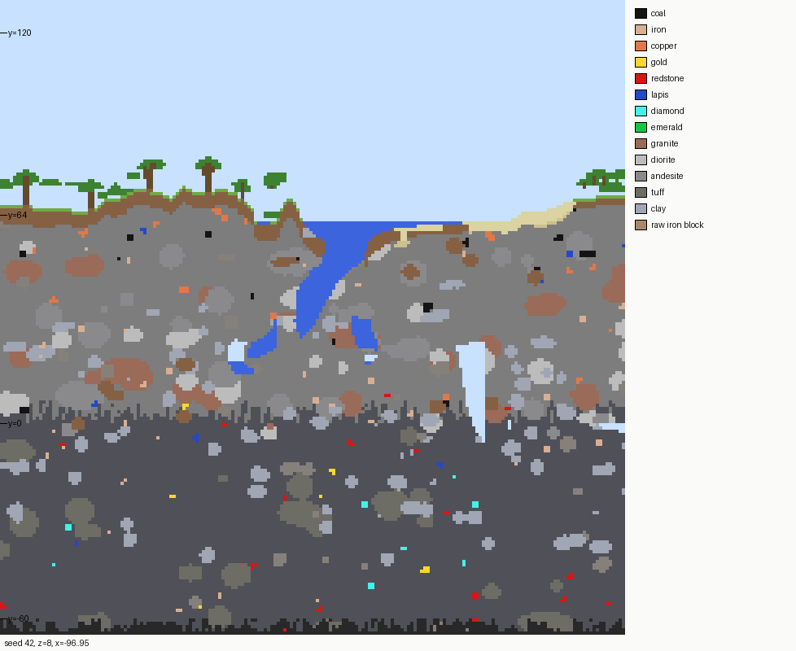
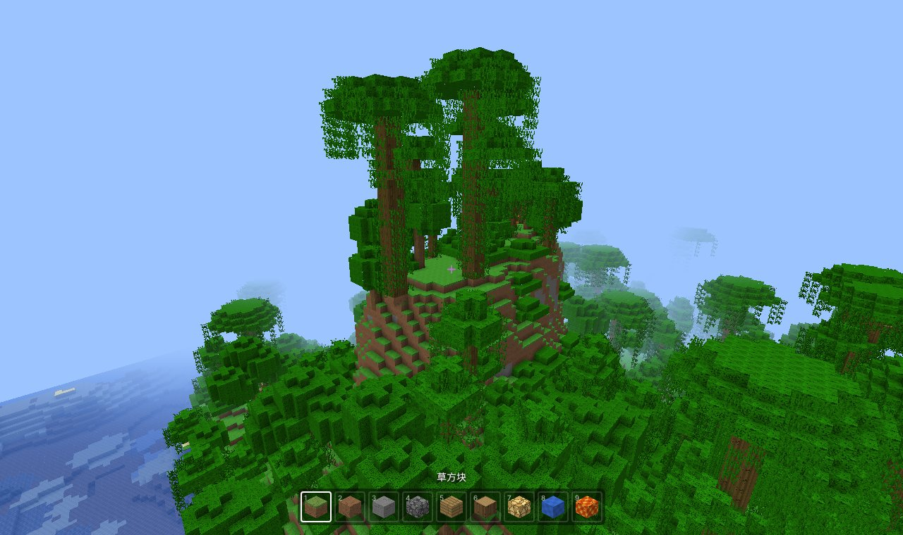
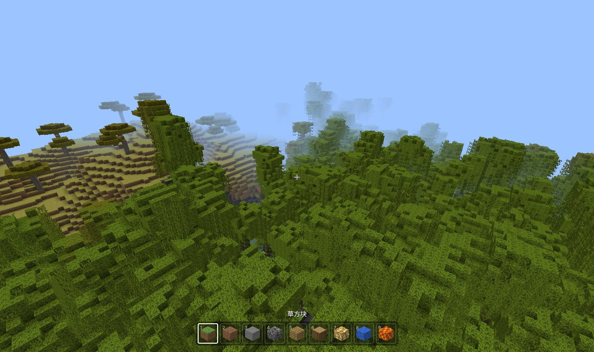
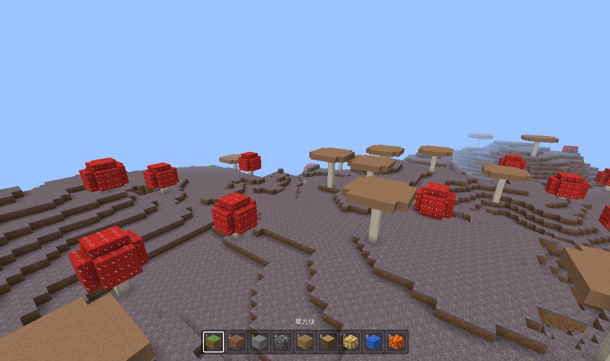

# 用 TypeScript 复刻 Minecraft（v5）：地物——矿石、树和积雪

> 系列目标：用 TypeScript + three.js 在浏览器里逐版复刻 Minecraft Java 版，每一版一个能打开的 demo。从这一版起目标版本改成 **1.21.4**（世界生成数据和 1.21.1 相同，群系表只多了苍白之园）。
> 本篇讲 v5：原版的**地物**（feature）系统，以及里面的矿石、36 种树、巨型蘑菇、积雪和冰；还有一个副产品：一套**和原版服务端逐格对照**的工具。
>
> 代码：mc-replica（tag `v5`） · Demo：（部署后填链接） · 上一篇：[v4：生物群系与地表规则](v4-生物群系与地表规则.md)



## 一、v5 做了什么

| | v4 | v5 |
| --- | --- | --- |
| 地下 | 只有石头、深板岩、含水层 | 矿脉（铜 / 铁）、16 种矿石、花岗岩 / 闪长岩 / 安山岩 / 凝灰岩团、土 / 沙砾团、水下的沙 / 黏土圆盘 |
| 地面 | 光秃秃的草地 | 36 种树（9 种树干放置器、11 种树叶放置器组合出来的）、巨型蘑菇；蜂巢、藤蔓、可可果、红树根、胎生苗等装饰 |
| 寒冷的地方 | 雪块只来自地表规则 | 冷的群系地面和树顶有一层雪，水面结冰 |
| 方块 | 51 种 | 109 种，新方块的纹理仍是代码画的；雪层 / 地毯是扁的，藤蔓等是十字形镂空 |
| 核对 | 和 Java 参照实现对拍 | 另外**直接和原版 1.21.4 服务端生成的存档逐格比较** |



## 二、先有对照，再写代码

v0 ~ v4 的“对拍”是我用 Java 把原版算法重写一遍，再和 TS 版本逐位比较。这能抓住移植错误，但抓不住“我理解错了原版”的错误——两边是同一个人写的。

v4 结束时你下载了原版 1.21.4 的 server.jar（用来导出群系参数表）。它能做的远不止导出报告：

1. 写一个 `server.properties`：种子 42、关掉在线验证、关掉结构；
2. 无界面启动服务端，用 `forceload add` 让它生成几块区域，`save-all` 存盘；
3. 用 TS 写一个读存档的工具（`tools/vanilla/anvil.ts`：区域文件 `.mca` → 解压 → NBT → 每个 section 的调色板和位压缩数组）；
4. 拿我们生成的区块和存档里的区块**逐格比较**（`tools/vanilla/diff.ts`）。

第一个结果就很有意思。用数据包把所有地物和雕刻器（carver）关掉之后，比较“纯地形 + 地表”：

| 区域（每块 16 个区块） | 一致 |
| --- | --- |
| 出生点 | 99.996%（58 格不同，都是流动中的水） |
| 侵蚀恶地、沼泽、沙漠 | 100%、100%、100% |

也就是说 v0 ~ v4 的地形、含水层、群系、地表规则已经和原版**逐格一致**了。唯一的系统差别是“凝灰岩、铁矿”这一类——那是矿脉，下一节就做。

## 三、矿脉：不是地物

矿脉（`OreVeinifier`）是 1.18 加的，在噪声阶段就决定了：密度 > 0、本来要放石头的格子，先问含水层，再问矿脉，都说“不管”才是石头。

```ts
const d = veinToggle.compute(ctx)          // > 0 铜矿脉（y 0..50），否则铁矿脉（y -60..-8）
if (|d| + 边缘收缩 < 0.4) return null      // 不在矿脉里
if (随机 > 0.7) return null                // 30% 的格子直接跳过
if (veinRidged.compute(ctx) >= 0) return null
return 随机 < 概率(|d|) && veinGap > -0.3 ? (2% 粗矿块 : 矿石) : 填充石（花岗岩 / 凝灰岩）
```

三个噪声 `vein_toggle / vein_ridged / vein_gap` 早在 v0 的 noise router 里了，只是没人用。要注意它们要和 `final_density` 走**同一个 NoiseChunk**（同样的插值和缓存），所以给 NoiseChunk 加了一个 `wrap()`。加完再比较，铁矿脉、铜矿脉、凝灰岩、粗铁块的位置和原版完全一致。

## 四、地物系统

### 1. 一个地物 = 放置规则 + 地物本身

原版的数据包里有两种文件：

- `configured_feature`：地物本身和参数，比如“一团 17 个煤矿石，可以替换石头或深板岩”；
- `placed_feature`：引用一个地物，加一串**放置修饰器**，比如：

```json
{ "feature": "minecraft:ore_coal",
  "placement": [ {"type": "count", "count": 30}, {"type": "in_square"},
                 {"type": "height_range", "height": {"type": "uniform", "min_inclusive": {"absolute": 136}, "max_inclusive": {"below_top": 0}}},
                 {"type": "biome"} ] }
```

意思是：重复 30 次 → 每次在区块里随机挑一列 → 随机挑一个高度 → 这个位置的群系有这个地物才放。

原版用 Java Stream 把修饰器串起来。Stream 是**惰性、深度优先**的：第 1 个位置先走完所有修饰器、把矿石放下去，才轮到第 2 个位置。随机数的消耗顺序因此是交错的。我一开始按“先算完所有位置再放”写，位置全对、矿石形状全错——因为放矿石本身也要用随机数。改成递归：

```ts
place(i, x, y, z) {
  if (i === modifiers.length) return feature(level, random, x, y, z)
  for (const p of modifiers[i](random, x, y, z)) place(i + 1, ...p)
}
```

### 2. 随机种子

每个区块一个“装饰种子”，每个地物一个“地物种子”：

```ts
decorationSeed = f(世界种子, 区块最小角的 x, z)          // 原版 setDecorationSeed
featureSeed    = decorationSeed + 地物序号 + 10000 × 步骤  // 原版 setFeatureSeed
```

这里的随机源叫 `WorldgenRandom`：它**继承旧的 LegacyRandomSource 的算法**（`nextInt` 用 `next(31)` 取模那一套），但每次的随机位来自 Xoroshiro：`next(bits) = xoroshiro.nextLong() >>> (64 - bits)`。所以同一个种子，它的 `nextInt(16)` 和 Xoroshiro 自己的 `nextInt(16)` 不一样，不能混用。

### 3. 地物序号：一次拓扑排序

“地物序号”不是 JSON 里的顺序。原版把所有可能出现的群系的地物列表合成一张有向图：同一个群系里 A 在 B 前面就连一条边，然后做深度优先的拓扑排序（`FeatureSorter`），得到每个步骤里所有地物的全局顺序。序号错一个，后面所有地物的种子都错。

原版只跑“这个区块和周围 8 个区块里出现过的群系”的地物。我检查了一下：1.21.4 里所有被群系引用的 194 个地物**都**带 `biome` 过滤，群系不对的位置本来就放不下。所以这里每个步骤直接把所有地物跑一遍，结果完全一样，还省掉了“统计 3×3 区块里有哪些群系”这一步。

### 4. 3×3 区块和“谁先放”

地物可以写到周围 8 个区块里（树冠、矿石团都会跨过区块边界），所以一个区块的最终方块 = 自己的原型 + 自己和周围 8 个区块放的地物。

原版按生成顺序依次装饰：后装饰的区块能看到先装饰的邻居放下的树。顺序取决于玩家怎么走——**原版自己在不同的生成顺序下，区块边上的树就是不一样的**。这里有两个选择：

| 做法 | 雪原针叶林 4 个区块的树方块和原版一致 |
| --- | --- |
| 每个区块只看原型（和顺序无关） | 45% |
| 共享一个世界，按“先 z 后 x”依次装饰 | 92.5% |

差别这么大，是因为密林里一棵树被邻居的树挡住没长出来，少用的那几个随机数会让同一区块后面的树全部错位。

但“共享世界”在浏览器里不好用：结果取决于哪个区块先生成，多个 Worker 各算各的就拼不上。最后的折中是**装饰区域**：每 4×4 个区块一个区域，区域里按“先 z 后 x”依次装饰，后面的能看到前面的；不同区域之间只看原型。这样任何一个区块的结果只取决于它所在的区域，和加载顺序无关；同一个区域的区块固定交给同一个 Worker，缓存能复用。雪原针叶林那 4 个区块变成了 90.6%。

### 5. 跳过没实现的

v5 实现的地物类型：`ore`、`disk`、`tree`、`huge_red_mushroom`、`huge_brown_mushroom`、`freeze_top_layer` 和三种“随机选一个”的选择器。其余类型（花草、湖、钟乳石、晶洞……）现在什么都不放。每个地物有自己的种子，跳过一个不影响别的。没实现的地物直接整个跳过，连放置修饰器也不跑——钟乳石的修饰器要在地下查几百次群系，跳过之后每个区块的装饰从 404 ms 降到 71 ms。

## 五、矿石

`OreFeature` 的形状是这样来的：在起点附近随机一个方向，拉一条长度和矿团大小相关的线段，沿线段放 `size` 个球，球的半径随机，中间大两头小（`sin(π·t)`），被别的球包住的球删掉，最后把球里能替换的方块换成矿石。



几个容易错的地方：

- 起点方向用 `Math.sin`，球的半径用原版自己的**查表** `Mth.sin`（65536 项的 float 表，`(int)(x * 10430.378F) & 65535`）。我原来以为新版本改成了 double 参数，看了 1.21.4 的字节码才知道还是 float；
- 一堆 `float` 运算：`(float)size / 8.0F`、`random.nextFloat() * (float)Math.PI`，全部用 `Math.fround`；
- 写矿石时直接改 section，**不更新高度图**；
- `discard_chance_on_air_exposure`：挨着空气的位置有一定概率不放（钻石是 0.5～1，所以洞壁上很少看到钻石）。

和原版只留矿石的存档比较：36 个区块里 16 个区块的矿石逐格一致，一共 5000 多块矿石；剩下的区块差在区块边上，原因还是“谁先放”。

## 六、树

### 1. 一棵树怎么长

原版的 `TreeFeature` 把树拆成几个可替换的零件，36 种树都是它们的组合：

```text
高度 = 树干放置器（基础高度 + 两个随机数）
树叶高度 / 半径 = 树叶放置器
检查上方空地够不够（minimum_size：每一层要多大的空地）
[根放置器]（只有红树）→ 树干（返回若干“树叶挂点”）→ 每个挂点长一团树叶 → 装饰器
```

| 零件 | v5 实现 |
| --- | --- |
| 树干 | straight（橡树、白桦……）、forking（金合欢）、giant（2×2 云杉）、mega_jungle（2×2 丛林木 + 侧枝）、dark_oak、fancy（大橡树）、bending（杜鹃树）、upwards_branching（红树）、cherry |
| 树叶 | blob、fancy、bush、spruce、pine、mega_pine、acacia、dark_oak、jungle、random_spread、cherry |
| 根 | mangrove_root_placer |
| 装饰 | beehive、trunk_vine、leave_vine、cocoa、alter_ground（灰化土）、attached_to_leaves（胎生苗）、pale_moss、creaking_heart |



### 2. HashSet 的遍历顺序

装饰器遍历原木和树叶的顺序是：Java `HashSet<BlockPos>` 的遍历顺序，再按 y 稳定排序。藤蔓、可可果每个位置消耗一次随机数，顺序错了就全错。

`HashSet` 的顺序其实是确定的：`BlockPos.hashCode() = (y + z·31)·31 + x`，扰动一下（`h ^ h >>> 16`）取低几位就是桶号；桶数从 16 开始、超过 0.75 倍就翻倍；扩容时同一个桶里的相对顺序不变。所以最终顺序 = 按最终桶号稳定排序。`javaHashOrder` 和真正的 `java.util.HashSet` 对拍过（`tests/parity.test.ts`）。

### 3. 拿不准的地方：看原版的字节码

红树的根一直对不上：树干、树叶全对，根偏了一两格，后面的藤蔓、胎生苗也跟着错。我凭记忆写的是：

```ts
return random.nextBoolean() ? [旁边] : [旁边的下面]
```

server.jar 里就有原版代码，只是名字混淆了。用“mangrove_root_placement”这个字符串在 6306 个 class 文件里找到 `eka.class`，`javap -c` 看字节码：

```text
117: aload_3
118: invokeinterface azh.h:()Z        // random.nextBoolean()
123: ifeq          134
126: aload         6                  // true → 旁边
...
134: aload         5                  // false → 下面（不是“旁边的下面”）
```

改成 `random.nextBoolean() ? [旁边] : [下面]`，红树逐格一致。字节码只能看清楚小方法，但对“某一行到底是什么”这种问题很有用。后面查 `Mth.sin` 的参数类型、矿石用的是 `Math.sin` 还是 `Mth.sin`，也是这么查的。

### 4. 核对

单独放树的数据包：每个区块从 36 种树里随机挑一种（和原版用同一个数据包，序号、种子都对得上），在 21 个群系的样本区域里比较：

- 75 个区块的树逐格一致，8500 多块原木 / 树叶 / 藤蔓 / 蜂巢……
- 不一致的只有苍白橡树：它的装饰器会调用“苍白苔藓地块”（vegetation_patch），还没实现。



## 七、积雪和冰

`freeze_top_layer` 是最后一步（第 10 步）：每一列找最高的“挡住运动或者有流体”的方块（MOTION_BLOCKING 高度图），

- 下面那格是水源、温度 < 0.15 → 结冰；
- 这一格是空气、温度 < 0.15、下面的方块顶面完整（树叶也算）→ 放一层雪。

所以雪会落在树冠上。雪层只有 2/16 高，地毯 1/16 高，它们不是完整方块，不挡住旁边方块的面，网格里单独输出。



## 八、性能

| 项目 | 时间（Node，未打包） |
| --- | --- |
| 区块原型（地形 + 矿脉 + 地表） | 约 130 ms |
| 区块装饰（地物） | 约 70 ms |
| 一次群系查找（参数表） | 160 µs → 26 µs |

群系查找原来是 7593 项逐项比较，地物的 `biome` 过滤要查很多次。现在先把参数表建成一棵包围盒树，查找时先算到包围盒的距离下界，比当前最好的还远就整棵跳过；距离相等时比较表里的序号，所以结果和逐项比较完全一样（2 万个随机点逐个对照过）。

## 九、还没做的

- 其余地物：花草、湖、泉、钟乳石、晶洞、苔藓地块、洞穴藤蔓……（v5.x）
- 雕刻器（carver）：老式的“蠕虫洞”和峡谷；
- 原木的朝向：大橡树、樱花树横着的树枝在原版是横放的原木，我们的方块还没有状态，都是竖着的（v7 做方块状态）；
- 区块边上的树：装饰区域边界两侧互相看不到，和原版（以及原版自己在不同生成顺序下）会有差别。
