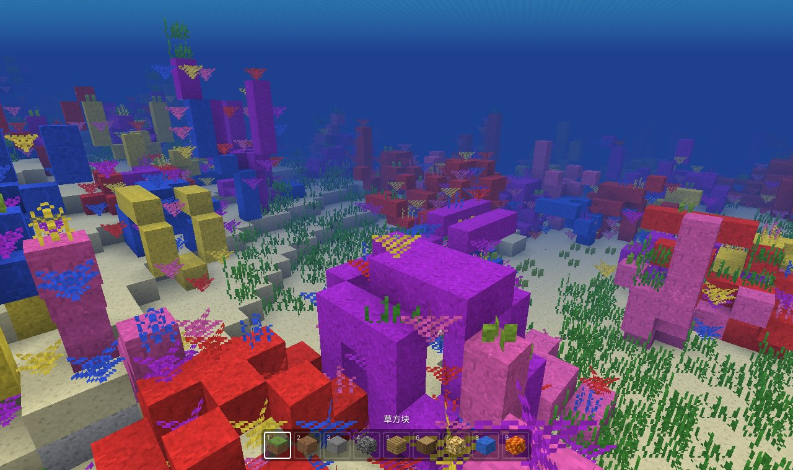
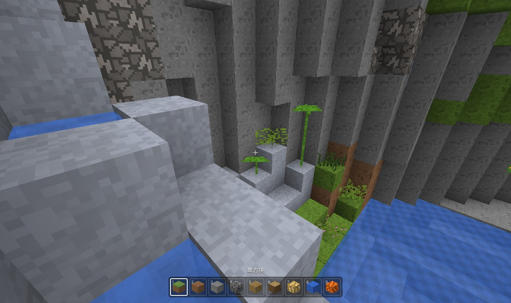
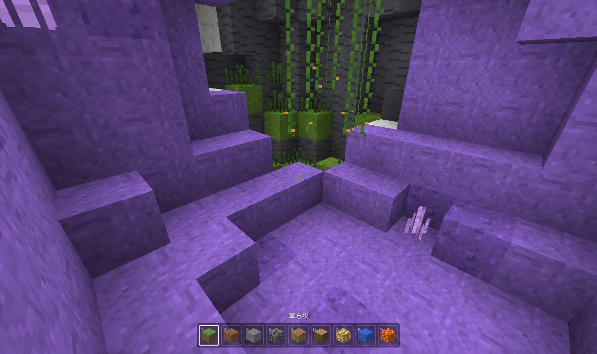
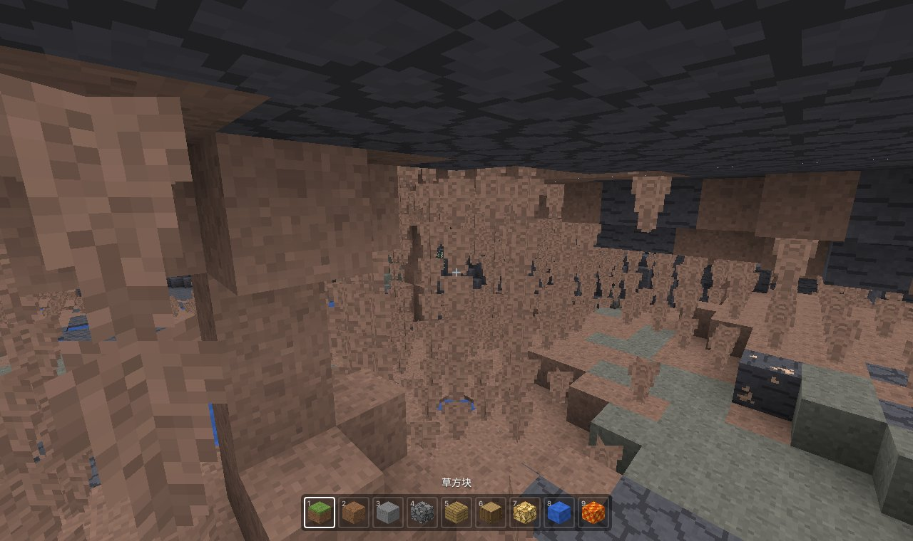
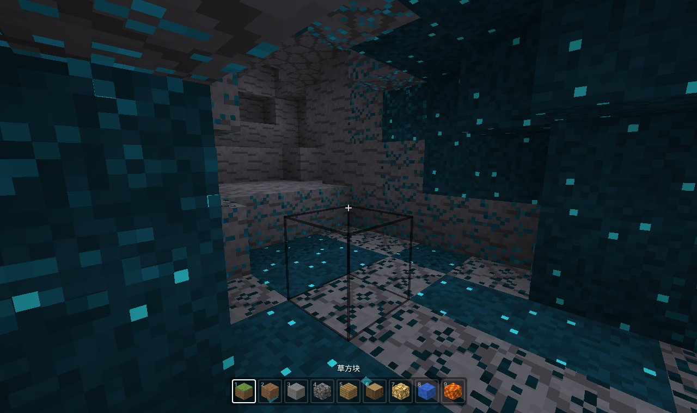
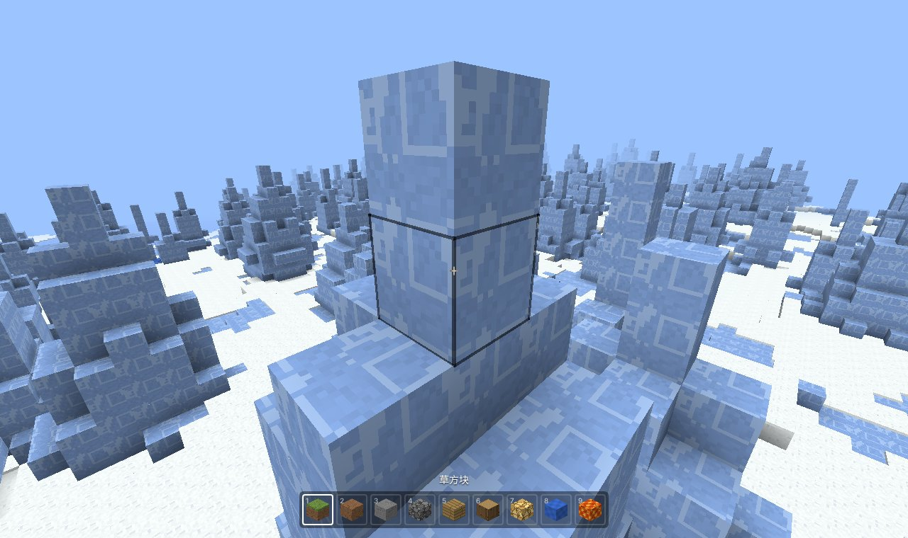
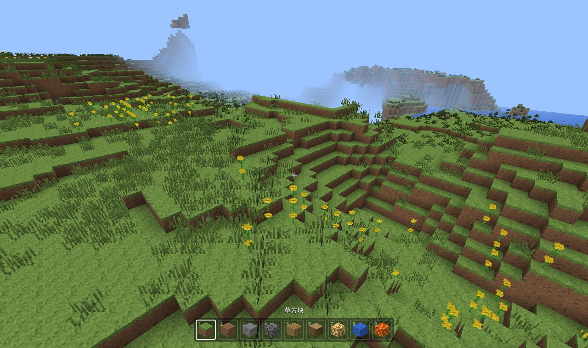
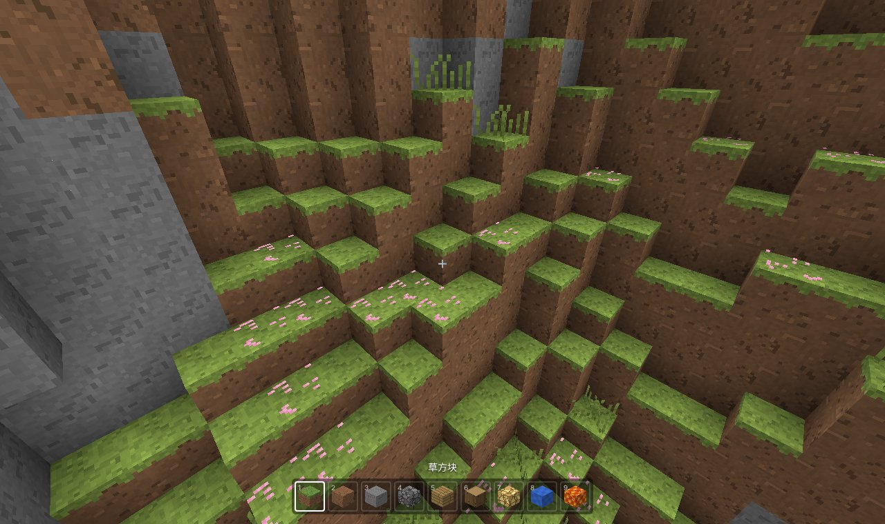

# 用 TypeScript 复刻 Minecraft（v5.1）：其余地物与洞穴

> 本文是 mc-replica 系列的第 v5.1 篇。v5 搭好了地物系统，只放了矿石、树和积雪；
> v5.1 把雕刻器（洞穴、峡谷）和主世界其余的地物都补上，并且每一批都拿原版 1.21.4 服务端生成的存档逐格对照。
> 开发日志见 [../notes/v5.1-notes.md](../notes/v5.1-notes.md)。



## 一、v5.1 做了什么

- **雕刻器**：洞穴和峡谷，和原版只开雕刻器的存档对照 99.996% ~ 100%
- **93 种新方块**：花草、珊瑚、滴水石、紫水晶、幽匿、苔石、刷怪笼、箱子……一共 202 种
- **31 种地物**：花草丛、甘蔗、仙人掌、海草、海带、竹子、藤蔓、发光地衣、苔藓 / 黏土地块、杜鹃树、熔岩湖、泉、
  冰刺、冰山、蓝冰、森林岩、沙漠井、地牢、水下岩浆、晶洞、三种滴水石、幽匿、三种珊瑚
- **原版对照**：40 个群系样本区域、640 个区块，99.67% 的方块和原版一致
- **快了一些**：群系查找三处优化，结果和原版一样



## 二、雕刻器：在地形上再挖一遍

噪声地形本身已经有洞（v3 的“奶酪洞”“面条洞”），雕刻器是另一套更老的系统：从一个区块“起头”，
用随机游走挖出一条隧道，沿途挖椭球。

1. 每个区块要看周围 **±8 个区块**起头的洞，因为一条隧道最多能伸出这么远。
2. 起头区块用哪些雕刻器，看它 (x·4, 0, z·4) 那一格的群系（噪声群系，不是方块群系）。
3. 种子是 `setLargeFeatureSeed(世界种子 + 雕刻器序号, x, z)`，用的是 Java 老的 48 位线性同余随机数，不是 Xoroshiro。
4. 挖到的每一格交给含水层决定：空气、水还是岩浆（y ≤ 熔岩高度就是岩浆）；如果挖穿了地表，下面露出来的泥土换成草方块。

48 位 LCG 在 JS 里用 bigint 很慢。这里用两个 24 位整数拼起来算乘法，和 bigint 版对拍结果相同，快 3 倍。

## 三、对照：一个“完整地物”的原版存档

v5 的做法是给原版服务端一个“只留矿石”“只留树”的数据包，单独核对一类地物。v5.1 的地物太多，干脆直接用原版的全部地物生成存档，
然后**按方块种类**统计：每种方块原版有几格、我们有几格、位置对上的有几格。

```text
方块                       原版      我们      位置一致
packed_ice                  13121     13089    99.5%
mossy_cobblestone            1370      1388    99.9%
glow_lichen                  1702      1737    97.3%
amethyst_block              10699     10289    96.2%
...
```

一致率低的方块，再用 `probe.ts` 把对不上的格子连同六个邻居打印出来，看是“多了”“少了”还是“挪了位置”。

## 四、照着字节码写

地物的代码都在原版的 server.jar 里，类名是混淆的。窍门是：`Feature` 的注册类里，每个地物名字符串（`"geode"`）后面紧跟着 `new 某个类`，
一次就能把所有地物和类名对上。然后 `javap -c` 看每个类的 `place` 方法，**按字节码里调用随机数的顺序**写 TS。

为什么要这么较真？因为每个地物用的是同一个随机数序列：一个区块里放 150 次发光地衣，只要第 3 次多用了一个随机数，
后面 147 次的位置就全变了。

### 发光地衣多了一倍

第一版的发光地衣比原版多一倍，位置只有 55% 对得上。读字节码发现原版的“向外搜索”是这样写的：

```java
for (int i = 0; i < searchRange; i++) {
    m.setWithOffset(origin, direction);   // 每次都从 origin 出发！
    ...
}
```

它每次都把位置设成“起点旁边那一格”，循环 20 次检查的都是同一格——看起来像是原版的笔误，但我们要复刻的就是它的行为。
照抄以后 97% 一致。

### 一些“方块状态”的坑

我们的方块还没有状态（朝向、含水、上下半……，v7 再做），所以：

- 两格高的植物（向日葵、高草、大海草）两格放同一种方块
- 海草、海带、珊瑚原版总是“含水”的，这里直接把它们当成水源：网格按水画，流体模拟也不会冲掉它们
- 发光地衣、幽匿脉络是“多面”方块，原版记着贴在哪几面。渲染时按“哪几面挨着实心方块”画；
  幽匿蔓延时要用到面，地物运行期间单独记一张表



## 五、几个有意思的地物

**晶洞**：在 ±16 格的立方体里撒 3~4 个“中心点”，每格算它到所有中心点的 1/√(距离² + 偏移) 之和，再加一点噪声：
和越大越靠里，依次是空气、紫水晶、方解石、平滑玄武岩。还有一定概率开一道裂缝。

**滴水石**：三种地物。`dripstone_cluster` 在一片区域里，每一列从洞顶到洞底找出“柱子”，按到中心的距离决定钟乳石和石笋多长，
两根对上时连成一根；`large_dripstone` 是带“风”的大钟乳石，每往下一格往风的方向偏一点。



**幽匿**：深暗之域里的幽匿块是“蔓延”出来的：10 个带电量的游标从中心出发，每一步把旁边的石头变成幽匿块、在空气里长脉络，
电量用完就停；离中心远的地方还可能长出幽匿感测体和尖啸体。



**冰山**：圆的还是椭圆的、多高、水下多深、顶上有没有雪、要不要挖一道缺口，都由十几个随机数决定。
冰刺和冰山的浮冰 99.5% 和原版一致。



**花**：平原和草甸的花不是随机挑的，而是看一个固定种子（2345）的噪声：同一片地方开同一种花，所以会成片。



## 六、对不上的地方

640 个区块里 99.67% 的方块一致，剩下的主要是这几类：

- **生成顺序**。树、滴水石簇、幽匿、苔藓地块都会伸到邻居区块里。原版后生成的区块能看到先生成的邻居放下的东西，
  而先后顺序取决于加载顺序——原版自己换个加载顺序结果也会变。我们用 4×4 区块的“装饰区域”，区域之间互相看不到，
  样本区域跨了区域边界的地方（比如丛林）树就对不上。
- **光照**。蘑菇要长在暗处，但生成地物时光照还没算完，原版取到的亮度和生成顺序有关。我们当成“都亮”，最接近原版存档。
- **方块状态**：苍白苔藓地毯不会往上长，没有气泡柱，化石要读结构模板文件，这些都留到以后。

## 七、性能

所有地物都实现之后，每个区块的地物时间从 70 ms 涨到了 200 ms 以上，而大头在**查群系**：每个地物放之前要看那个位置是什么群系。
三处优化，结果都和原版完全一样：

1. 气候参数表查找时，先拿“上一次的结果”的距离当上界剪枝（原版的 RTree 也是这么做的）。
2. 气候的 6 个参数里，温度、湿度、大陆性、侵蚀、奇异度都和 y 无关，按列缓存；只有“深度”每层都算。
3. 方块群系的“抖动”只和它周围 8 个角点有关，按角点缓存，每次少算 72 次 64 位乘法。

现在 Node 里连续生成 8×8 个区块，每个约 500 ms，其中地形 + 地表 + 雕刻器约占六成；游戏里有多个 Worker 并行。



## 八、下一步

- v6 是光照和昼夜。有了光照，蘑菇“要长在暗处”的判断也可以重新核对
- 方块状态（v7）做完以后，回来补滴水石的形状、两格高植物的上下半、幽匿脉络的面
