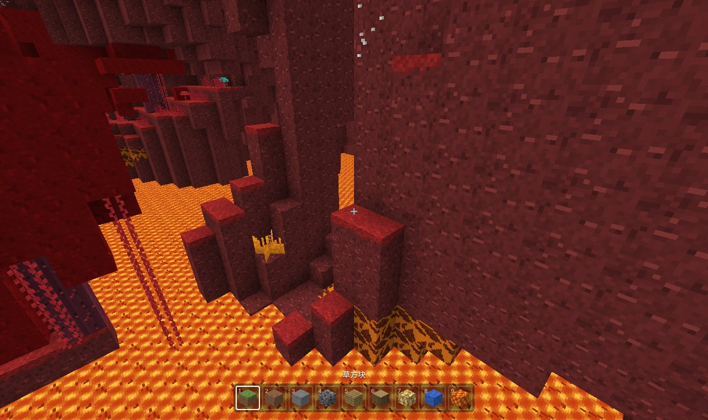
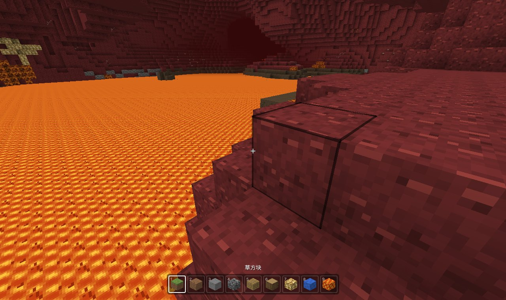
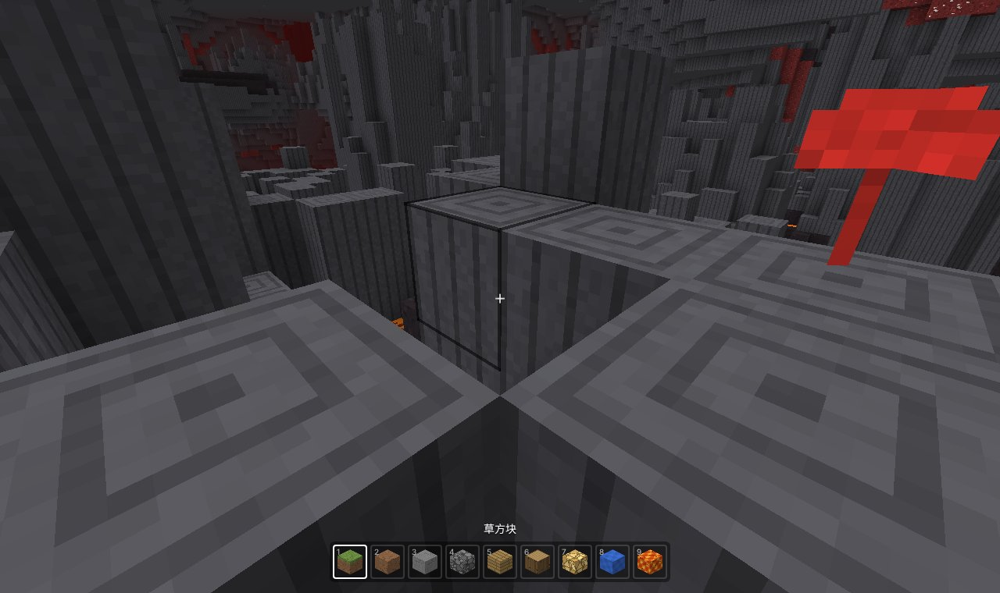
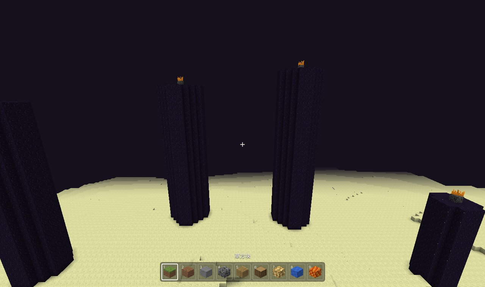
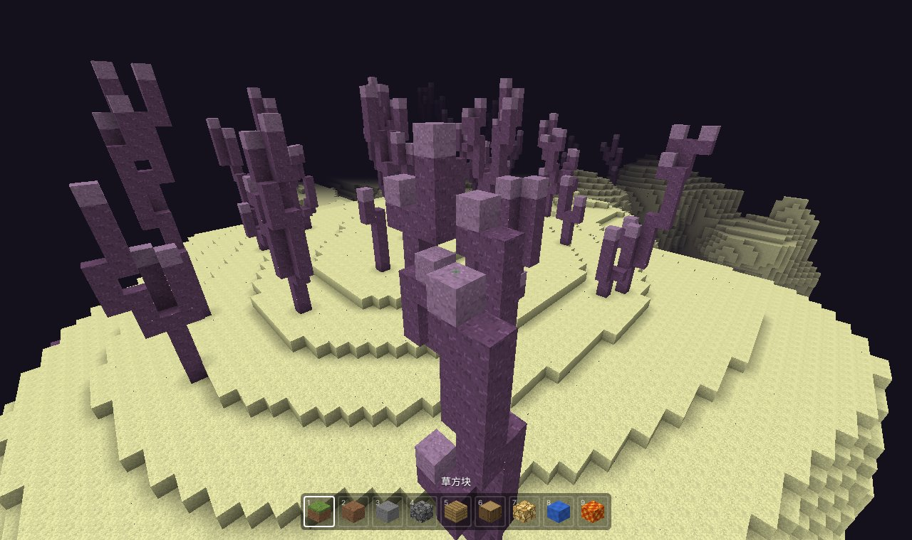

# 用 TypeScript 复刻 Minecraft（v5.2）：下界、末地与收尾

> 本文是 mc-replica 系列的第 v5.2 篇。v5.1 把主世界的地物补齐了，v5.2 收尾：查清楚滴水石为什么对不上，补上化石和气泡柱，
> 然后做下界和末地——结果发现这两个维度连地形都是错的。开发日志见 [../notes/v5.2-notes.md](../notes/v5.2-notes.md)。

## 一、v5.2 做了什么

- **下界、末地的地形**：之前只有约 60% 和原版一致，现在 **100%**
- **下界**：雕刻器 + 10 种地物（萤石、玄武岩柱、玄武岩柱群、三角洲、团块、远古残骸、巨型菌、植被、两种藤）
- **末地**：黑曜石柱、出生平台、末地小岛、紫颂植物、折跃门；末地的群系
- **主世界收尾**：化石、气泡柱；滴水石簇修了一处条件，并且查清了剩下的差别从哪来
- 32 种新方块，下界和末地有了自己的天空色

## 二、一次只看一个地物

v5.1 的“完整地物”存档里，滴水石锥只有 45% 对得上。一个区块里有几十种地物，很难说是哪个的问题。
v5.2 给对照工具加了一个模式：**只留指定的地物**，原版服务端和我们用同一个数据包。三种滴水石分开看：

| 只放 | 和原版一致 |
| --- | --- |
| 大钟乳石（large_dripstone） | 100% |
| 滴水石锥（pointed_dripstone） | 99.99% |
| 滴水石簇（dripstone_cluster） | 99.7%，但对不上的都是“整簇” |

问题在滴水石簇。先读字节码，找到一处漏掉的条件（放水洼时脚下也要是石头或水），改完差别还在。
再加一个调试开关：每个区块只放自己的地物、看不到邻居放的。结果一样——说明是**这个区块自己的随机数序列走偏了**。

原因是滴水石簇会读周围的地形：它从洞顶往下扫一根“柱子”。如果邻居区块的簇先放了，扫描结果不同，用掉的随机数个数也不同，
之后这个区块里的每一簇都会挪位置。我们自己把同一片区域按两种顺序装饰，结果就差了 12%。
而原版的世界生成是多线程的，区块的先后本身就不固定——这种差别没法消除，只能记下来。幽匿蔓延是同样的情况。

## 三、化石：第一次用到结构模板

化石不是“程序画”出来的，而是把原版 jar 里的 `.nbt` 结构模板贴到地下。v5.2 新加了一个工具，把 jar 里的模板转成 JSON
放进 `datapacks/`（和其他原版数据一样，不进仓库）。

贴模板这一步（`StructureTemplate.placeInWorld`）要处理旋转、旋转后的“零点”、包围盒，还有三种“处理器”：

- **腐烂**：每块骨头有 10% 不放——要用地物的随机数，按模板里方块的顺序（先 y，再 x，再 z）
- **保护**：不覆盖不能替换的方块
- **规则**：深层化石把煤矿换成钻石矿

只放化石的存档里逐格一致。

## 四、下界：地形先错了

做下界地物之前，先比较了关掉地物的下界存档：只有约 60% 一致，连群系都不对。原因有三个：

1. **所有维度共用了一个随机状态**。原版按 noise_settings 里的 `legacy_random_source` 选：主世界用新的 Xoroshiro，
   下界和末地用旧的 48 位线性同余随机数，温度、湿度还有一套专门的“旧下界群系噪声”。代码其实早就写了，只是没按维度选上。
2. **实心方块写死成了石头**。现在用 noise_settings 的 `default_block`：主世界石头、下界下界岩、末地末地石。
3. **末地的群系**不是查气候参数表，而是看区块中心的 `erosion`（末地小岛噪声）分成高地、中地、小岛、荒地。

改完以后，下界和末地的地形、群系都和原版 **100%** 一致。

## 五、下界和末地的地物

下界的地物大多是“读地形”的：玄武岩柱从天花板一直垂到地面；三角洲找“四周都实心、只有上面是空的”格子；
玄武岩团块从起点往下找到第一块下界岩，再按曼哈顿距离一圈一圈往外替换（`BlockPos.withinManhattan` 的遍历顺序也要照抄）。
巨型菌分菌柄和菌盖两步，菌盖边上挂下垂泪藤。

放置修饰器也多了一个：`count_on_every_layer`。下界有很多层“地面”，它从高往低数，每一层放几个，直到某一层一个都放不下。

末地的 10 根黑曜石柱，半径和高度由世界种子打乱决定，最高的两根带铁栏杆笼子。原版在柱顶放末影水晶时取了一次随机数（朝向），
我们不放实体，但随机数照样取，后面的地物才对得上。

## 六、结果

| 区域 | 和原版一致 |
| --- | --- |
| 下界、末地地形（不放地物） | 100% |
| 下界荒地、诡异森林、灵魂沙峡谷 | 99.9% ~ 99.99% |
| 玄武岩三角洲 | 91%（团块、柱群互相影响，和生成顺序有关） |
| 末地主岛、出生平台、外岛 | 99.996% ~ 100% |
| 主世界 40 个区域 | 99.67%（化石 99.8%、气泡柱 97.7%） |

## 七、下一步

v5 系列到这里告一段落：三个维度的地形和地物都有了，剩下的差别都来自生成顺序和还没有的方块状态。
下一版 v6 做光照和昼夜。
