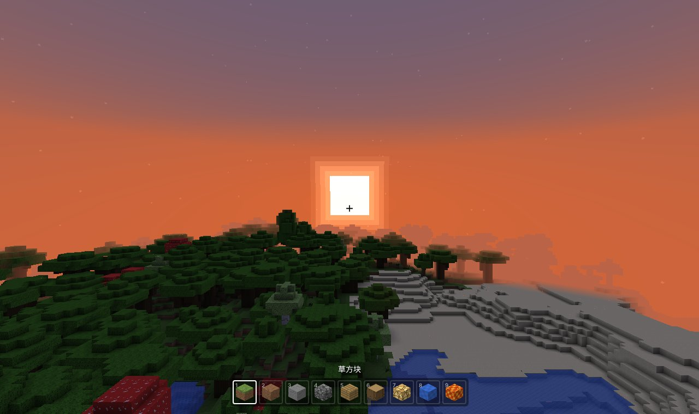
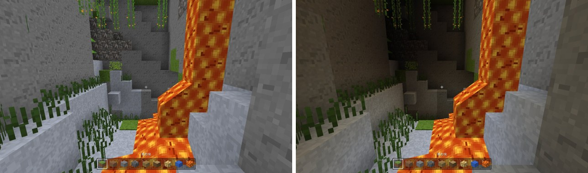
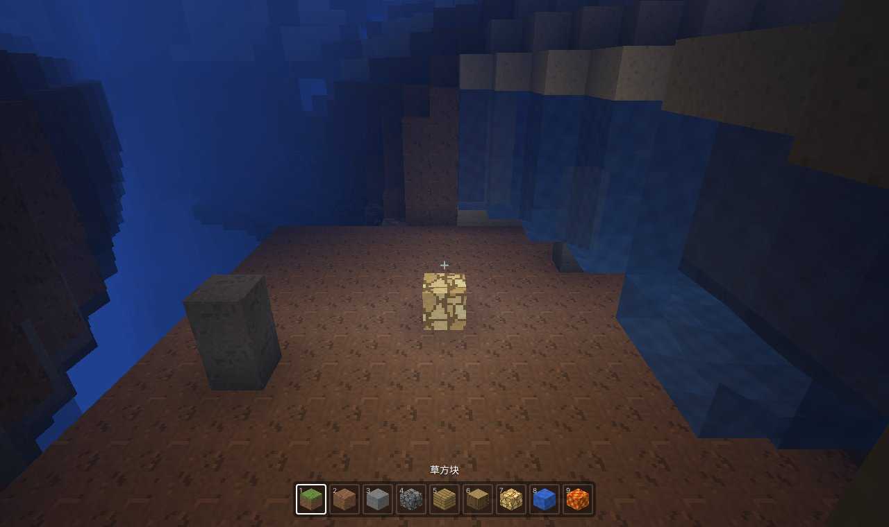
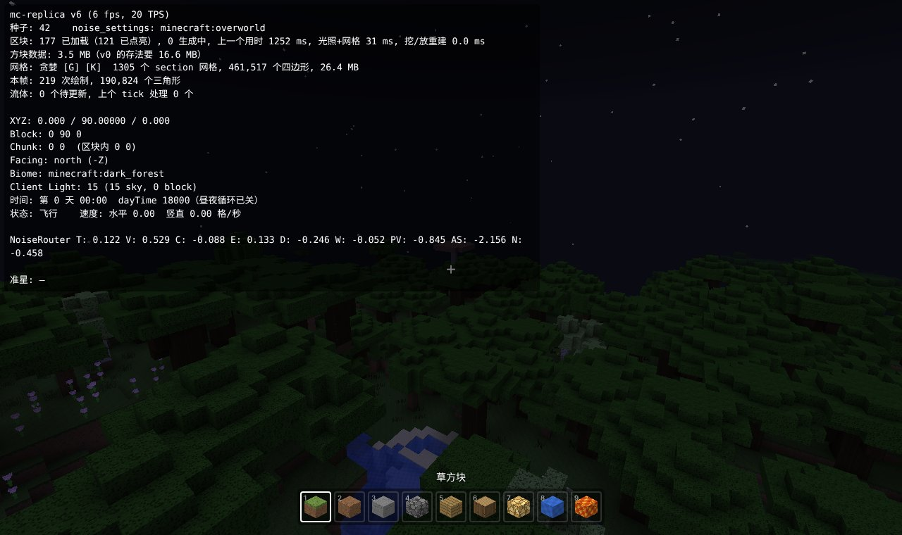
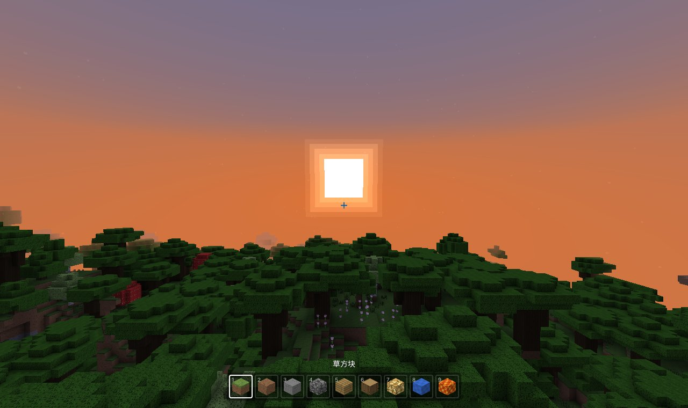
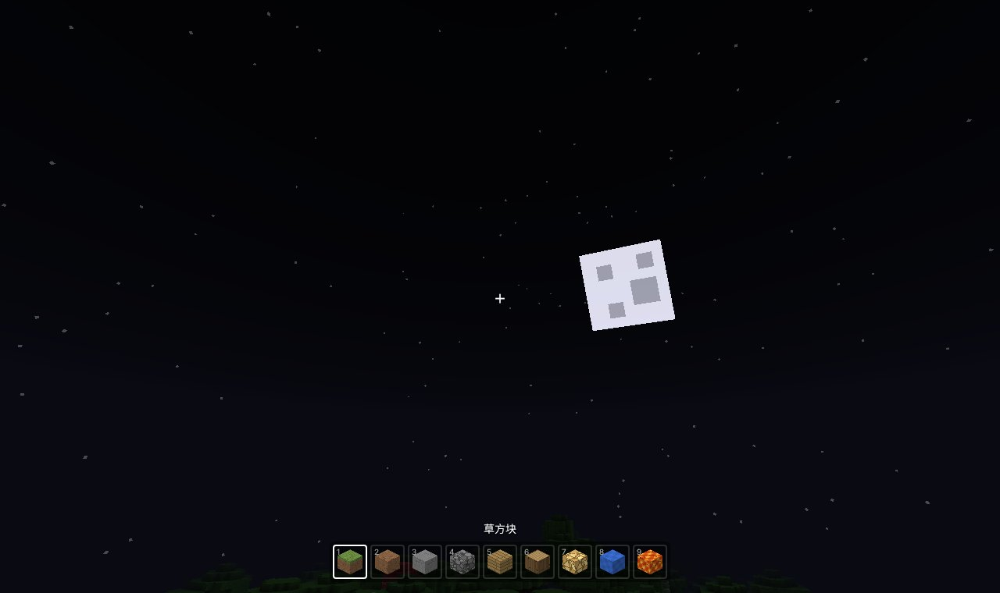

# 用 TypeScript 复刻 Minecraft（v6）：光照与昼夜

> 本文是 mc-replica 系列的第 v6 篇。到 v5.2 为止，三个维度的地形和地物都有了，但所有方块都一样亮：
> 洞穴里和正午的草地一样亮，也没有白天黑夜。v6 补上光照和昼夜。开发日志见 [../notes/v6-notes.md](../notes/v6-notes.md)。

## 一、v6 做了什么

- **光照引擎**：天空光和方块光，和原版存档里存的光照逐格一致
- **平滑光照**：原版的 AO 和亮度插值，洞穴里越往深处越暗
- **增量更新**：挖放方块、流体流动时只更新附近的光照
- **昼夜**：时间流逝，天空和雾的颜色跟着变，有日出日落、太阳、月亮（8 个月相）、星星
- F3 里能看到脚下的亮度和时间；菜单里可以调时间、关昼夜循环、调亮度

## 二、两种光

原版每一格存两个 0~15 的亮度：

- **天空光**：从天上照下来的。露天的地方是 15，钻进洞里慢慢变暗。注意它和时间无关——晚上天空光照样是 15，
  “天黑”是渲染时乘了一个系数（后面讲光照贴图）。下界和末地没有天空光
- **方块光**：发光方块发出来的：岩浆、萤石 15，发光地衣 7，岩浆块 3

每个方块有两个属性：`lightBlock`（光穿过它要减多少：石头 15，水、树叶、冰 1，空气、花草 0）
和 `lightEmission`（自己发多亮的光）。这两张表没有手抄，而是**直接从原版 jar 里读出来的**：
写了一个十几行的 Java 程序，调用原版服务端初始化注册表，把 2 万多个方块状态的属性打印出来。

## 三、光怎么传

规则只有一条：每走一格，亮度减 `max(1, 目标方块的 lightBlock)`。一格的最终亮度是所有光源沿所有路径传过来的最大值。

天空光多一步：先找“光源”。每一列从世界顶往下，第一个 `lightBlock ≠ 0` 的方块之上全是 15。所以水面那一格是 14
（水的 lightBlock 是 1），再往下每格减 1；树荫下是 14，因为旁边露天的空气横着照过来。

这个最大值是一个“不动点”，和计算顺序无关。所以虽然原版是多线程、边加载边算的，我们一次把 3×3 个区块算完，结果也能逐格对上。
实现是按亮度分桶的广度优先：先处理所有 15 的格子，再处理 14 的……每格最多展开一次。

## 四、和原版对照

对照工具读原版存档里每个 section 的 `SkyLight`、`BlockLight`，有两种用法：

- 拿**原版存档里的方块**算光照，只检验光照引擎
- 拿**我们生成的方块**算，端到端

第一次对照，方块光就是 100%；天空光只有一个地方不对：树叶上面有一层雪的时候，原版的树叶暗 1 级。
原因是雪层“底面完整、按形状挡光”——光不能从雪层往下走。加上这条之后，引擎逐格一致。

还有一个意外：**原版存档自己有时候是“没算完”的**。保存的时候有些光照更新还在队列里，存档里出现过石头里天空光是 15 的整片区域。
工具会检查每一格是不是满足“亮度 = max(光源, 邻居 − 代价)”，原版自己不满足的区块单独统计。

| 对照 | 天空光 | 方块光 |
| --- | --- | --- |
| 没有地物的存档（方块和原版完全一样），三个维度 | 100% | 100% |
| 完整存档，用原版的方块（只检验引擎） | 99.994% | 100% |
| 完整存档，用我们生成的方块 | 99.82% | 99.44% |

第二行剩下的差别全是原版更亮，都在原版“没算完”的区域旁边。第三行的差别来自方块本身——比如洞穴藤蔓有没有发光的浆果，
是方块状态，v7 才有。

## 五、挖一个方块

区块第一次点亮时整块计算；之后挖放一个方块，只更新附近（原版也是这样），分两步：

1. **熄灭**：从改动的格子出发，比自己暗的邻居可能是从这里照过去的，清零并继续往外；不比自己暗的邻居另有光源，留着
2. **点亮**：从光源和第 1 步留下的边界重新扩散

天空光还要看光源有没有变：在露天放一个方块，它下面整列原来的 15 都不再是光源。
测试里随机挖放 300 次，每一次都和整块重算的结果比较，全部一致。

## 六、平滑光照

亮度是存在方块里的，画的时候要变成顶点的颜色。原版的“平滑光照”：一个面的每个角，取面前面那一格（中心）、
角旁边的两格、斜对角那一格，四格亮度的平均。有两个细节：

- 不透明方块里的亮度是 0，原版把 0 换成中心的值（否则墙角会黑一大片）
- 两边都挡光时，斜对角那格看不到，用第一边的值代替

AO（墙角变暗）也换成了原版的 0.4 / 0.6 / 0.8 / 1.0。v1 起的贪婪网格要多一个条件：四个角的亮度也一样才能合并。

## 七、光照贴图

顶点里存的是两个亮度，颜色从一张 **16×16 的光照贴图** 里查：横轴方块光、纵轴天空光，每格是那个组合的颜色。
这张图每帧按时间重新算（公式照抄 1.21.4 的 `lightmap.fsh`）：

- 天空光乘一个“天空亮度”：正午 1.0，午夜 0.2，夜里还偏蓝
- 方块光的颜色偏暖：亮的地方接近白色，暗一些的偏黄；还会轻微闪烁
- 下界有 0.1 的环境光；末地整张图偏绿

所以天黑的时候**不需要重建任何网格**，只换一张 16×16 的贴图。

## 八、昼夜和天空

一天 24000 刻（现实 20 分钟），0 是早上 6 点。太阳的角度不是匀速的：原版用一个余弦把白天黑夜拉得一样长，黄昏过得快一点。

天空在原版里是相机上方 16 格的一个圆盘，颜色是天空色，用“天空雾”往雾色过渡——所以抬头是深蓝，越往地平线越浅。
天空色、雾色来自玩家周围群系的 `sky_color` / `fog_color`，按原版的 6×6×6 高斯核平均。
朝太阳方向看时，雾里还会混进日出日落的颜色。

太阳、月亮、星星在“天球”上，随时间转动。星星用固定种子 10842 随机撒 1500 个点，落在单位球里的留下——一共 780 颗。
太阳和月亮的贴图和方块一样是代码画的（原版贴图有版权）。

## 九、下一步

v7 做方块状态和 JSON 模型：楼梯、台阶、栅栏，以及这一版留下的洞穴藤蔓浆果、海泡菜个数这些“状态决定亮度”的方块。
