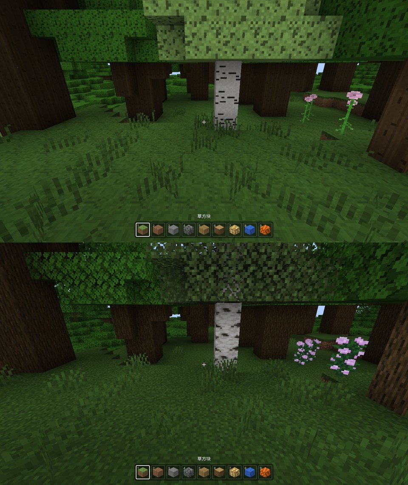
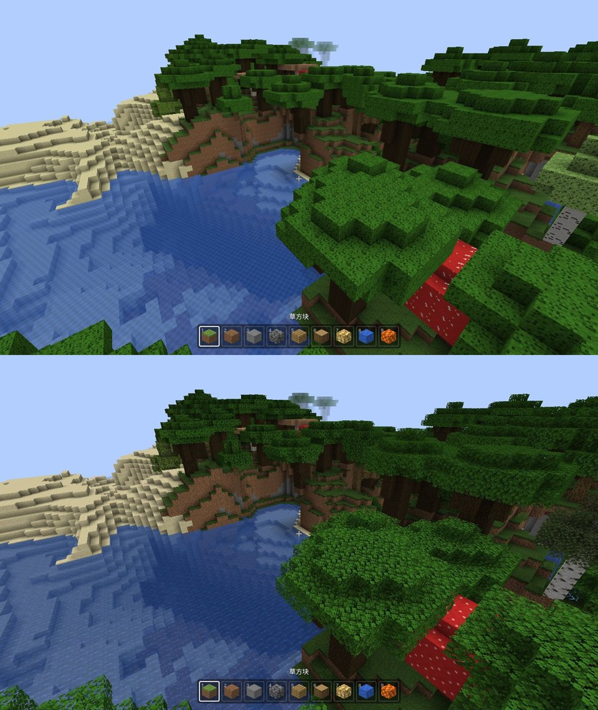
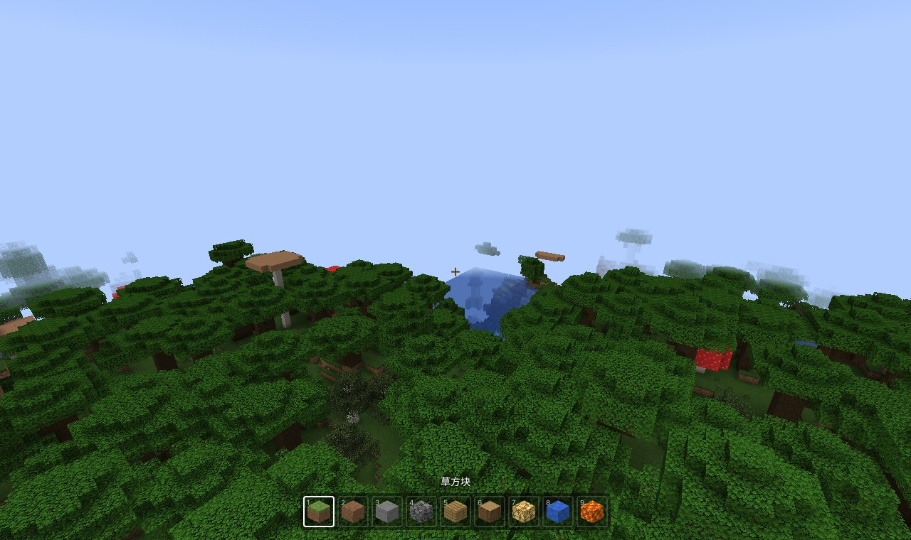
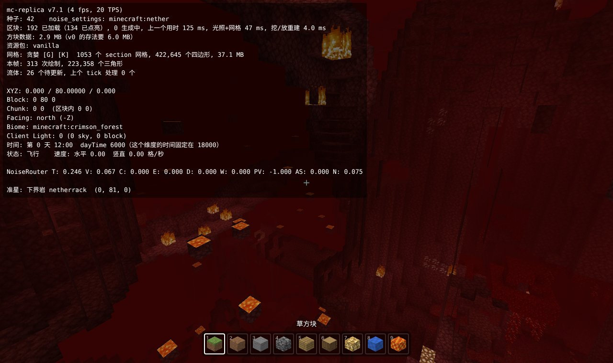

# 用 TypeScript 复刻 Minecraft（v7.1）：方块模型

> 本文是 mc-replica 系列的第 v7.1 篇。v7 给方块加上了状态，但画出来的样子还是 v1 那一套：
> 完整方块、十字形的花草、一片薄薄的雪。v7.1 读进原版的方块模型和纹理，让每个状态长成原版的样子。
> 开发日志见 [../notes/v7.1-notes.md](../notes/v7.1-notes.md)。



*上：v7（程序画的纹理）。下：v7.1（原版模型和纹理）。同一个位置、同一个时间。*

## 一、资源从哪来

原版的模型和纹理在客户端 jar 的 `assets/minecraft/` 下，和世界生成数据一样归 Mojang 所有，不能放进仓库。
做法和 v0 的数据包一样：从你自己的 1.21.4 客户端里拷出三个目录，放进被 git 忽略的 `resourcepacks/vanilla/`。

```text
blockstates/       1097 个：每个方块的状态 → 用哪个模型、转多少度
models/block/      2213 个：模型 —— 几个盒子，每个盒子几个面，每个面一张纹理
textures/block/    1088 张：16×16 的 png
```

我们只有 234 种方块，第一次加载时只读用到的：先读这些方块的状态文件，从里面找出引用的模型，再沿着 `parent` 一层层读上去。
纹理也只读烘焙结果里用到的 308 张。没有资源包时，一切照旧（程序画的纹理）。

## 二、从状态到四边形

以横放的橡木原木为例：

```text
blockstates/oak_log.json         "axis=x": { model: "block/oak_log_horizontal", x: 90, y: 90 }
models/block/oak_log_horizontal  parent: block/cube_column_horizontal   textures: { end: oak_log_top, side: oak_log }
  → cube_column_horizontal       textures: { up: #side, north: #end, ... }   （"#end" 是引用，要一路找到真正的纹理名）
  → cube                         elements: 一个 0..16 的盒子，6 个面，每个面 cullface 是自己的方向
```

“烘焙”（原版 ModelBakery / FaceBakery）就是把这一串变成四边形：

1. 沿 parent 往上合并 `textures`（子模型覆盖父模型），`elements` 取最近的那个
2. 每个盒子的每个面 → 4 个顶点。顶点顺序照抄原版 FaceInfo（从正面看逆时针）
3. 纹理坐标：面的 `uv` 是一个矩形，`rotation` 把 4 个角轮换；没写 `uv` 时按盒子的位置算默认值
4. 盒子自己的 `rotation`（只能绕一个轴转 ±22.5° 或 ±45°，`rescale` 时把另外两个轴拉长，让斜着的面仍然撑满方块）
5. 状态文件里的 `x`、`y` 旋转（绕方块中心，先 X 后 Y）。`cullface` 跟着转：转完以后朝东的面，挨着东边的邻居时才不画
6. `uvlock`：纹理不跟着方块转，“钉”在世界上 —— 按转完以后的位置重新取默认纹理坐标

状态文件有两种写法。`variants` 按属性挑一个；`multipart` 是“条件满足就叠上去”，栅栏、藤蔓、粉红花簇都是这样，
每个方向一块，`when` 里还能写 `OR` / `AND`。一个状态的结果是若干“部分”，每个部分若干带权重的“候选”，每个候选若干四边形。

烘焙在主线程做一次（120 ms 左右），结果是普通的对象和数组，直接 postMessage 给每个 Worker。

## 三、贪婪合并还能用吗

v1 的贪婪网格把一大片同样的面合成一个大矩形，纹理靠 GPU 的“重复平铺”铺满。前提是：每个方块的面在纹理上都一样摆。
有了模型，这个前提没了：横放的原木侧面，纹理转了 90°；石头有一半是镜像的。

办法是把“这个面怎么贴纹理”写成一个式子：

```text
纹理坐标 = M · D + c
```

D 是面上一点的“世界纹理坐标”（原版默认 uv 的那套规则，对位置是线性的），M 是一个 2×2 的矩阵，只能是 90° 的旋转或镜像（每项 -1、0、1），
c 是整数平移。烘焙出来的整面（盖满方块的一面、贴着边界、纹理是完整的一张），用它的 4 个顶点解出 M 和 c。
贪婪合并时，M、c 和纹理层一样，是“面的样子”的一部分 —— 样子相同才合并。合并出的 w×h 大矩形，把 4 个角的 D 代进去，
纹理照样一格一张地重复，转的角度也对。

不能这样写的面（草方块侧面的那层草、十字形的花草、藤蔓、斜着的面……）逐个输出。
草方块是最常见的情况：顶面一张纹理，能合并；侧面是“泥土 + 染成草色的覆盖层”两个面，逐个输出。

为了让纹理可以转，纹理坐标不再由着色器按位置算，而是存进顶点。每个顶点从 12 字节变成 20 字节。

## 四、随机朝向

原版的石头、泥土、沙子、草方块……状态文件里有 4 个候选：原样、镜像、转 180°、镜像再转 180°。
所以一大片石头看不出重复的花纹。挑哪个是按位置定的（原版 WeightedBakedModel）：

```text
随机数.setSeed(Mth.getSeed(x, y, z))
候选 = 落在 nextInt(总权重) 上的那个
```

`Mth.getSeed` 和 LegacyRandomSource（java.util.Random 的那个 48 位 LCG）都是 v0 就有的。multipart 每个部分都要挑时，
先取一次 nextLong，每个部分都用它重新 setSeed。挑的结果只看世界坐标，所以 Worker 第一次生成和主线程挖方块后重建，挑的一样。

代价是贪婪合并合并得少了：4 种样子交错着，一大片地面合并不成一整块。实测多了约 4% 的四边形。

花草还有一个随机：位置偏移（原版 OffsetType）。花、高草在格子里随机挪 ±0.25 格，矮草和蕨还会往下沉一点，
种子是 `Mth.getSeed(x, 0, z)` —— y 取 0，所以两格高的花上下两半挪得一样。

## 五、光照：不满一格的面

v6 的平滑光照是给完整方块的面做的：面前面那一格叫“中心”，每个角取中心、两边、斜对角四格的平均。
模型的面可能不在方块边界上（雪层的顶面、花的茎），也可能不满一格（粉红花簇的一片花瓣）。原版 ModelBlockRenderer 的做法：

- 面贴着方块边界（或者方块本身是完整方块），“中心”取面前面那一格；否则取方块自己这一格
- 面不满一格时，先照常算出 4 个角的值，每个顶点再按它在面上的位置做双线性插值

模型可以关掉 AO（`ambientocclusion: false`，十字形植物都是这样），发光的方块也不用平滑光照，这两种整个面一个亮度。

## 六、谁挡住谁

v1 起，一个面挨着实心方块就不画。有了模型，“实心”不够用了：树叶是完整方块、也挡光，但它的纹理有洞。
如果树叶挡住旁边的泥土，从树叶的缝里就能看见“虚空”。原版把这类方块标成 noOcclusion：树叶、玻璃、冰、仙人掌、红树根……
它们不挡住邻居。于是多了一张表 `OCCLUDES`：按模型算（6 个面都是整面）并去掉 noOcclusion 的方块。

结果是森林里的四边形多了不少：树叶和树叶之间的面也要画（原版“高品质”画质就是这样）。

玻璃、冰反过来：同一种挨着时中间那面不画（原版 skipRendering）。冰和水用纹理自己的 alpha，画进半透明网格。

## 七、染色

v4 的草、树叶、水是“灰色纹理 × 生物群系颜色”，要染色的像素用 alpha 标记。原版是按面染：模型的面写了 `tintindex`，
再按方块查颜色（BlockColors）：草方块、矮草、甘蔗用草色，橡树、丛林、金合欢、深色橡树、红树的树叶和藤蔓用树叶色，
云杉树叶、白桦树叶、睡莲是写死的颜色（#619961、#80A755、#208030）。顶点里的“染色字段”多了几个标记，
程序画的纹理还按 v4 的规则染（只染 alpha 标记的部分），资源包的纹理整张染。



*上：v7。下：v7.1。*

## 八、数字

种子 42，主世界出生点，视距 6（121 个区块）：

| | v7 | v7.1 |
| --- | --- | --- |
| 四边形 | 47.8 万 | 89.5 万 |
| 网格显存 | 28.7 MB | 82.4 MB |
| 一个区块的光照 + 网格 | 28 ms | 81 ms |

多出来的四边形里，约一半是树叶之间的面，其次是草方块侧面的覆盖层，随机朝向占约 4%。
显存多得更多，是因为每个顶点从 12 字节变成 20 字节，而且一大片树叶的 section 顶点超过 65536 个，下标要用 32 位。





## 九、还没做的

- 动画纹理（水、岩浆、火）只取第一帧；流体侧面原版用 flow 纹理
- 箱子、末地折跃门这些“方块实体”原版有专门的渲染器，这里还是程序画的方块
- 物品栏的图标还是程序纹理

下一步是 v8：存档。玩家改过的世界存进 IndexedDB，并且能直接读原版的 `.mca` 存档。
