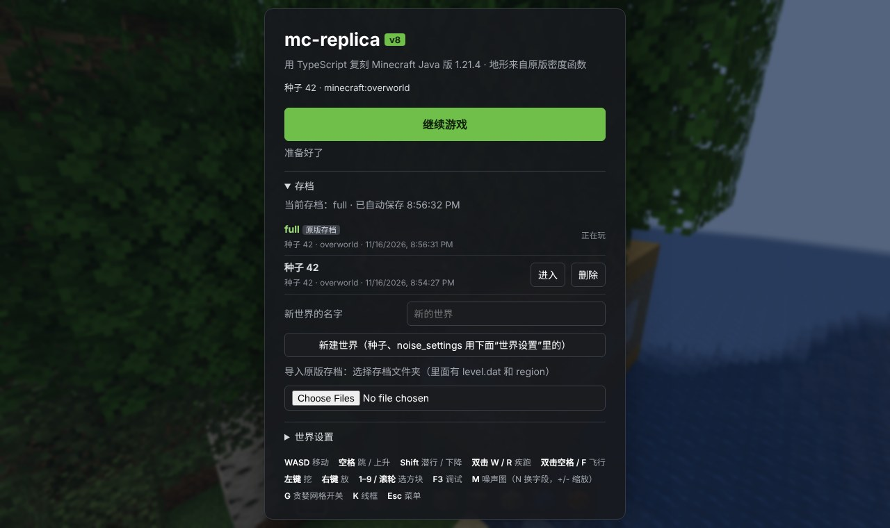
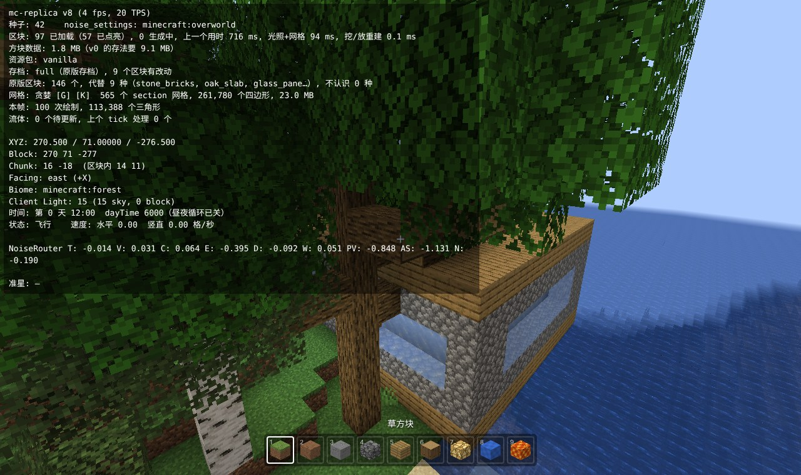
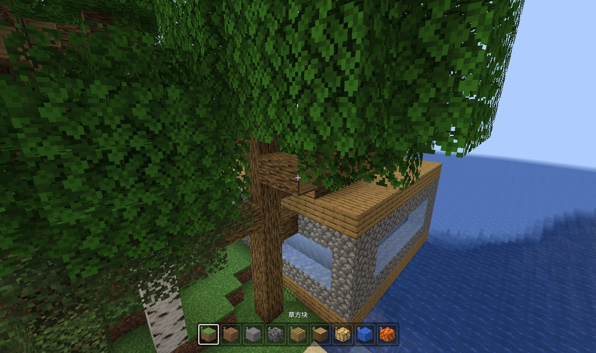

# 用 TypeScript 复刻 Minecraft（v8）：存档

> 本文是 mc-replica 系列的第 v8 篇。到 v7.1 为止，刷新一下页面，挖的坑、盖的房子就都没了。
> v8 把世界存进浏览器，并且能直接打开原版的存档。
> 开发日志见 [../notes/v8-notes.md](../notes/v8-notes.md)。



## 一、存什么

原版的存档会把每个生成过的区块整个存下来：一个区块的方块、光照、生物群系、方块实体、计划刻……
我们不用这样。v0 起地形就和原版逐位一致，同一个种子、同一个区块，每次生成的结果都一样，没必要存。
要存的只有“和生成的结果不一样的地方”：

```text
世界   名字、种子、noise_settings、玩家（位置、朝向、是否在飞）、时间、昼夜循环开没开
区块   玩家改过的方块：区块内下标 → 状态
```

改过的方块其实 v0 就记着（`Terrain.edits`，区块卸载再加载时写回去），只是一直放在内存里。v8 把它存进 IndexedDB。

状态不存编号，存字符串。v7 的状态编号是按“我们有哪些方块”排出来的，以后加了方块编号就会变。
所以每个区块存一个调色板（和原版一样）：

```text
palette: ["minecraft:glowstone", "minecraft:oak_log[axis=z]"]
entries: [100, 0,  200, 1]      ← 区块内下标 100 是调色板第 0 项，200 是第 1 项
```

## 二、什么时候存

原版每 5 分钟自动保存一次，关服务器时再存一次。网页不一样：标签页随时会被关掉，而且关掉时能做的事很有限。
所以存得勤一些：每 10 秒一次（只存这 10 秒里改过的区块），切到别的标签页、关掉页面时也存一次。
一次没存完时下一次不重复开始；存失败的区块下次再存。

世界列表在菜单的“存档”里。换世界就是改地址栏（`?world=<id>`）再刷新页面，和 v0 换种子一样，最不容易出错。
不带 `world` 时打开这个种子的默认世界，所以以前的链接（`?seed=42`）照样能用，而且会自动保存。

## 三、读原版存档

原版的存档是一个文件夹：

```text
level.dat              世界信息：种子、出生点、时间、单人存档的玩家（gzip 压缩的 NBT）
region/r.0.-1.mca      主世界的区域文件：一个文件 32×32 个区块
DIM-1/region/          下界
DIM1/region/           末地
```

### NBT

原版所有存档文件都是 NBT：一棵带类型、带名字的树，整数是大端的。一共 12 种标签，读起来就是一个递归函数。
v5 起对照工具里就有一份（Node 的 Buffer），v8 用 DataView 重写一份，浏览器里也能跑。
解压用浏览器自带的 DecompressionStream（gzip 和 zlib 都支持），不用引入库。

### 区域文件

```text
前 4 KiB    1024 个位置：3 字节的起始扇区 + 1 字节的扇区数（一个扇区 4 KiB）；0 = 这个区块没存
再 4 KiB    1024 个修改时间
之后        每个区块：4 字节长度 + 1 字节压缩方式 + 压缩后的 NBT
```

一个区块的 NBT 里，`sections` 是 24 个 16³ 的段，每段一个调色板 + 按位压缩的下标 —— 和 v1 我们自己的存法一样。
每个下标 max(4, ⌈log₂(调色板长度)⌉) 位，一个 long 放 ⌊64 / 位数⌋ 个，不跨 long。
JavaScript 里 long 是 bigint，逐格做 bigint 移位很慢。于是每个 long 拆成高低两个 32 位数，再用普通的位运算取。

主线程只做“在区域文件里切出这个区块的那一段”，解压、解码交给 Worker。

### 没有的区块

原版存档里只有玩家去过的地方。走出去以后，原版会接着生成；我们也一样：区域文件里没有、或者没生成完的区块，
按 level.dat 里的种子自己生成。v5 起我们生成的区块就和原版一致，所以接缝处看不出来。

拿原版服务端的存档逐格比了一下，5 个不同生物群系的区块，原版存的和我们按同一个种子生成的有 99.92% 一样。

### 我们没有的方块

我们只有 234 种方块（地形生成用得到的）。原版存档里，玩家盖的房子、村庄里有很多别的：楼梯、玻璃、火把、羊毛……
这一版先找代替品：木头类 → 木板，石头类 → 圆石，玻璃 → 冰，火把、灯 → 萤石；实在不像的当空气。F3 里会显示代替了几种、有几种不认识。



*在原版服务端里用命令盖了一间小屋（石砖墙、玻璃窗、橡木台阶的屋顶、火把、书架），导入以后：石砖变圆石、玻璃变冰、台阶变整块木板。*

要把它们都画对，得把原版全部 1000 多种方块（2.7 万个状态）加进来，每个都要有碰撞、光照、模型 —— 留给 v8.1。

## 四、导入

菜单里选择一个存档文件夹（`<input type="file" webkitdirectory>`）。只读 level.dat 和区域文件，别的（玩家数据、实体、POI）用不上。
区域文件整个存进 IndexedDB 的 files 表 —— 选文件夹拿到的文件，刷新页面以后就读不到了。

玩家的朝向要换算一下：原版 yaw 0 朝南（+z）、顺时针增加，pitch 正数往下看，单位是角度；
three.js 的相机 yaw 0 朝北（-z）、逆时针增加，pitch 正数往上看，单位是弧度：

```text
我们的 yaw = π − 原版 yaw（弧度）      我们的 pitch = −原版 pitch（弧度）
```

服务端的存档 level.dat 里没有玩家（玩家在 playerdata/ 里），就在存档的出生点附近找地方出生。



## 五、还没做的

- 原版的其余方块（v8.1）
- 方块实体（箱子里的东西、告示牌上的字）、实体和生物
- 导出成原版存档
