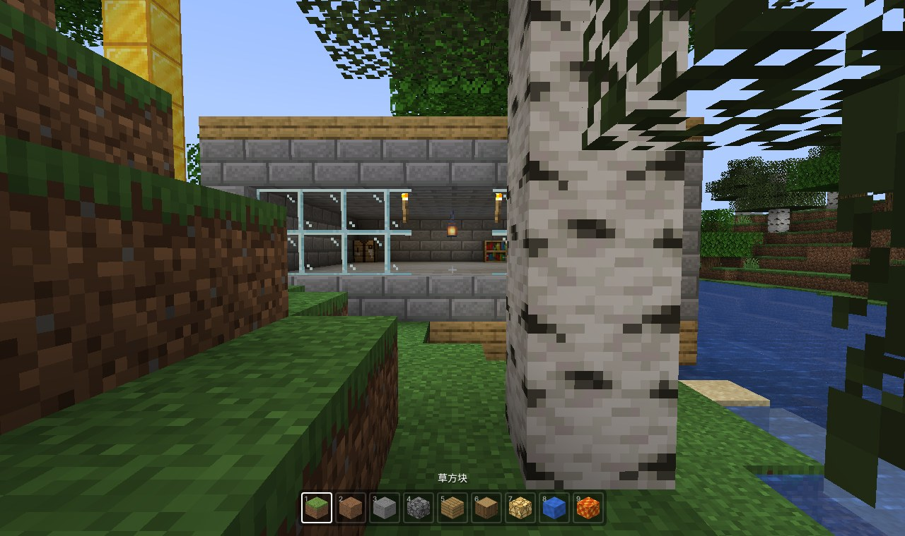
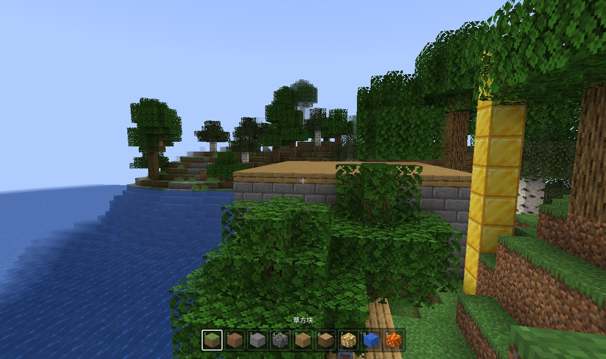

# 用 TypeScript 复刻 Minecraft（v8.1）：原版全部方块

> 本文是 mc-replica 系列的第 v8.1 篇。v8 能导入原版存档了，但我们只有地形生成用得到的 234 种方块，
> 玩家盖的房子里的楼梯、玻璃、火把只能换成“差不多”的方块。v8.1 把原版 1.21.4 的 1095 种方块全部加进来。
> 开发日志见 [../notes/v8.1-notes.md](../notes/v8.1-notes.md)。

*在原版服务端里用命令盖的小屋，导入以后：石砖墙、玻璃板窗户、墙上的火把、吊着的灯笼、书架、工作台、橡木台阶的屋顶。v8 时它们是圆石、冰、萤石和整块木板。*

## 一、一种方块要知道什么

加一种方块，要回答这些问题：

| 问题 | 用在哪 | 从哪来 |
| --- | --- | --- |
| 有哪些属性、每个属性能取什么值 | 状态编号（v7） | 数据报告 `blocks.json` |
| 挡多少光、发多亮的光 | 光照（v6） | 原版服务端 |
| 碰撞箱 | 玩家走路、跳、放方块 | 原版服务端 |
| 能不能挖 | 挖方块 | 原版服务端（破坏时间 -1 = 挖不动） |
| 长什么样 | 网格 | 资源包里的模型（v7.1） |

第一行和最后一行 v7、v7.1 已经解决了，而且本来就是按原版的文件读的，对所有方块都适用。中间三行要从原版的代码里拿。

## 二、从混淆的 jar 里拿数据

v6 拿光照属性时，写过一个小 Java 程序直接调用原版服务端的类：遍历方块注册表，对每个状态调用 `getLightBlock()` 和 `getLightEmission()`。
麻烦在于官方发布的 jar 是混淆过的，`BlockState` 叫 `dwy`，`getLightBlock` 叫 `g`。当时这几个名字是手查的。

碰撞箱（`getCollisionShape(BlockGetter, BlockPos)`）和破坏时间（`getDestroySpeed(BlockGetter, BlockPos)`）也可以手查，但这次换了个办法：**按行为认**。

- 用反射列出 `BlockState` 及其父类上所有“两个参数、第一个是接口”的方法，顺便拿到 `BlockGetter`、`BlockPos` 这两个类型
- `BlockPos.ZERO`：`BlockPos` 里类型是自己的静态字段；`EmptyBlockGetter.INSTANCE`：jar 里实现了 `BlockGetter` 的枚举
- 返回形状的方法有好几个（轮廓、碰撞、视觉……）。对一根栅栏和一层雪各调一次：**栅栏 1.5 格高、一层雪没有碰撞箱**的那个就是碰撞箱
- 返回 float 的方法里，**基岩 -1、石头 1.5** 的那个就是破坏时间
- 形状转成盒子：`VoxelShape` 上返回 `List`、没有参数的方法（`toAabbs`），每个盒子的 6 个 double 字段按声明顺序是 minX…maxZ

这样换了版本只要重跑一次，不用再查混淆表。导出的结果：27866 个状态，320 种不同的碰撞箱。
楼梯是两个盒子，栅栏是一根 1.5 格高的柱子（加上连着的方向），灵魂沙比一格矮 1/8（所以走在上面会陷下去一点），一层雪没有碰撞箱。

## 三、编号

v7 的规则是“方块 b 的默认状态编号就是 b”，所以已有的 234 种方块编号不动，其余 875 种按原版的注册顺序接在后面。
状态从 2372 个变成 27816 个，调色板的直接模式从 12 位变成 15 位 —— v1 讲调色板时说过原版是 15 位，现在一样了。

按状态存的数据（光照、碰撞箱）按原版的状态顺序写，查的时候把我们的状态换算成原版的下标（`vanillaIndex`）。
两者只在有“固定属性”的方块上不一样：比如海草我们只有 `waterlogged=true` 的那一半状态。

## 四、碰撞

v2 的移动和碰撞是照原版写的：把玩家的盒子沿三个轴依次推，碰到附近方块的碰撞箱就停（`physics.ts`）。
当时每个方块要么是完整的盒子，要么什么都没有。碰撞的代码本来就支持一个方块有多个盒子，所以只要把“是不是实心”换成原版的碰撞箱。
现在可以走上台阶（抬步 0.6 格，台阶 0.5 格）、被栅栏拦住（跳不过去，1.5 格）、陷进灵魂沙里一点。

## 五、选方块

物品栏原来写死 9 种方块。现在多了原版的“选方块”：对着一个方块按鼠标中键，它就进了当前这一格物品栏（已经有的话直接切过去）。
原版拿到的是物品，放下去是默认状态，我们也一样 —— 所以放下的栅栏不会自动连上，楼梯也不会拐弯。这是下一版（v9）要做的：放方块时按原版的规则定状态。

## 六、代价

- 状态多了 10 倍，所有按状态的表都跟着变大（每张表几十 KB）
- 烘焙全部状态的模型约 0.8 秒；结果要复制给每个 Worker，启动多了 1~2 秒
- 开发时（`npm run dev`）第一次加载要读 3000 多个模型文件

## 七、还没做的

- 放方块时的状态（v9）
- 方块实体：箱子、告示牌、床、旗帜、头颅原版用专门的渲染器画，这里还是程序画的方块
