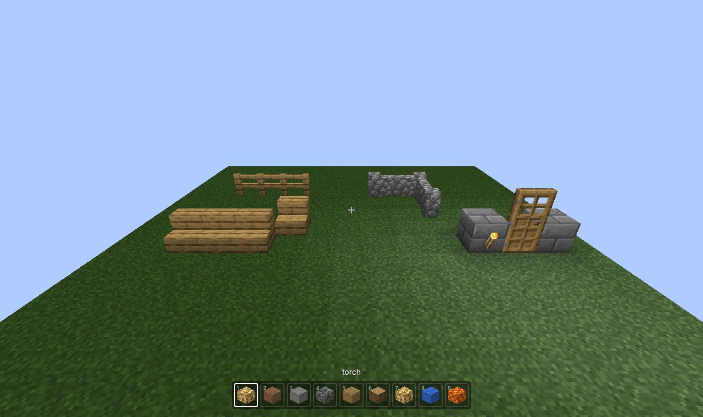
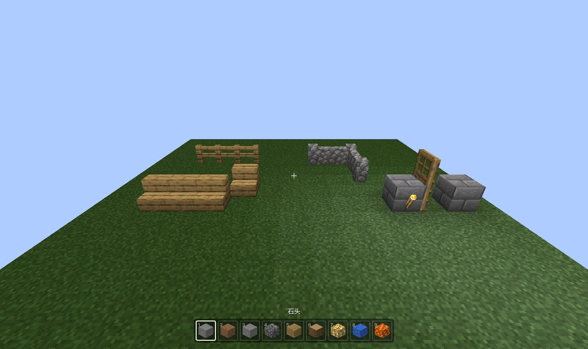

# 用 TypeScript 复刻 Minecraft（v9）：放方块

> 本文是 mc-replica 系列的第 v9 篇。v8.1 有了原版全部方块，但放下去的都是“默认状态”：
> 楼梯全朝北，栅栏一根根孤零零的，门只有下半扇。v9 照着原版，让放下去的方块自己“长”成该有的样子。
> 开发日志见 [../notes/v9-notes.md](../notes/v9-notes.md)。



*每一个都是用准星瞄准、右键放的：栅栏连成一排，墙在拐角处立了柱子、直线中间没有，楼梯朝放的人看的方向，门两格高、门轴靠一边，火把插在石砖的侧面。*

## 一、两个函数

原版放一个方块要经过两个函数：

- **getStateForPlacement**：只看“怎么放的” —— 点的哪一面、点在面上的哪个位置、玩家朝哪边看 —— 定出状态
- **updateShape**：方块的某个邻居变了，这个方块要不要跟着变。放下以后，6 个邻居各调用一次；
  邻居变了，又会通知它自己的邻居

很多看起来像“放的时候算的”东西，其实是第二个函数做的：栅栏连没连上、楼梯拐没拐弯、门的上下两半保持一致、挖掉门的下半上半跟着消失。
所以放一个栅栏时，它先按四周的方块算一遍自己的连接，再通知旁边的栅栏 —— 旁边那根也跟着连过来。

`terrain/placement.ts` 就是这两个函数，外加一个“一层层往外传”的循环。它们只通过 `get(x, y, z)` 读世界，所以测试里拿一个 Map 当世界就能测。

## 二、点在哪

原来的准星只知道“点到了哪一格、哪一面”。很多方块还要知道点在面上的哪个位置：

- **台阶**：点侧面的上半，放上半台阶；点下半，放下半
- **楼梯**、**活板门**：同理，决定是不是倒过来放
- **门**：门轴放哪边，最后要看点在门那一格的左半还是右半

射线在 DDA 里走到哪一格时，已经知道走了多远，所以“打在面上的那一点” = 眼睛 + 方向 × 距离。

## 三、连接

栅栏连不连向一个邻居（原版 `FenceBlock.connectsTo`）：

```text
同类的栅栏（木栅栏连木栅栏，下界砖栅栏连下界砖栅栏）
或者 横着的栅栏门
或者 邻居朝着这边的那一面是“坚固的”，并且邻居不是树叶、南瓜、西瓜、潜影盒……
```

“坚固的面”是原版的 `isFaceSturdy`：这一面能撑住东西。石头 6 面都坚固，下半台阶只有底面坚固，楼梯是底面和背面。
v8.1 导出碰撞箱时已经有一套“按行为认方法”的办法，这次照样认出这个方法：石头 6 面都是、下半台阶只有底面是、空气都不是的那个。

墙多了一层：每一边分 none / low / tall，中间还有一根柱子（`up`）。原版的规则：一条直线中间没有柱子，拐角、尽头、十字路口有；
墙上面压着东西时边是 tall。玻璃板和铁栏杆和栅栏差不多，只是互相连、也连墙。

## 四、楼梯拐弯

楼梯的 `shape` 有五种：直的、内拐角左右、外拐角左右。原版的判断（`getStairsShape`）只看前后两格：

- **前面**（楼梯朝的方向）是一个同样上下的楼梯，它朝向和我垂直 → 外拐角，往哪边拐看它朝哪
- 否则**后面**是这样的楼梯 → 内拐角
- 还要确认拐角的另一边没有“挡着”的楼梯，不然两排平行的楼梯也会被当成拐角

## 五、两格的方块

门、床、两格高的花草，放的时候一次写两格，之后靠 updateShape 维持：

- 门的上半发现下面不是门的下半了，就变成空气（反过来也一样）；开门时只改点到的那一半，另一半在 updateShape 里把它抄过来
- 床的脚朝 `facing` 方向找头，头反过来找脚
- 门轴放哪边（原版 `getHinge`）：先看左右两边有没有完整的方块（门轴靠墙），再看左右是不是已经有门（两扇门对开），
  都一样时按点在左半还是右半

## 六、用方块

右键原来只有“放”。现在先看点到的是不是能“用”的方块：木门、木活板门、栅栏门 —— 是就开 / 关，不放方块。按着 Shift 时直接放（和原版一样）。
铁门、铁活板门要红石信号才能开，右键没有反应。栅栏门打开时，如果人站在门的另一边，门会转过来往人这边开。



## 七、还没做的

- 红石：红石线的连接和信号、拉杆按钮通电、活塞（v9.1）
- 方块“站不住”时掉下来：原版里火把底下的方块被挖掉，火把会掉落；这里火把还挂在空中
- 两个箱子拼成大箱子
