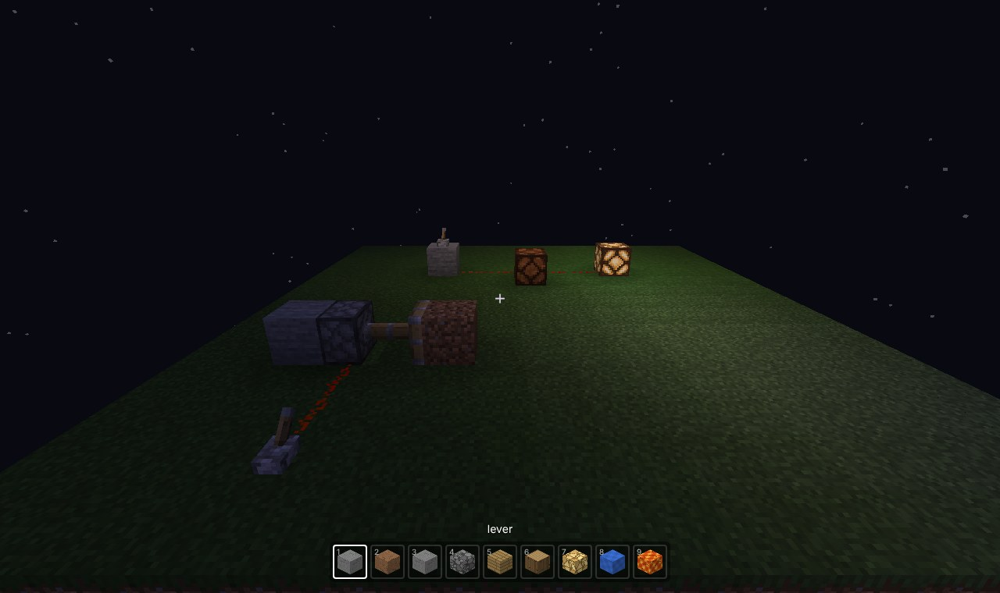

# 用 TypeScript 复刻 Minecraft（v9.1）：红石

> 本文是 mc-replica 系列的第 v9.1 篇。v9 的方块会按邻居改自己的形状了；红石是同一套“方块更新”上的另一层：
> 信号沿着红石线传，传到灯、门、活塞，它们再改自己的状态。
> 开发日志见 [../notes/v9.1-notes.md](../notes/v9.1-notes.md)。

*夜里。远处：石头上的拉杆扳下，红石线（强度 15）点亮了线尽头的灯；挨着线中间的那盏灯没亮 —— 直线只给它指着的方向充能，原版就是这样。
近处：拉杆通过两格红石线让活塞推出去，泥土往前挪了一格。*

## 一、信号从哪来

原版里每个方块都可以回答两个问题：

- **getSignal(方向)**：往这个方向发多少信号（0..15）
- **getDirectSignal(方向)**：发多少“强”信号 —— 强信号能穿过实心方块

方向的约定很绕：参数是“从收信号的方块指向发信号的方块”。几个例子：

| 方块 | 弱信号 | 强信号 |
| --- | --- | --- |
| 拉杆、按钮（打开时） | 6 个方向都是 15 | 只给它贴着的那个方块 |
| 红石火把（亮着） | 除了它插着的方块，都是 15 | 只给头顶的方块 |
| 中继器（通电） | 只往前 15 | 同左 |
| 红石线（强度 p） | 往下面、往它连着的方向 p | 同左 |
| 红石块 | 6 个方向都是 15 | 没有 |

实心方块（原版叫 conductor，导体）自己不发信号，但被强充能时，会对周围所有方向发出它收到的最大强信号（`Level.getSignal`）。
所以“拉杆贴在石头上，石头另一边的红石线有 15”。一个方块周围有没有信号（`hasNeighborSignal`），就是问 6 个邻居各自朝它发多少。

## 二、红石线

### 强度

一根红石线的强度 = max(周围给它的信号, 相邻红石线的强度 − 1)。“相邻”包括上下斜着的：线可以沿方块的侧面爬上去、走下来。

有一个坑：红石线会给脚下的方块强充能，脚下的方块又会把强充能发给旁边的红石线 —— 两根线会通过方块互相“充能”，拉杆关了也灭不掉。
原版的办法是算红石线强度时，临时让所有红石线不发强信号（`shouldSignal = false`）。我们照抄。

强度变小的时候，一排线会一格一格地往下算，最多 15 轮就稳定了。

### 形状

每个方向是 none / side / up。规则（`getConnectingSide`）：

- 那一边是能连的东西（红石线、中继器的两头、拉杆火把这些信号源）→ side
- 那一边是方块，方块顶上有红石线，而且自己头顶没被挡住 → 爬上去（up）
- 那一边是空的，下面一格有红石线 → side（往下走）

然后：一边都没连的是十字；只连了一边（比如只有北），把对面（南）也补上，变成一条直线。
线的方向很重要：一条东西向的直线，只给东西两头指着的方块充能，旁边的方块（截图里中间那盏灯）收不到。

## 三、有延迟的方块

原版的“计划刻”：现在不变，几个 tick 以后再看一眼。v3 的流体已经有一套，这次给红石也加一套：

- **红石火把**：插着的方块有信号 → 2 tick 后熄灭（所以火把是“非门”）
- **中继器**：输入变了 → delay × 2 tick 后跟着变；输出总是 15，所以它也是“放大器”
- **红石灯**：通电马上亮，断电 4 tick 以后才灭
- **按钮**：按下去，石头的 20 tick、木头的 30 tick 以后弹起

## 四、通知谁

一格变了，原版通知它的 6 个邻居，有些方块（红石线、火把、拉杆）还会通知“邻居的邻居” —— 因为强充能能穿过一个方块再影响下一格。
这里统一通知曼哈顿距离 2 以内的 25 格。多通知的格子重新算一遍，结果不变，只是多花一点时间。

## 五、活塞

活塞的“有没有信号”有两个特别之处：

- 正面（推出去的那一面）的信号不算
- 活塞**上面那一格**周围有信号，也算 —— 原版代码的历史遗留，玩家叫它“半连接”，很多机器靠它

推的时候沿着朝向数：碰到空气或者会被推碎的（花草、火把……）就停，碰到推不动的（黑曜石、基岩、有方块实体的箱子熔炉……）就推不动，
超过 12 个也推不动。然后从最远的开始，每个往前挪一格，最前面放活塞头。粘性活塞收回时把头前面那个方块拉回来。

原版推方块有动画（`moving_piston`，两 tick 里慢慢挪过去），这里是一瞬间完成的。

## 六、还没做的

- 比较器、侦测器、压力板、绊线钩
- 黏液块、蜂蜜块带着一片方块一起动
- 中继器被侧面锁住、火把“烧坏”
